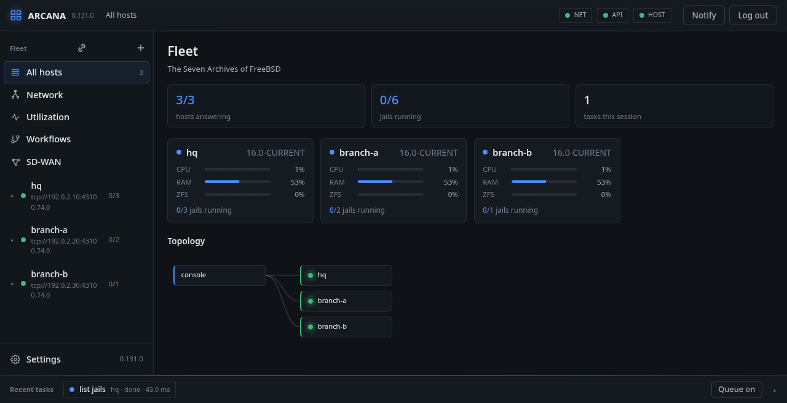

# Arcana

The Seven Archives of FreeBSD: a fleet of FreeBSD hosts,
run from one panel.

An agent on every host and a console in the browser, signed in to with
a security key or a passkey. It shows each host as it is (its jails,
services, packages, network, firewall, storage and resource use) and
changes it, by the base system's own tools, each change a job that the
host finishes even when the console is cut off, with a trace of every
call and program it used.

[**Install** Set up a console, sign in with a passkey, and add the first hosts.](install/index.md)

[**The first hour** The panel as a new user meets it, a picture a step.](tour/index.md)

[**The sections** Every tab: what it shows, and what each button sends.](sections/panel.md)

[**SD-WAN** MEF 70.2 services on FreeBSD hosts, from an example to an applied service.](sdwan/index.md)

[**Automation** Jobs, the queue, the HTTP API, arcanactl.](automation/jobs.md)

[**Under the hood** The architecture, the seven Archives, the agent's protocol.](hood/architecture.md)

Throughout, a box like this one names the FreeBSD piece that does the
work:

**FreeBSD:** a jail is started with `jail(8)` and read with
`libjail(3)`; a change to `rc.conf` is made as `sysrc(8)` makes it.

Arcana is open source under the BSD-2-Clause licence:
<https://github.com/spmzt/arcana>. This book is
<https://github.com/spmzt/arcana-docs>, rebuilt every day from Arcana's
`main`; each page says at its foot which commit it describes. The whole
book is also [one PDF](arcana.pdf), to read offline or print.
