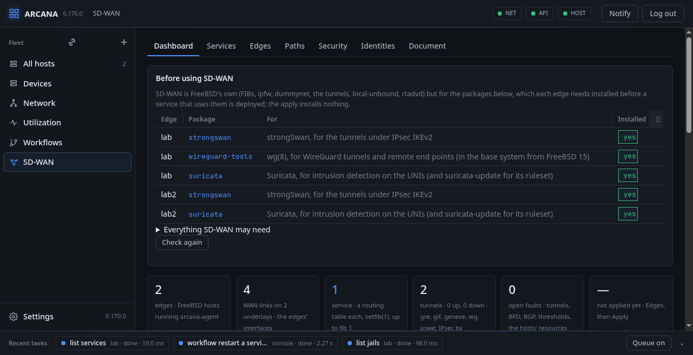
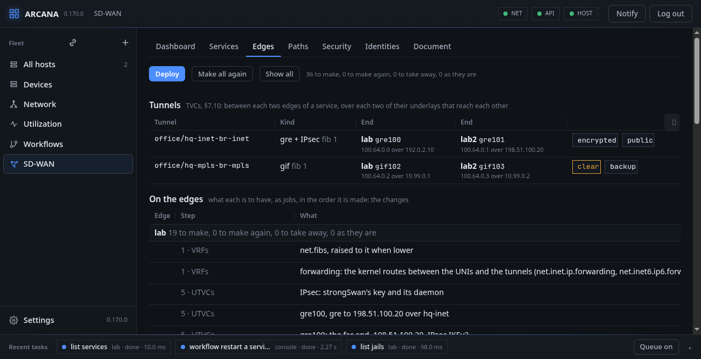

# Check, plan and apply

A document is kept only once the console has checked it against MEF
70.2, and is made on the edges only when you ask: the **Edges** tab
shows what the services would make on each edge, and **Deploy** makes
it, step by step, in the order Mplify 119 sets out.

## Dashboard



**Dashboard** counts what there is, each number naming the FreeBSD
piece that does the work (routing tables by setfib, tunnels by gre,
gif, geneve, wg and uswe, IPsec by strongSwan or keyed by the agents,
the rules in an ipfw set),
draws the edges with the tunnels between them as their probes see them
(green up, red down, dashed a backup, a lock encrypted, the delay and
loss on each) or as planned before an apply, and lists the underlays,
the edges and the services in tables, with forms: **+ underlay** (its
type, billing, the tunnel kind over it and IPsec under it), **+ edge**
(a host the console has), **+ WAN link** on an edge (the underlay, the
interface picked from the host's own list with the address it has, the
gateway, bandwidth, breakout and backup), each changed with the pencil
or taken away with the cross, the document kept at each step and
checked as a whole; **Services** has the same for a service and its
parts: **+ service** (id, routing table, reserved prefixes, underlays,
provider AS, evaluation interval, BFD), **+ end point** (an edge, its
interface from the host's list, a VLAN tag, the IPv4 and IPv6 subnets
with the edge's address in each, a NAT prefix), **+ zone** (name and
prefixes, or the Default), **+ flow** (applications from the catalog,
DSCP, protocol, ports, prefixes, or everything), **+ policy** (the
tunnel criteria, breakout, the destination zones, performance by a
metric with threshold, ceiling and remediation, bandwidth by a limiter
or a commit and limit, importance; for egress, the block), and **+
rule** on an end point (zone, flow or group, ingress and egress policy)
or on a zone (flow and policy). What a form does not ask for, as
virtual topologies, rate limiters, secondary subnets or BGP at a UNI,
stays as it is and the Document tab writes. It shows one service's
end points, zones, flows (in the
order they are matched), policies, topologies and rate limiters;
**Document** the whole of it as JSON. **Check** asks the console
whether it is one the standard allows and **Keep** keeps it; what the
console says no to names where, and the requirement:

```text
swvc office, policy realtime: performance: the ceiling is the
threshold or above it (R72)
```

A change is made from the version it was read at; one made from an
older version is refused, so two pages do not undo each other. **Start
from an example** writes one with two of the console's hosts as its
edges.

## What an edge changes on its host

Making a host an edge, and giving it its WAN links, changes the host
only as follows, and only once a plan is applied (**Deploy**, which says
first what it will make):

- **IP forwarding** turned on for IPv4 and IPv6
  (`net.inet.ip.forwarding`, `net.inet6.ip6.forwarding`), kept in
  `/etc/sysctl.conf`.
- **NTP**, when the edge names servers: `ntpd(8)` set to them.
- **A WAN link's interface is not touched** while it is left
  **Static** with no routing table of its own, which is how a link is
  made: its addresses and routes stay as the host has them, and the
  link only says which interface and address the tunnels start from.
  Only a link you set to **DHCP** gets `dhclient(8)`, to **SLAAC**
  `rtsol(8)` (`ifconfig_<if>="DHCP"` or `inet6 accept_rtadv`, kept in
  rc.conf), and only a link given a **routing table (VRF)** is put in
  it (`ifconfig <if> fib N`). Undone, each goes back to table 0 and to
  the addressing it had before Arcana first set DHCP or SLAAC on it:
  the agent keeps the interface's two rc.conf lines then
  (`addressing-was.json`), so a host on SLAAC or DHCP by its own
  rc.conf stays on it, and a static address is given back. A change
  made in safe mode and not confirmed is undone the same way, to what
  the interface had just before it.
- **The link the console reaches the host through** is said in its
  form: DHCP or SLAAC may give it another address, and a table of its
  own sends its replies by that table, so either can lose the host to
  the console. The form refuses to give that link either unless you
  tick that you reach the host another way too, or that its address
  and routes stay.
- Once a service uses the edge: more routing tables (`net.fibs`), the
  service's tunnels in its table, its routes, ipfw rules in set 30, and
  BIRD, strongSwan, local-unbound, Squid or Suricata as it asks, each
  listed below.

## Edges



**Edges** shows what the kept services make on the edges, and makes
it: **Deploy** says first what it will make, make again and take away
and asks, then runs it, each edge's steps done so far shown on its
line while it runs; the table lists each edge's objects by step in
the order they are made, the changes alone until **Show all**; **Past
applies** lists the last fifty, when, how each went and what it did.
Each edge is to have, for each service on it:

- `net.fibs` raised to the highest service FIB on it, and one (never
  lowered). It is per vnet: a fresh vnet has 1. `net.add_addr_allfibs`
  must be 0, the default: at 1 an interface's addresses are routed in
  every table and no service can have one of its own, so the step
  fails and says so.
- strongSwan's key and daemon, when one of its tunnels wants IPsec.
- Its end of each tunnel (a Tunnel Virtual Connection, §7.10): one
  between each two edges of a service, over each two of their UCS End
  Points that a tunnel can join (the same underlay, or two public
  ones), each End Point with its outer `address`. The tunnel is the
  underlay's `tunnel`: gre, gif or geneve, under IPsec IKEv2 in
  transport mode when it says `ipsec` (a public underlay does unless it
  says otherwise; and every tunnel of a service does when one of its
  policies says `encryption` `required-always`, R39, which an underlay
  that says no IPsec cannot meet), or wg. One IKEv2 connection serves
  every tunnel of a kind between the same two outer addresses: in
  transport mode it protects all of them, and two would conflict. It is in the service's FIB, its outer packets
  in FIB 0, its inner addresses a /31 and a /127 of the service's
  reserved prefixes; each end has its own unit (`gre100`, `gre101`),
  since two ends may be one host. The far end is told once both ends
  have a key: the wg peer, or the IKEv2 connection with the far host's
  key, protecting only the tunnel's own packets (GRE, IP-in-IP, or
  UDP for geneve).
- Routes in the service's FIB: each far end point's prefixes by a
  tunnel to its edge, one that is no backup first and a private one
  before a public one; and each UNI's static routes. A prefix no tunnel
  can carry (an IPv6 one with no IPv6 reserved prefix for the tunnels'
  inner addresses, say) is left out, and the plan says so in a note.
- The UNIs, last: the interface, or a VLAN on it, in the service's FIB,
  with the provider's addresses.

Each is a row with the jobs that make it, and whether it is to be
made, made again (its jobs changed), taken away, or is as it is.
**Apply** takes away what goes, last made first, and then makes what
comes in the order of Mplify 119's activity flow (§12.1, steps 1 to
13), each step on every edge before the next; a step that fails takes
away what it made and stops the apply. The Edges tab names each row's
step:

| Step (§12.1) | What Arcana makes |
|---|---|
| 1 VRFs | the services' tables, the domains' and the underlays' (net.fibs raised, setfib); forwarding on |
| 2 Synchronization | ntpd by the edge's servers |
| 3 UCS UNIs | the WAN links' interfaces: their table, addressing, routing with the underlay |
| 4 Control plane | the control tunnels (CTVC), their key pairs and SAs; the iBGP to the host, by BIRD |
| 5 UTVCs | the data tunnels: gre, gif, geneve, wg or uswe, IKEv2 under them or the agents' keys; no GRE with MPLS labels (not supported) |
| 6 SD-WAN UNIs | the UNI interfaces and VLANs, their addresses, router advertisements and DHCP |
| 7 Subscriber routing | the routes written, and BIRD at the UNIs (static, BGP, OSPF) |
| 8 Application flows, 9 Zones | the ipfw tables and rules in set 30 |
| 10 Policy map | the steering: each far prefix by its policy's tunnels in order |
| 11 Fault management | BFD on the tunnels in BIRD; the agents' faults (§11.3) |
| 12 Performance monitoring | the probes, their thresholds |
| 13 Enable SD-WAN UNI | the UNIs come up last (R169) |

What was made is
kept in `sdwan-state.json` with what takes it away again, and the
planner's ledger (the tables, RDs, the tunnels' units, VNIs and
addresses: [The planner's ledger](models.md#the-planners-ledger)), so
that one added moves none of the others. **Make all again** takes
everything made away first.

## How an edge is changed

A step is made on its edge in one of two ways.

**A device edit**, where the agents' models say it: a PATCH (merge) or
DELETE of a node in the host's candidate, through the console's own
RESTCONF (the fleet mount), then a **confirmed commit** (120 seconds,
with a persist id), confirmed over a connection dialled for it. A
commit that cuts the host off from the console is undone by the host
itself at the timeout. Made so:

- `net.fibs` and forwarding, as `arcana-sysctl`'s kept values;
- the `gre(4)` and `gif(4)` tunnels: `ietf-interfaces`' entry with its
  type, `arcana-interfaces`' tunnel ends, its description and MTU, RFC
  8529's `bind-ni-name` for its table, the inner /31 and /127;
- the services' loopbacks;
- the UNIs: an interface's binding and the provider's addresses, or a
  `vlan(4)` made with its parent and tag; SLAAC's advertisements in the
  same entry (RFC 8349's prefix, `arcana-ra`'s RDNSS);
- a FIB's static routes of one gateway, as `ietf-routing`'s static
  protocol in the FIB's network instance.

**A job**, for the rest: everything on a vnet jail's edge; a tunnel
with an outer table of its own (`tunnelfib`), `wg(4)`'s interfaces and
peers, `geneve(4)`, the `uswe` tunnels' `ipsec(4)` interfaces and their
SAs, strongSwan; a route of several weighted gateways; a UCS End
Point's DHCP or SLAAC and its own table; a remote end point's
WireGuard; kernel modules, NTP, the FEC relay. The rules, steering and
probes are the `arcana-sdwan` and `arcana-probe` modules' commits.

A refused edit discards the candidate's changes, fails its step with
the host's reason and its tag, and the apply is rolled back: each step
made taken away, the last first, as for a failed job.

<div class="freebsd">

**FreeBSD:** a commit is the agent's: it writes what rc(8) reads into
its own file, `/usr/local/etc/rc.conf.d/arcana` (`cloned_interfaces`,
`ifconfig_<if>`, `static_routes`), `sysctl.conf(5)` for `net.fibs`
and forwarding, `rtadvd.conf(5)`, and makes the same now with
`ifconfig(8)`, `sysctl(8)` and `route(8)`. Taken away, each goes from
the file and from the kernel.

</div>

## Warnings to accept

Some of an edge's commits change what is yours, and the agent makes
them only with your consent: naming Arcana's file in `rc_conf_files`,
once (`rc-conf-files`), and a variable your own files set that Arcana's
writes (`rc-conf-conflict`, yours then commented out, never deleted).
The plan lists each such warning a step's commit may ask under **To
accept** (the edge, the step, what it says), and the **Deploy** and
**Make all again** dialogs list them again: their button accepts them
for that apply alone. An apply that accepts other than the plan lists
is refused before anything is made. Accepted, the warnings go with
that step's edits and both commits as RESTCONF's `arcana-accept`;
never silently: one not accepted is the agent's refusal, the step
fails ("not accepted: the plan lists it, the apply accepts it for this
step") and the apply is rolled back. An apply the console starts
itself (an identity's) accepts none.

## Refused as infeasible

A plan that cannot be carried is no plan: an edge whose policies
commit more bandwidth (each rate limiter's or policy's commit) than its
uplinks carry (its UCS End Points' bandwidth, where each says one) is
refused (409), with the two sums and the nearest that fits: the
largest commit lowered by the excess, or the excess more in uplinks.
The apply is refused the same.

A wg tunnel's FIB is set, but not kept across a reboot: wg-quick(8),
which brings wg up at boot, gives its addresses before any table can
be set. gre, gif and geneve keep theirs in `rc.conf`.
