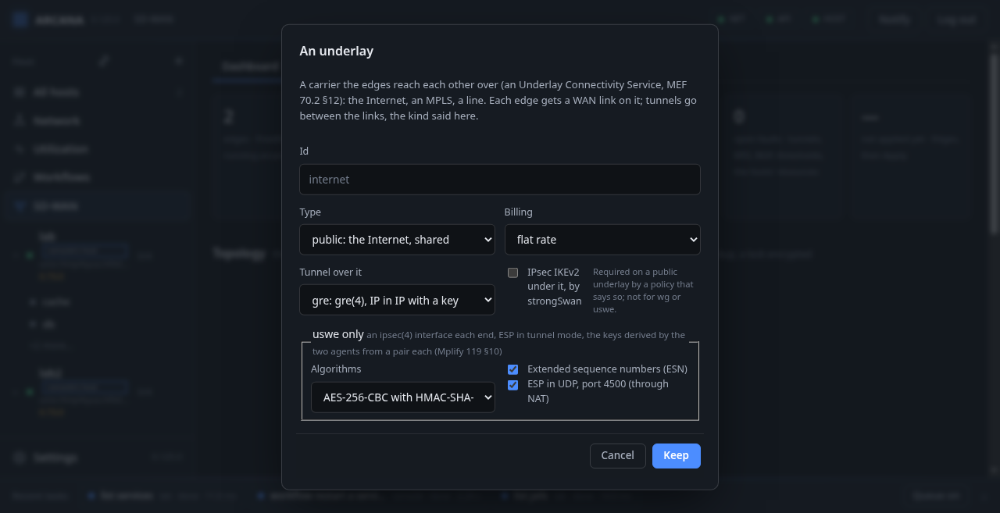
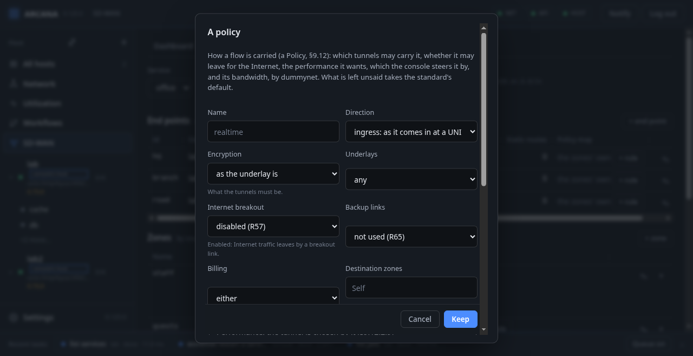
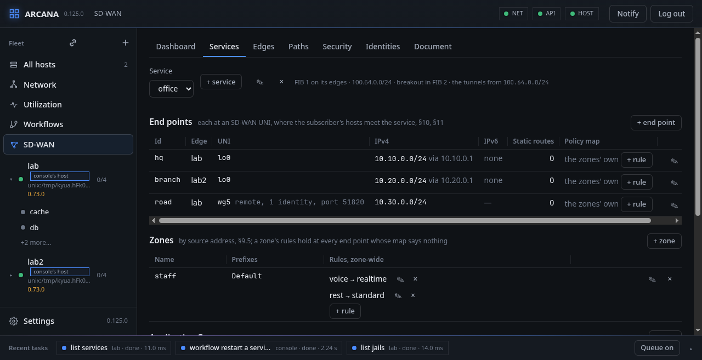
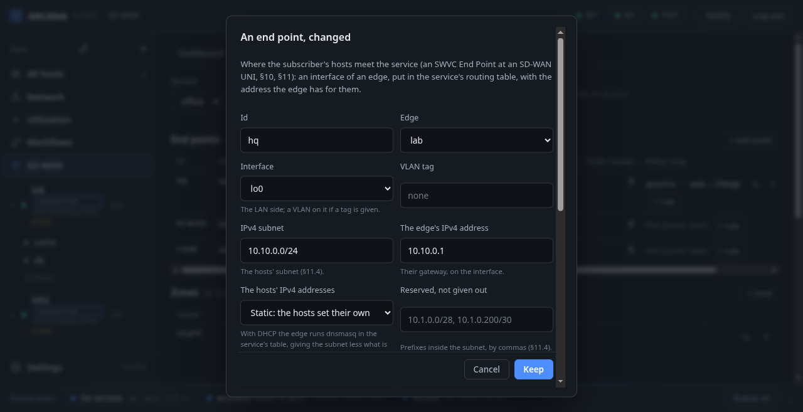
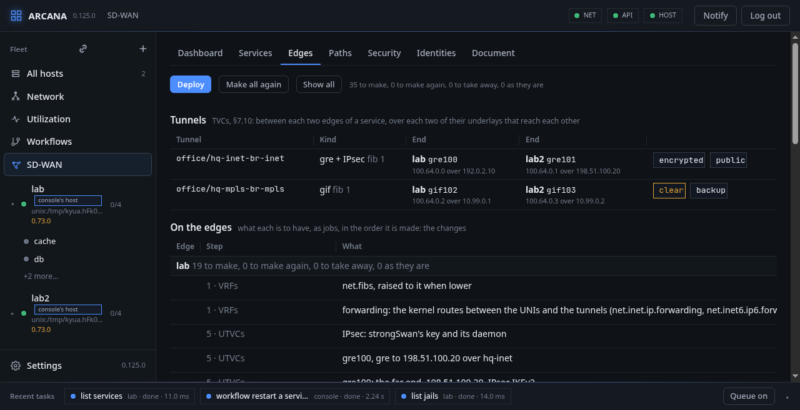
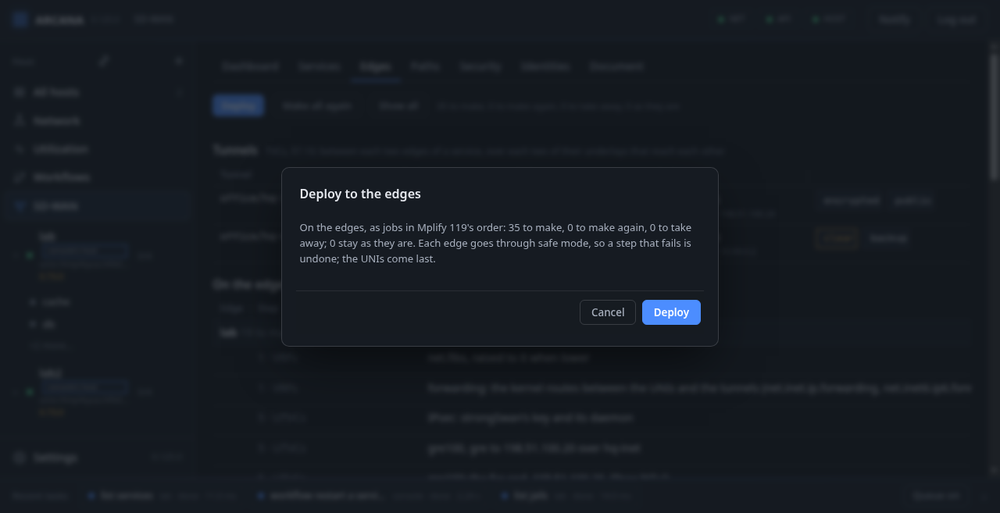
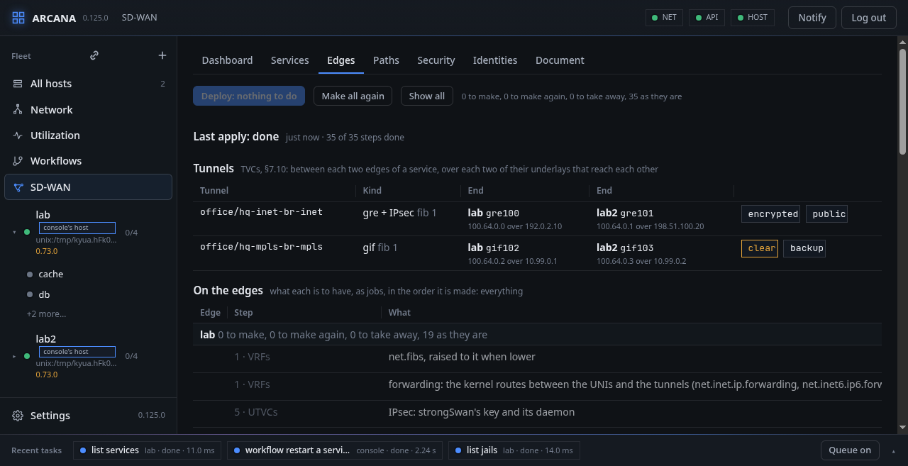

# A service with two edges

**Document → Start from an example** writes a whole service with two of
the console's hosts as its edges. This chapter walks through it, part
by part. Its addresses are documentation addresses: make them your
own before **Keep**.

## Two underlays

```json
"ucs": [
  {"id": "internet", "type": "public", "billing": "flat-rate",
   "tunnel": {"kind": "gre", "ipsec": true}},
  {"id": "mpls", "type": "private", "billing": "usage-based",
   "tunnel": {"kind": "geneve"}}
]
```

Two links the business buys: the Internet, public and paid flat-rate,
over which tunnels are `gre` under IPsec IKEv2; and a private circuit,
paid by use, over which tunnels are `geneve` in the clear, being
private already. On the Dashboard, **+ underlay** asks the same.



## Two edges

```json
"edges": [
  {"server": "HOST-A", "ucs_end_points": [
    {"id": "hq-inet", "ucs": "internet", "interface": "vtnet0",
     "address": "192.0.2.10", "gateway": "192.0.2.1", "breakout": true},
    {"id": "hq-mpls", "ucs": "mpls", "interface": "vtnet1",
     "address": "10.99.0.1"}]},
  {"server": "HOST-B", "ucs_end_points": [
    {"id": "br-inet", "ucs": "internet", "interface": "vtnet0",
     "address": "198.51.100.20"},
    {"id": "br-mpls", "ucs": "mpls", "interface": "vtnet1",
     "address": "10.99.0.2", "backup": true}]}
]
```

Each edge is a host of the console (`server` is its id), with a WAN
link on each underlay: the interface, its address, and on the head
office's Internet link a gateway and `breakout`, so the Internet is
reached there. The branch's private link is a `backup`: used only when
nothing else is left.

## The service

```json
"swvcs": [{
  "id": "office", "fib": 1, "ucs": ["internet", "mpls"],
  "reserved_prefixes": ["100.64.0.0/24", "fd00:64::/64"],
  "domains": {"service": {"prefix": "100.64.0.0/24", "rd": "64600:1", "label": 1001},
              "breakout": {"fib": 2, "rd": "64600:2", "label": 1002},
              "subscriber": {"rd": "64600:3", "label": 1003}},
  "intervals": {"eval": 1000, "arrival": 100, "ir": 500},
```

The service `office` has routing table 1 on both edges, uses both
underlays, and keeps `100.64.0.0/24` for itself: the tunnels' inner
addresses come from it. Its `domains` are Mplify 119's: the Internet
traffic goes by a table of its own, 2, so table 1 holds no default
route. `intervals` are MEF 70.2's performance time intervals (§9.7),
in milliseconds: `eval`, the evaluation interval, is how long each
probe sample lasts.

## Zones, flows and policies

```json
  "zones": [{"name": "staff", "prefixes": "Default",
    "policies": [{"app": "voice", "policy": "realtime"},
                 {"app": "rest", "policy": "standard"}]}],
  "flows": [
    {"name": "voice", "criteria": {"dscp": [46]}},
    {"name": "rest", "criteria": {"any": true}}
  ],
```

Every host is in the zone `staff` (its prefixes are `Default`).
Packets marked DSCP 46 (EF, voice) are the flow `voice`, everything
else the flow `rest`; flows are matched in order, the first that
matches. In the zone, `voice` gets the policy `realtime` and `rest`
gets `standard`.

```json
  "policies": [
    {"name": "realtime", "direction": "ingress", "criteria": {
      "encryption": "required-public-only",
      "allowed-destination-zones": "All",
      "performance": {"primary": {"metric": "delay", "threshold": 30, "ceiling": 50},
                      "secondary": [{"metric": "loss", "threshold": 0.01}]}}},
    {"name": "standard", "direction": "ingress", "criteria": {
      "encryption": "required-public-only",
      "allowed-destination-zones": "All",
      "internet-breakout": "enabled",
      "af-security-ingress": "guard"}}
  ],
```

- `realtime` wants a tunnel under 30 ms of one-way delay and 1 % loss,
  and leaves the one it has only when it goes over 50 ms: the
  hysteresis between threshold and ceiling keeps it from flapping.
- `standard` may break out to the Internet, and its traffic goes
  through the security policy `guard`.
- Both encrypt what crosses a public underlay, and may reach every
  zone.



## A security policy

```json
  "security_policies": [
    {"name": "guard", "criteria": {
      "ip-block": {"deny": ["192.0.2.0/24"]},
      "dns-domain-filter": {"deny": ["ads.example"]},
      "dns-protocol-filter": true,
      "log": true}}
  ],
```

MEF 88's: a prefix denied, a domain that does not resolve, every DNS
query kept to the edge's own resolver, and what is denied logged. See
[Security](security.md).

## End points

```json
  "end_points": [
    {"id": "hq", "edge": "HOST-A", "uni": {"id": "hq-lan", "interface": "vtnet2",
      "ipv4": {"mode": "static", "prefix": "10.10.0.0/24", "provider": ["10.10.0.1"]}},
     "nat": {"ip_version": "ipv4", "public_prefix": "192.0.2.8/30"}},
    {"id": "branch", "edge": "HOST-B", "uni": {"id": "br-lan", "interface": "vtnet2",
      "ipv4": {"mode": "static", "prefix": "10.20.0.0/24", "provider": ["10.20.0.1"]}}},
    {"id": "road", "edge": "HOST-A", "remote": {"interface": "wg5",
      "prefix": "10.30.0.0/24", "port": 51820,
      "identities": [{"name": "alice", "zone": "staff",
                      "public_key": "xTIBA5rbo…"}]}}
  ]
}]
```

Each site's LAN is a UNI: the interface the hosts are on, their
subnet, and the edge's address in it, their gateway. The head office
translates what breaks out to a public prefix of its own. `road` is not
a site but people: a WireGuard interface on the head office's edge,
where each identity connects with its own key and is treated as a host
of its zone. See [Access by identity](security.md#identities).





## Check, keep, deploy

**Check** asks the console whether the document is one MEF 70.2
allows; what it refuses names where, and the requirement:

```text
swvc office, policy realtime: performance: the ceiling is the
threshold or above it (R72)
```

**Keep** stores it. Nothing has changed on the edges yet: **Edges**
shows what would be made there, edge by edge, in the order Mplify 119
sets out, and the two tunnels the two underlays give.



**Deploy** says what it will make, make again and take away, and asks:



Then it runs, each edge's steps shown on its line as they are done; a
step that fails takes away what it made and stops. When it is done,
the plan says every object is as it is to be:



From here, [Probes, rules and steering](steering.md) says how traffic
finds its way, and [Check, plan and apply](apply.md) has everything
the Edges tab does.
