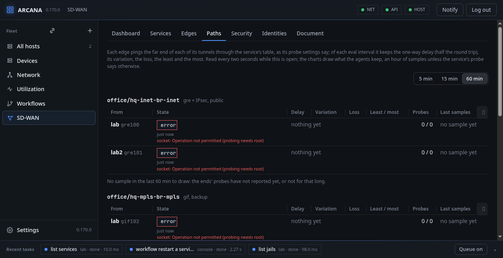

# Faults and troubleshooting

Each edge keeps a day of faults, as Mplify 119 names them; Paths and
the Dashboard show them. The second half of this chapter is what has
gone wrong on real labs, and what to look at.

## Faults

**Faults** (Mplify 119 §11.3): each edge keeps the day's faults, each
with its time, type, severity (Warning, Minor, Major, Critical, and
Cleared), what it is of, who saw it and a line: a tunnel the probes
lost (tunnel), a BFD session down (bfd), a BGP neighbour down after
it was up (bgp-neighbor), a BIRD instance that stopped answering, which
the agent starts again at once (bird-instance), a metric
over a threshold (tca), CPU or memory over the sampler's limit (cpu,
memory), a program the kernel saw die of a signal (crash, Major, of
`host:bird` or `jail:web/nginx`: the signal by name, how many times in
24 hours, and why there is no core when there is none, said anew at
each crash and cleared after an hour without one; a daemon that set
its group, as `bird -g` does, dumps no core while
`kern.sugid_coredump` is 0). One of a type and object is open at a time; set and cleared
are events (`sdwan-fault`) within the second (R71), and `GET
/api/servers/<id>/sdwan` lists the day's; Paths lists them, open
first, and the dashboard counts the open ones. A service's `tca`
(thresholds for `delay` and `ipdv` in ms and `loss` as a fraction,
and `damping`, intervals in a row, 1 by default) gives the probes the
thresholds: a metric over its threshold for so many intervals is a
fault, cleared when under it again for as many (MEF 105 §7.4,
stateless, O1); the service form asks for them. AS override, damping and extended communities are
refused, BIRD having no word for them. Paths shows each edge's instances and their protocols,
as `birdc show protocols` lists them; `arcanactl sdwan bird json`
sets them by hand.
## Troubleshooting

What has gone wrong on real labs, and where to look first.

### The probes say "probing needs root"

The probes are ICMP echo on a raw socket, which only root may open. An
agent run as another user (a test, a host where it was started by
hand) makes the tunnels but cannot measure them, and Paths says so on
each. Run the agent as root, as its rc script does.

### "net.add_addr_allfibs is 1"

At 1, an interface's addresses are routed in every table, and no
service can have a table of its own; the first step fails and says so.
It is 0 by default: set it back in `/etc/sysctl.conf`.

### Nothing that comes in by an IPsec tunnel is filtered

What IPsec decrypts goes past the firewall by default
(`net.inet.ipsec.filtertunnel=0`), and a tunnel's payload with it. The
agent sets it and its IPv6 twin to 1 whenever it loads the service's
rules; a host where something sets them back loses the filtering of
what comes in by an encrypted tunnel.

### A WireGuard tunnel is in the wrong table after a reboot

A wg tunnel's routing table is set by the apply, but not kept: at
boot, `wg-quick(8)` gives the interface its addresses before any table
can be set. **Make all again**, or an apply after the boot, puts it
right; gre, gif and geneve keep theirs in `rc.conf`.

### An IPv6 prefix is not routed

A far end point's IPv6 prefix is carried only by tunnels that have
IPv6 inner addresses, which come from an IPv6 reserved prefix (or the
service domain's). Without one the prefix is left out, and the plan
says so in a note.

### The proxy does not start

URL filtering needs Squid, a plugin: `pkg install squid` on the edge
(the package has SSL, SSL_CRTD and TP_IPFW). The apply refuses where it
is missing, and says so. Squid also needs a resolver: where the service
has a DNS filter it is pointed at it, and otherwise at the host's own.

### Deploy says "install what SD-WAN needs on the edges first"

Nothing is installed by the apply. What a service needs on an edge
that is not FreeBSD's own (strongSwan, BIRD, `wg`, dnsmasq, Squid) is
listed under **Before using SD-WAN**, on the Dashboard and the Edges
tab, each edge with what it has; Deploy waits until every edge has
what it needs, and says which `pkg install` is missing where. See
[Before using SD-WAN](index.md#before-using-sd-wan).

### An edge in a vnet jail

An edge may be a vnet jail, made and changed from its host; but the
probes and the rules run where the agent runs, so such an edge is not
measured or steered yet.

### Reading what an edge was told

Every step of an apply is a job on the edge, with its trace in the
activity bar and in the host's **Jobs** tab: the program, its
arguments and what it said. `arcanactl sdwan` on the edge reads what
its agent holds: the probes and their samples, the rules and their
counters, the BIRD, DNS, DHCP and proxy instances, the faults.
