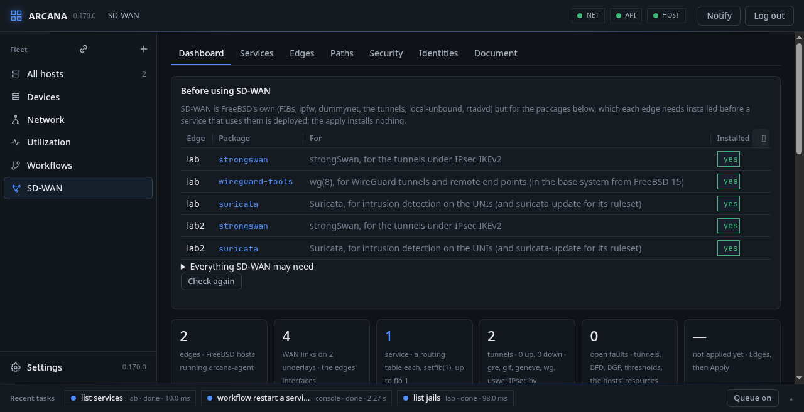

# MEF 70.2 in a page

An SD-WAN service joins a business's sites over whatever links they
have (an Internet line, a private MPLS circuit, a 5G modem), and sends
each kind of traffic by the link that suits it best at the moment, as a
policy says. Arcana builds such services on FreeBSD hosts, in the terms
of **MEF 70.2**, the open standard for SD-WAN services, and adds what
**Mplify 119** (the Universal SD-WAN Edge) and **MEF 88** (security
policies) ask for. It uses no vendor's words and no vendor's model.



## The words

| MEF 70.2 | Is | In the document | On a FreeBSD edge |
|---|---|---|---|
| **UCS**, Underlay Connectivity Service (§12) | a link the provider buys: the Internet, a private network | `ucs` | the interface it arrives on |
| **SD-WAN Edge** (§7.8) | a site's box | `edges` | a host with `arcana-agent` |
| **UCS End Point** (§12.3) | where an edge meets an underlay | `edges[].ucs_end_points` | an interface, an address, a gateway |
| **SWVC**, SD-WAN Virtual Connection (§9) | the service itself | `swvcs` | a routing table of its own (a FIB) on every edge |
| **TVC**, Tunnel Virtual Connection (§7.10) | a tunnel between two edges over one underlay | worked out, never written | a `gre`, `gif`, `geneve`, `wg` or `uswe` interface, IPsec under it where asked |
| **SWVC End Point** and its **UNI** (§10, §11) | where the subscriber's hosts meet the service | `end_points[].uni` | an interface or VLAN in the service's table |
| **Zone** (§9.5) | the hosts a set of rules applies to, by source address | `zones` | an ipfw table |
| **Application Flow** (§9.14) | a kind of traffic: by address, port, DSCP, application | `flows` | ipfw rules |
| **Policy** (§9.12) | what a flow gets: encryption, which links, breakout, performance, bandwidth | `policies` | the policy's table, the steering, dummynet |
| **Policy map** | which flow gets which policy at an end point | `end_points[].policy_map`, `zones[].policies` | the rules' order |

## How it works on the edges

```text
 subscriber hosts ──UNI──▶ edge A ════ tunnels over each underlay ════▶ edge B ──UNI──▶ hosts
                           │  a FIB of the service's own                     │
                           │  ipfw: zone → flow → policy → tunnel            │
                           │  probes: delay, variation, loss per tunnel      │
                           └─ the console's manager orders the tunnels ──────┘
```

1. Each service has a **routing table of its own** on each edge, so
   its addresses may overlap the host's and another service's.
2. Between every two edges, over every two of their links that can
   reach each other, there is a **tunnel**, in the service's table, its
   outer packets in the host's own.
3. What comes in at a UNI is sorted by **ipfw**: its source gives its
   zone, the flows in order give its kind, the policy map its policy,
   and the policy's table sends it by the first tunnel that suits.
4. Each edge **probes** its tunnels ten times a second and moves a
   flow to the next tunnel the moment one is down, by itself; the
   console's **manager** reorders the tunnels when one's delay, its
   variation or its loss crosses a policy's threshold.

## What FreeBSD does

<div class="freebsd">

**FreeBSD:** a service's routing table is a FIB (`setfib(1)`,
`net.fibs`), its interfaces put into it with `ifconfig fib` and its
tunnels' outer packets kept in the host's own with `tunnelfib`.
Tunnels are `gre(4)`, `gif(4)`, `geneve(4)`, `if_wg(4)` and
`ipsec(4)`, with strongSwan's IKEv2 or keys the agents derive
themselves. Flows and policies are `ipfw(8)` rules in a set of their
own, with tables for zones and destinations and `fwd tablearg` to the
tunnel chosen; bandwidth is `dummynet(4)`; breakout is ipfw's
in-kernel NAT. Routing at the UNIs and between the edges is BIRD, one
instance per service in its table; DNS filtering is the base system's
`local-unbound(8)`; router advertisements `rtadvd(8)`.

</div>

## Before using SD-WAN

SD-WAN is FreeBSD's own, but for a few packages, which each edge needs
installed **before** a service that uses them is deployed. The apply
installs nothing: **Before using SD-WAN**, at the top of the Dashboard
and above Deploy on the Edges tab, lists what the kept services need on
each edge and whether it is there, with the `pkg install` to run (or a
button that runs it there as a job), and Deploy waits until nothing is
missing.

| Package | Is | Needed for |
|---|---|---|
| `strongswan` | strongSwan's IKEv2 | a tunnel under IPsec (an underlay with `ipsec`, or a policy that says `encryption`) |
| `bird3` | BIRD | routing at a UNI (static, BGP, OSPF), BFD, a control plane, a WAN link routed on its underlay |
| `dnsmasq` | dnsmasq | DHCP at a UNI |
| `squid` | Squid | a security policy with `url-filter` or `malware` |
| `c-icap`, `c-icap-modules`, `clamav` | c-icap and ClamAV, then `freshclam` for its signatures | a security policy with `malware` |
| `suricata` | Suricata, then `suricata-update` where a policy adds the ruleset | a security policy with `ids` |

On an edge:

```sh
pkg install strongswan bird3 dnsmasq squid c-icap c-icap-modules clamav suricata
freshclam                      # ClamAV's signatures, for malware scanning
# the ruleset, where a policy's ids adds it: Security › IDS/IPS ›
# Fetch the ruleset, which runs suricata-update
```

or only those the services use there.

## Where it is in the panel

**SD-WAN**, in the side bar, has seven tabs:

| Tab | Has |
|---|---|
| **Dashboard** | counts, the edges and their tunnels as the probes see them, the underlays and edges with their forms |
| **Services** | a service's end points, zones, flows, policies, topologies and rate limiters, with their forms |
| **Edges** | what the services make on each edge, **Deploy**, and the past applies |
| **Paths** | each tunnel's delay, variation and loss, the steering, BFD, the keys, faults |
| **Security** | MEF 88 security policies, lists and feeds, the record of what was denied |
| **Identities** | the people let in at remote end points, each a WireGuard key |
| **Document** | the whole as JSON, **Check** and **Keep**, and **Start from an example** |

The next chapter builds a service from that example.
