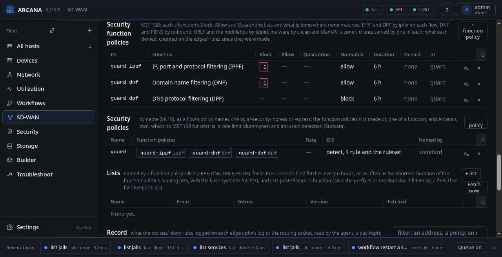

# Security: MEF 138 and access by identity

A service's security is MEF 138's Security Functions, each with a
policy of its own: addresses, ports and protocols filtered; domain
names; URLs; TLS opened by a middlebox; malware; DNS itself; and the
answers DNS gives. Its remote end points let people in by identity,
each a WireGuard key the console issues and revokes. The **Security**
and **Identities** tabs hold them.

## Security



A **security function policy** (MEF 138 §9) is one function's: its
Policy ID (`id`, one in the service), the `function`, and three lists.

- **Block**: matched, the traffic is blocked.
- **Allow**: matched, it is let through, where the entry is more
  specific than a Block or Quarantine entry that matches too.
- **Quarantine**: suspicious; blocked as the Block's are, kept apart
  so that it can be moved to either list later.

Where no entry matches, `no-match` says what is done: `allow` or
`block`. Each list may also name **lists** (below), feeds or pasted.
`duration` is how many hours apart the threat data is refreshed: the
lists a function policy names are fetched at least that often.
`notify` says whose matches are told: Block and Quarantine where it
says nothing (MEF 138's Notification modifier).

A **security policy** is what a flow's policy names by
`af-security-ingress` or `af-security-egress`: the function policies
it is made of (`function-policies`, one of a function at most), and
two of Arcana's own that no MEF 138 function is, a `rate-limit` in
bits per second (a dummynet pipe) and intrusion detection (`ids`,
below).

```json
"security_function_policies": [
  {"id": "office-ippf", "function": "ippf",
   "block": [{"dav4": ["192.0.2.0/24"]}],
   "allow": [{"dav4": ["192.0.2.8/29"], "dport": [443]}],
   "lists": {"block": ["feodo"]},
   "no-match": "allow", "duration": 6},
  {"id": "office-dnf", "function": "dnf",
   "block": ["ads.example"], "no-match": "allow", "duration": 6},
  {"id": "office-dpf", "function": "dpf",
   "no-match": "block", "redirect": true, "duration": 6}
],
"security_policies": [
  {"name": "office", "function-policies":
   ["office-ippf", "office-dnf", "office-dpf"],
   "rate-limit": 20000000}
]
```

The functions, what their entries are, and where they run:

| Function | An entry | On the edge |
|---|---|---|
| `ippf` IP, port and protocol filtering | `sav4`, `dav4`, `protv4`, `sav6`, `dav6`, `nextheadv6`, `sport`, `dport`, as a flow's criteria (Table 5) | ipfw, on each flow |
| `dnf` Domain name filtering | a name, or `*.` and one; each covers the names beneath it | unbound, by zone |
| `urlf` URL filtering | a host, `*.host`, either with a path, a `*` ending it | Squid, by zone |
| `mbsf` Middlebox | a TLS version: `ssl3`, `tls1.0` … `tls1.3` | Squid, by zone |
| `mdr` Malware detection and removal | none: ClamAV's signatures decide | c-icap and ClamAV, by zone |
| `dpf` DNS protocol filtering | `sav4`, `dav4`, `sav6`, `dav6`, `message-type` `any` (Table 6) | ipfw, on each flow |
| `pdns` Protective DNS | `type` `A` or `AAAA` and a `value`, an address, a prefix or `any` | unbound, by zone |

There is no `dlp`: FreeBSD has no engine for data loss prevention,
nor do the packages Arcana uses.

**IPPF** and **DPF** are rules of each flow, as its policy names
them. In the flow's block on each edge, before the forward, the
function policy's entries come most specific first: an Allow tags the
packet (`count tag`, a tag of the function policy's own), a Block or
Quarantine drops what is not tagged, logged where `notify` says. The
named lists' prefixes go to a table of the function policy's own a
family, `sw<fib>_f<n>v4` and `v6`, the list being the value (1 Block,
2 Quarantine, 3 Allow), so the longest match among them decides; a
prefix is matched to the flow's destination and to its source. Where
`no-match` is `block`, the rest of the flow is dropped, and logged.
DPF does the same for the flow's DNS (UDP and TCP 53, TCP 853 for DNS
over TLS) that is not for the edge itself, answering what it blocks
at once with port unreachable; with `redirect` (Arcana's: MEF 138's
Alter action), DNS it would block goes to the service's resolver on
the edge instead.

**DNF**, **PDNS**, **URLF**, **MBSF** and **MD+R** serve what a
zone's clients ask for, so they are the zone's: whatever its policies
and the end points' maps for it name, one function policy of each, or
the document is refused. A policy that names one of them by
`af-security-egress` is refused too: the clients ask on their way in.

- **DNF** and **PDNS** are the service's resolver, the base system's
  unbound(8), an instance per service on each edge with a UNI of it,
  in the service's table, on the UNIs' provider addresses. Each zone
  is a view of its own, chosen by the zone's prefixes
  (`access-control-view`). DNF's Block and Quarantine are local zones
  answering NXDOMAIN, its Allow ones answering as they would, the
  most specific deciding; where `no-match` is `block`, the root
  answers NXDOMAIN but for the Allow. PDNS looks at the answers: an
  answer whose address is on its Block (`response-ip`, the `respip`
  module) is NXDOMAIN.
- **URLF**, **MBSF** and **MD+R** are Squid, below.

The Security tab lists the function policies, each with its lists,
No-match, Duration, the packets its rules denied on every edge (as
`ipfw -S show` counts them, by the rules' comments) and the security
policies it is in; and the security policies, with their function
policies, rate limit, IDS and the policies naming them. **+ function
policy** and **+ policy** add one, the pencil edits it.

## Lists

**Lists** (SASE-2): a function policy's `lists` names lists for its
Block, Allow and Quarantine beside its own entries (IPPF, DNF, URLF
and PDNS). A list is a feed, a URL the console's host fetches with
the base system's fetch(3) (https, http or file), or entries pasted
on the Security tab: one a line, prefixes and domain names, `#` for a
note. Feeds are fetched every `interval` hours (6 unless said), or as
often as the shortest `duration` of the function policies naming
lists. Each list is kept in `sdwan-lists.json` with a version that
moves when its entries change, when it was fetched, and the error of
a fetch that failed, which keeps the last entries. A function takes
from a list what it filters by: IPPF and PDNS the prefixes, DNF and
URLF the domains. The document is refused for a list that is not
there.

What IPsec decrypts goes past the firewall on its way in by default
(`net.inet.ipsec.filtertunnel=0`), and a tunnel's payload with it, so
the agent sets that and its IPv6 twin to 1 whenever it loads the
rules: what comes in by an IPsec-carried tunnel is then filtered like
the rest.

## The record

**The record** (SASE-2): IPPF's and DPF's rules log what they block,
as `notify` says, and every No-match block, to the routing socket (ipfw's `logdst rtsock`, a thousand
a rule between resets, which the agent asks for), where the agent
reads them (RTM_IPFWLOG: the rule, its action, the addresses, the
interface and the rule's comment, which names the service, the
function policy and the list) into a record it keeps for a day beside its files, each an
event `sdwan-security` as it comes, twenty a second at most. The
`sdwan` read carries the day's count and the latest 500; Security
shows them from every edge, newest first, with a filter, and **CSV**
downloads the day's from every edge (`GET /api/sdwan/record.csv`;
`/api/sdwan/record` as JSON, `?swvc=`, `&policy=` (a function
policy's ID), `&edge=`, `&since=` to pick). `GET` and `PUT /api/sdwan/lists` carry the
feeds and the interval, `POST /api/sdwan/lists/fetch` fetches now
(`{"name"}` for one); **Fetch now** on the tab does the same. A list
may be large: the agent writes a table's entries 64 to a line as
`table … atomic add`, one call each, all or nothing, and raises
`net.inet.ip.fw.tables_max` when the tables would not fit; and when
only entries changed since the rules were applied (a list fetched
anew), each changed table is filled beside itself and swapped in with
`table … swap`, the rules and the steering left as they are.
`arcanactl sdwan rules @file` reads the JSON from a file.

## URL filtering and the middlebox

A zone with a **URLF**, an **MBSF** or an **MD+R** has its HTTP and
TLS forwarded by ipfw, from the zone's prefixes (ports 80 and 443, to
3128 and 3129 on the edge's own address at each end point), to Squid
on the edge, an instance per service in its table (`sdwan-proxy`,
`arcanactl sdwan proxy`). Squid is a plugin: installed by hand (`pkg
install squid`, the package has SSL, SSL_CRTD and TP_IPFW), never by
Arcana, and the apply says so where it is missing. It decides by zone,
the zone's prefixes its `src`.

- **Without an MBSF**, Squid looks at the TLS name (peek) and ends the
  connection to a host the URLF blocks (terminate), letting the rest
  through unopened (splice); a cleartext request is decided by its
  host, and its path. A URL with a path over HTTPS can only be seen
  where TLS is opened, so such an entry needs the zone's MBSF, or
  `http://` before it.
- **With an MBSF** (TLS 1.2 and 1.3 are what it opens, MEF 138's
  Supported list), TLS is opened (bump) with a CA of the instance's
  own, made once by the agent with `openssl(1)` and kept beside its
  files, whose certificate the Security tab offers for the clients to
  trust; but the hosts its `pass-through` names (Arcana's: a bank, a
  doctor) are never opened. Each request is then decided by host and
  path, the URLF's entries most specific first, so an Allow of
  `bad.example/ok` overrules the Block of `bad.example`. The TLS
  versions its Block names, and those on no list where its No-match
  blocks, are refused both ways (`tls-min-version`,
  `tls_outgoing_options`, the strictest of the service's zones);
  `invalid-server-certificate` `allow` lets a server whose certificate
  is not trusted through (`sslproxy_cert_error`); `unencrypted` `block`
  refuses cleartext HTTP.

A URLF's named lists are files of the instance's, a zone's Allow and
its Block (with its Quarantine) each, its Allow tried first; its
No-match last. The Security tab lists each edge's instances, their
mode and state; the `sdwan` read has them as `proxy`.

## Identities


**Identities** (SASE-3): the tab lists every remote end point's
identities with the address the plan gave each, when it was issued
and until when it is authorised. **+ identity** issues one at an end
point, for a console user (the name of one of the sign-in keys, with
the box ticked) or any name: the console makes the X25519 key pair,
puts the identity in the document (in place of one of the name: issued
again, with a new key), applies the edges, and shows the WireGuard
configuration once, the private key kept nowhere: the address, the
edge's key, its address on a public UCS and the port, the service's
prefixes, the service's resolver where there is one. **Revoke** takes it out
of the document and applies: its peer goes. A remote end point's
`reauth` (an hour to a year, in seconds) is how long an identity stays
authorised from its `issued` time; past it the manager's tick applies
and the peer is removed until the identity is issued again. `GET`,
`POST` and `DELETE /api/sdwan/identities` do the same. Each identity's
**session** is its peer as the edge's `wg(8)` tells it, read from the
edge with the list: the last handshake, the bytes each way and where
it came from; none when the edge has no peer for it yet.

**Groups**, above the identities, are a remote end point's groups of
them: **+ group** names one at an end point with the zone whose
policies its members get, a pool inside the remote's prefix their
addresses come from (empty: anywhere outside the pools) and the groups
its members reach, besides each other. **+ identity** then takes a
group in place of a zone. On the edge, each group is an ipfw table of
its live members' addresses, and the members of two groups neither of
which names the other are denied each other's traffic on the wg
interface, both ways, before the zone table sends anyone to their
zone's rules. So the policies are both: what a group's members get,
by its zone, and which group reaches which. The FreeBSD facility is
ipfw(8) tables and WireGuard's allowed-ips; the groups are the
console's own, beside MEF 70.2.

## Malware

A zone with an **MD+R** function policy (`detection-type`
`signature`, `removal` `block-subset`, `no-match` `allow`) has what
comes back to its hosts scanned: over HTTP, and over TLS where its
MBSF opens it. The service's Squid hands each response for the zone by
ICAP to a c-icap of the service's own, which scans it with ClamAV and
refuses what is infected: the client gets 403 Forbidden, and c-icap's
log names what was found. ClamAV's signatures decide; lists of hashes
are not given to it yet.

c-icap listens on the edge's own address in the service, where Squid
reaches it, at a port of the service's (1344 and ten for each routing
table), and takes that address alone: a host of the service asking it
directly is refused. It runs in the service's table, started before the
service's Squid and stopped with it; the `sdwan` read says whether it
runs (`proxy[].icap`).

c-icap, its ClamAV module (`c-icap-modules`) and ClamAV with its
signatures are plugins, installed by hand on each edge that scans,
never by Arcana; the agent says which is missing, and **Before using
SD-WAN** lists them. Keep the signatures fresh with `freshclam`
(`freshclam_enable` in `rc.conf`).

<div class="freebsd">

**FreeBSD:** the scanner runs with `setfib(1)` in the service's table;
with `net.inet.tcp.bind_all_fibs` at 0, a socket in that table binds
only the table's addresses, so the loopback (the host's table) is not
used: the edge's own address in the service is.

</div>

## Intrusion detection

A security policy with **`ids`** has the service's traffic
watched by Suricata at each edge, on the service's UNIs there: what
the end points send and what comes back to them. Intrusion detection
is Arcana's own: MEF 138 has no such Security Function. Its mode is
one of:

- **`detect`**: Suricata reads the UNIs beside the traffic; what a rule
  matches is told, and nothing is stopped.
- **`prevent`**: Suricata is in the traffic's way; what a `drop` rule
  matches does not pass, and is told with `"action": "blocked"`.

```json
"ids": {
  "mode": "detect",
  "ruleset": true,
  "rules": [
    "alert http any any -> any any (msg:\"a request for /attack\"; http.uri; content:\"/attack\"; sid:1000001; rev:1;)"
  ]
}
```

- **`rules`**: Suricata rules of the service's own, one a line; the
  console asks for an action, options in parentheses and a `sid`, and
  the edge checks the whole (`suricata -T`) before it runs anything.
- **`ruleset`**: whether the rules `suricata-update` keeps on the edge
  (`/var/lib/suricata/rules/suricata.rules`, Emerging Threats Open by
  default) are added. They are fetched and refreshed by **Fetch the
  ruleset** on the edge's Security page (`arcanactl suricata update`);
  until then the service's Suricata runs on its own rules alone.

The service's UNI subnets are Suricata's `HOME_NET`. Each alert comes
as an event, `sdwan-ids` (the rule, both ends, the interface, the
severity), and the Security tab lists each edge's instances with the
latest alerts, sorted and filtered like every table. A short
connection is told once Suricata is done with it, seconds after.

Suricata is a plugin, installed by hand on each edge that watches;
**Before using SD-WAN** lists it.

### Prevention

Where a policy says `prevent`, ipfw hands the service's IPv4 at each
UNI to its Suricata before anything else: what comes in at the UNI,
and what comes in elsewhere (a tunnel) for the UNI's subnet. Suricata
gives back what its rules let by, and the next rules put it back in
the service's routing table. The rules are one before the service's
own (number 9), in the same ipfw set.

It **fails closed**. While a Suricata that prevents is not running,
what is diverted to it goes nowhere: its UNIs pass nothing. The edge
says so as a Critical fault (`ids`) until Suricata runs again, and the
apply starts Suricata before the divert rules come and takes them away
before it stops it.

With a zone's URLF, MBSF or MD+R on the same service, or a DPF
that redirects, what the end points send to the web goes through
Suricata first and then to Squid. Squid answers them from the edge itself, and traffic from
the edge isn't diverted, so Suricata sees those flows from the end
point's side only. For such a service Arcana tells Suricata to take a
one-sided flow as it is (`stream.async-oneside`, `midstream`) and not
to drop its packets for looking odd (`drop-invalid: no`). What a
`drop` rule matches is still dropped, though with one side alone a
packet may get through before the drop. Squid's own fetches, and what
the edge is sent for itself, aren't diverted; what Squid fetches is
scanned by ClamAV where malware is scanned.

What it does not see:

- **IPv6** is not diverted, so it passes without inspection where the
  service prevents; detect still sees it.
- What comes back from **local breakout** reaches the UNI's subnet only
  after NAT, past the divert, so it is not inspected either.

<div class="freebsd">

**FreeBSD:** `divert(4)` (load `ipdivert.ko`, or `ipdivert_load="YES"`
in `loader.conf`). A packet given back through a divert socket is
routed in table 0, since a `PF_DIVERT` socket has no routing table of
its own and takes no `SO_SETFIB`. A packet given back on its way out
would be routed there before ipfw saw it again, so Arcana takes both
directions as they come in and sets the table again with `setfib`.
ipfw takes up again at the next rule number after a `divert`.

</div>

<div class="freebsd">

**FreeBSD:** Suricata reads the UNIs by libpcap, through `bpf(4)`,
the way `tcpdump(1)` does; nothing is put in the traffic's path.

</div>

## Zero trust

The Security tab opens with the service in the terms of MEF 118.1, the
Zero Trust Framework for MEF Services: Subject Actors reach Target
Actors only as a Policy Allows, and with no Policy they are Blocked.

| MEF 118.1 | In Arcana |
|---|---|
| Subject Actor | a zone's hosts, and the identities whose Role is the zone |
| Target Actor | the zones a policy allows, and the Internet where it breaks out |
| Access Control Policy, Policy Action | the policy map: a zone and an application flow to a policy (Allow), or to `Block`, or to nothing (Block) |
| Identity Provider, Authentication | the console: an identity is known by its WireGuard key |
| Role | an identity's zone |
| Policy Administration, Decision and Information Points | the console: its document, its plan, its identities, sessions and lists |
| Policy End Point, Policy Enforcement Point | each edge: ipfw, and the functions it runs |
| Session | an identity's WireGuard session (the Identities tab) |
| Continuous Monitoring | by time, a remote end point's re-authorisation interval; by event, the record, Suricata's alerts and the faults |
| System Administrator | the console's users, each by a security key |

### Audit Events

The console keeps an Audit Event for each Policy Action it applies or
sees applied, and for each change to the Policies: an identity issued
(Allow) or revoked (Block), an identity's re-authorisation running out
(Block, by time), the document kept and applied (Administer). Each
says what MEF 118.1 asks: the Policy, how, where, who (the security
key that did it), the event, the action, why and when.

The trail is kept in the console's data directory, one event a line.
Each line carries an HMAC-SHA256, under a key of the console's own
that no reader is given, of the line before's and its own, so a line
changed, taken away or put in breaks the chain from there. The tab
says whether the chain is intact and where it broke, and offers it
as CSV (`/api/sdwan/audit.csv`). What the edges deny is in the record
beside it.

