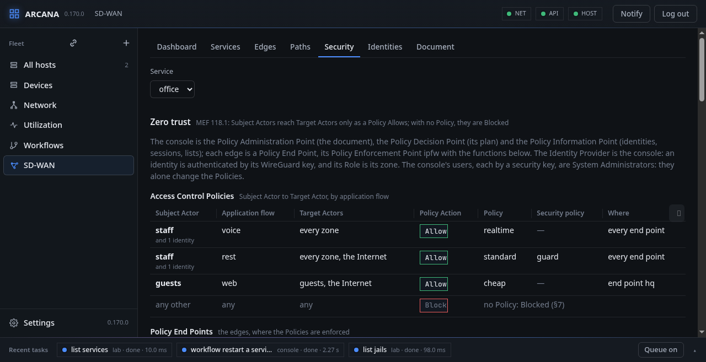
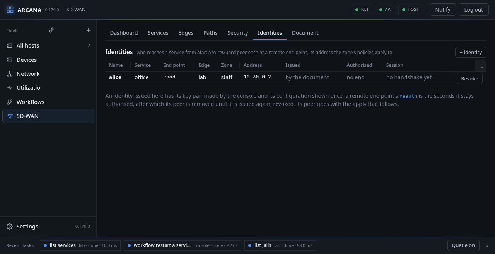

# Security: MEF 88 and access by identity

A service's security policies are MEF 88's: addresses allowed and
denied, domains denied, DNS kept to the provider's resolver, a rate, a
log, URLs filtered by a proxy; and its remote end points let people in
by identity, each a WireGuard key the console issues and revokes. The
**Security** and **Identities** tabs hold them.

## Security

**Security** lists the service's security policies (MEF 88): the
addresses allowed and denied, the domains denied and whether DNS is
kept to the provider's resolver, the rate limit, the log, and which
policies name each; **+ policy** and the pencil edit one. On the
edges, where a flow's policy names one by `af-security-ingress`, the
rules of that flow's block get, before the forward, a `deny` of what
goes to a prefix of the policy's deny list and one of what comes from
one, each with a `not` for the allow list, `log` where the policy
says, the prefixes in tables of the policy's own (`sw<fib>_s<n>d4`,
`d6`, `a4`, `a6`); a `rate-limit` is a dummynet pipe of the policy's
own, the flow sent through it on the way out by the tunnels. Named by
`af-security-egress`, the same denies stand on the way out by the UNI.
The DNS criteria are the base system's unbound(8), `local-unbound`:
where any policy of a service names a security policy with
`dns-domain-filter` or `dns-protocol-filter`, each edge with a UNI of
the service runs an instance of it in the service's table (`sdwan-dns`;
`arcanactl sdwan dns json` by hand; checked by local-unbound-checkconf
first, its pid file beside the agent's kept files, started again at
the agent's start), listening on the UNIs' provider addresses,
answering the UNIs' subnets, resolving by itself, and answering every
denied domain and the names beneath it with NXDOMAIN (a local zone
each; the domains of all the service's filtering policies together).
With `dns-protocol-filter`, every DNS query from the UNI, UDP or TCP,
is forwarded to that instance by an ipfw rule (`fwd provider,53`),
whatever resolver the host asked. Security lists the instances, and
counts for each policy what its deny rules dropped on every edge
(packets and bytes, as `ipfw -S show` counts them since the rules were
made, which the `sdwan` read carries as `rules.counters`, each rule's
number, packets, bytes and text).

## Lists

**Lists** (SASE-2): a security policy's `ip-block` and
`dns-domain-filter` may name `lists` beside their own entries. A list
is a feed, a URL the console's host fetches with the base system's
fetch(3) (https, http or file) every `interval` hours (6 unless said),
or entries pasted on the Security tab: one a line, prefixes and domain
names, `#` for a note. Each is kept in `sdwan-lists.json` with a
version that moves when its entries change, when it was fetched, and
the error of a fetch that failed, which keeps the last entries. The
prefixes of a named list go into the policy's deny tables after its
own, the domains into its DNS filter; the document is refused for a
list that is not there.

What IPsec decrypts goes past the firewall on its way in by default
(`net.inet.ipsec.filtertunnel=0`), and a tunnel's payload with it, so
the agent sets that and its IPv6 twin to 1 whenever it loads the
rules: what comes in by an IPsec-carried tunnel is then filtered like
the rest.

## The record

**The record** (SASE-2): a policy with `log` has its deny rules log
each packet to the routing socket (ipfw's `logdst rtsock`, a thousand
a rule between resets, which the agent asks for), where the agent
reads them (RTM_IPFWLOG: the rule, its action, the addresses, the
interface and the rule's comment, which names the service and the
policy) into a record it keeps for a day beside its files, each an
event `sdwan-security` as it comes, twenty a second at most. The
`sdwan` read carries the day's count and the latest 500; Security
shows them from every edge, newest first, with a filter, and **CSV**
downloads the day's from every edge (`GET /api/sdwan/record.csv`;
`/api/sdwan/record` as JSON, `?swvc=`, `&policy=`, `&edge=`,
`&since=` to pick). `GET` and `PUT /api/sdwan/lists` carry the
feeds and the interval, `POST /api/sdwan/lists/fetch` fetches now
(`{"name"}` for one); **Fetch now** on the tab does the same. A list
may be large: the agent writes a table's entries 64 to a line as
`table … atomic add`, one call each, all or nothing, and raises
`net.inet.ip.fw.tables_max` when the tables would not fit; and when
only entries changed since the rules were applied (a list fetched
anew), each changed table is filled beside itself and swapped in with
`table … swap`, the rules and the steering left as they are.
`arcanactl sdwan rules @file` reads the JSON from a file.

## URL filters

**URL filters** (SASE-4, MEF 88's `url-filter`): a security policy
with `url-filter` (`mode` sni or inspect, `deny` domains, `lists` by
name) has HTTP and TLS from the service's end points forwarded by
ipfw (ports 80 and 443, to 3128 and 3129 on the edge's own address at
each end point) to Squid on the edge, an instance per service in its
table (`sdwan-proxy`, `arcanactl sdwan proxy`). Squid is a plugin:
installed by hand (`pkg install squid`, the package has SSL, SSL_CRTD
and TP_IPFW), never by Arcana, and the apply says so where it is
missing. In mode sni Squid looks at the TLS names (peek) and ends a
connection to a denied domain, the rest let through unopened
(splice); in mode inspect it opens TLS (bump) with a CA of the
instance's own, made once by the agent with `openssl(1)` and kept
beside its files, whose certificate the Security tab offers for the
clients to trust. HTTP to a denied domain is refused outright. The
denied domains, the policy's own and its lists', each cover the
names beneath. The Security tab lists each edge's instances, their
mode and state; the `sdwan` read has them as `proxy`.

## Identities

**Identities** (SASE-3): the tab lists every remote end point's
identities with the address the plan gave each, when it was issued
and until when it is authorised. **+ identity** issues one at an end
point, for a console user (the name of one of the sign-in keys, with
the box ticked) or any name: the console makes the X25519 key pair,
puts the identity in the document (in place of one of the name: issued
again, with a new key), applies the edges, and shows the WireGuard
configuration once, the private key kept nowhere: the address, the
edge's key, its address on a public UCS and the port, the service's
prefixes, the DNS filter where there is one. **Revoke** takes it out
of the document and applies: its peer goes. A remote end point's
`reauth` (an hour to a year, in seconds) is how long an identity stays
authorised from its `issued` time; past it the manager's tick applies
and the peer is removed until the identity is issued again. `GET`,
`POST` and `DELETE /api/sdwan/identities` do the same. Each identity's
**session** is its peer as the edge's `wg(8)` tells it, read from the
edge with the list: the last handshake, the bytes each way and where
it came from; none when the edge has no peer for it yet.

## Malware

A security policy with **`malware`** (MEF 88) has what comes back to
the service's hosts scanned: over HTTP, and over TLS where the URL
filter opens it (mode inspect). The service's Squid, made for it if no
URL filter made it already, hands each response by ICAP to a c-icap of
the service's own, which scans it with ClamAV and refuses what is
infected: the client gets 403 Forbidden, and c-icap's log names what was
found.

c-icap listens on the edge's own address in the service, where Squid
reaches it, at a port of the service's (1344 and ten for each routing
table), and takes that address alone: a host of the service asking it
directly is refused. It runs in the service's table, started before the
service's Squid and stopped with it; the `sdwan` read says whether it
runs (`proxy[].icap`).

c-icap, its ClamAV module (`c-icap-modules`) and ClamAV with its
signatures are plugins, installed by hand on each edge that scans,
never by Arcana; the agent says which is missing, and **Before using
SD-WAN** lists them. Keep the signatures fresh with `freshclam`
(`freshclam_enable` in `rc.conf`).

**FreeBSD:** the scanner runs with `setfib(1)` in the service's table;
with `net.inet.tcp.bind_all_fibs` at 0, a socket in that table binds
only the table's addresses, so the loopback (the host's table) is not
used: the edge's own address in the service is.

