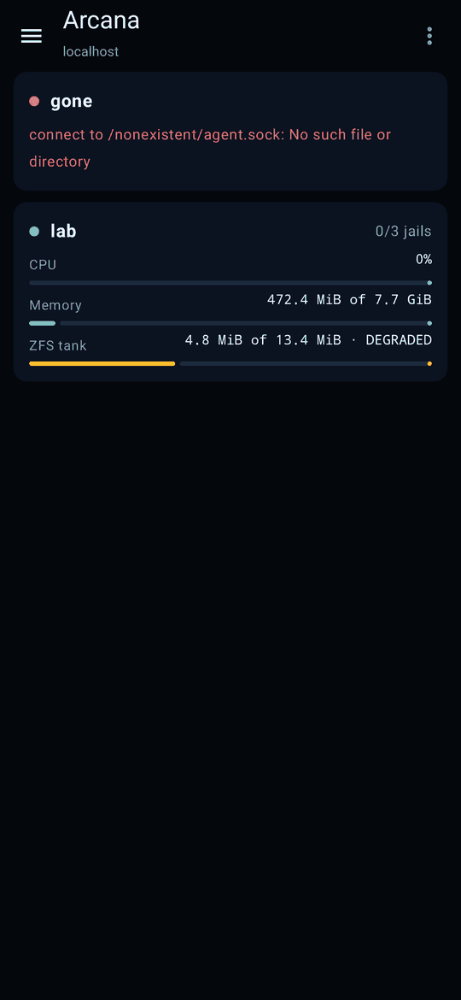
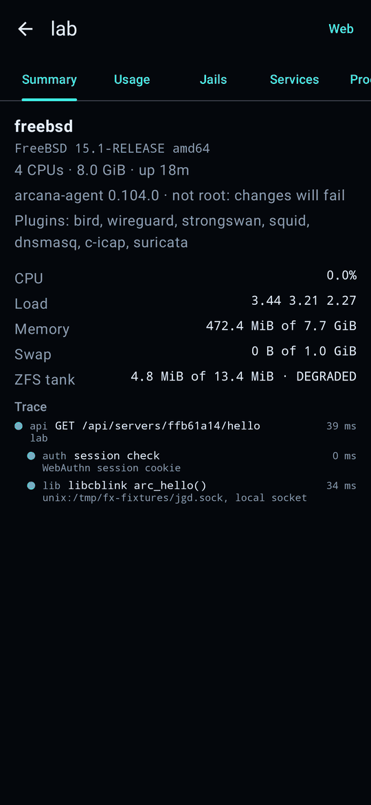
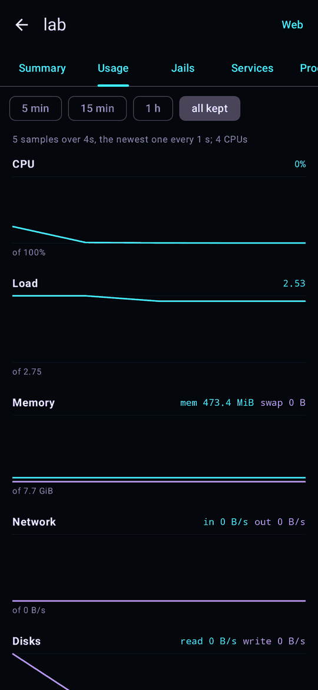
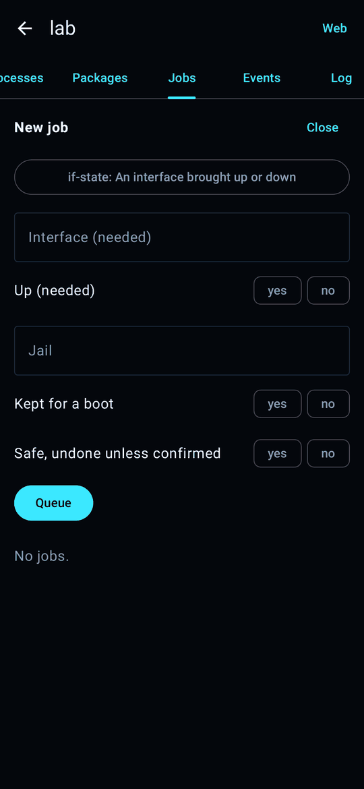
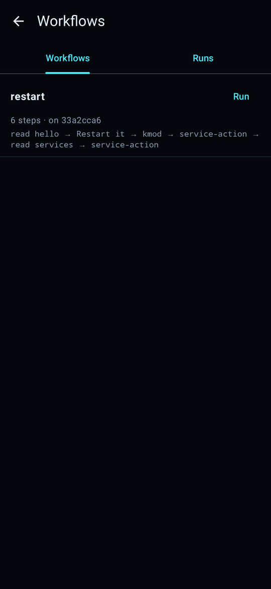
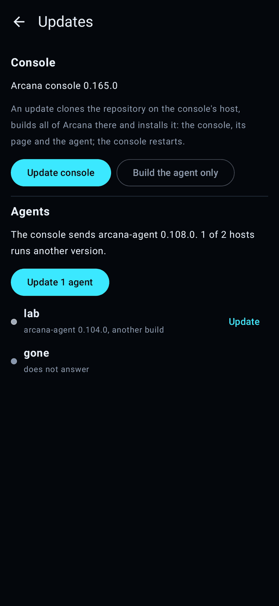
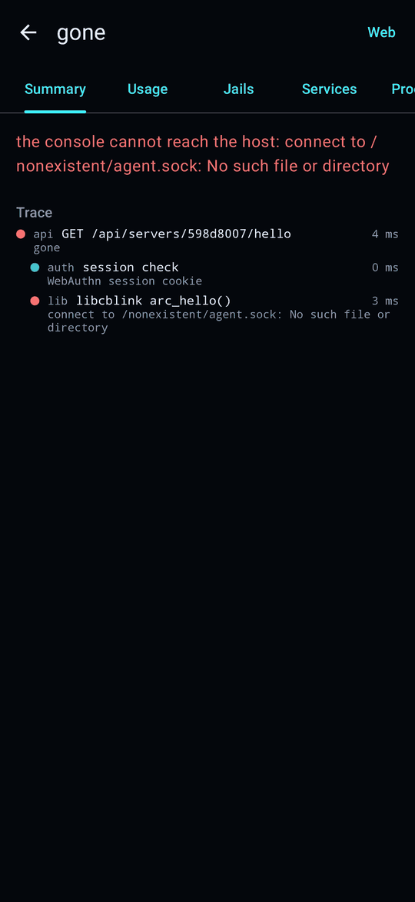

# The Android app

[arcana-apk](https://github.com/spmzt/arcana-apk) is a native Android
client of the console. It is no second console: it reads and asks
through the console's HTTP API, as the page does, and shows the same
traces.

It signs in with an API token. Make one in **Settings**, **API tokens**
(see [Settings](settings.md#api-tokens)) and scan its QR code on the
app's first screen: the code carries the console's address and the
token, so the app needs nothing typed. A **read** token lets it look;
a **write** token lets it change things too, such as sending a job or
updating an agent, audited under the token's name.

- **The fleet**: every host with its CPU, memory and ZFS, one that
  does not answer marked.
- **A host's summary**: what it is and how busy, with the trace of
  the reading.
- **Usage**: the host's charts.
- **New job**: a change sent to a host, with a write token.
- **Workflows**: the workflows and their runs.
- **Updates**: the console's version and the agents', as in
  **Settings**, **Update**.
- **A host the console cannot reach**: the console's reason, and the
  trace that shows where it stopped.

The pictures are drawn by the app's own tests against a stand-in
console serving replies recorded from console 0.165.0, which is the
version they show.
