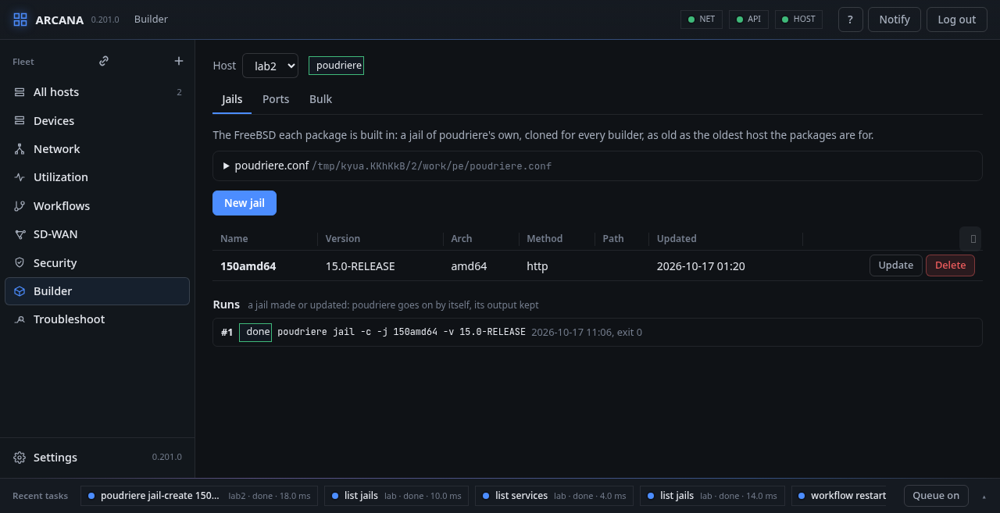
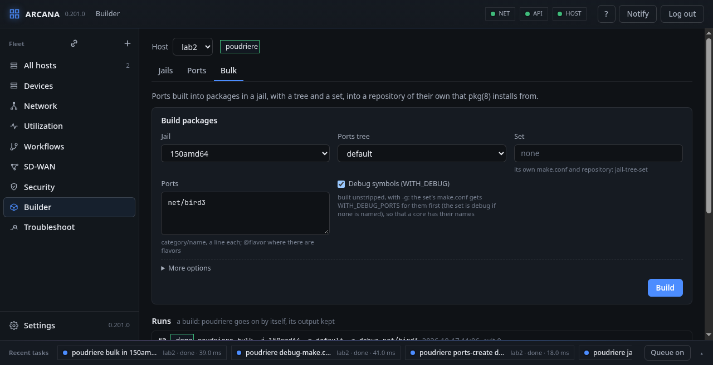

# Builder

**Builder**, in the side bar: poudriere(8), the ports' package builder,
on the host chosen at the top. It builds ports into packages in clean
jails of its own, into a repository that pkg(8) installs from. It is a
plugin: Arcana installs nothing by itself, and where poudriere is not
installed the page offers a button that installs `poudriere` (or
`poudriere-devel`, the newer one) with `pkg install`, a job of its own.

Three tabs: **Jails**, **Ports** and **Bulk**. What poudriere has is
read where it keeps it, so a builder set up by hand shows as it is: the
jails of `poudriere.d/jails`, the trees of `poudriere.d/ports`, the
`make.conf` files beside them, the repositories under the data
directory, and the latest build of each as `poudriere status` says.



## Runs

Making a jail or a ports tree takes minutes and a build can take hours:
far too long to hold the host's job queue. So these jobs start
poudriere and end at once, and poudriere goes on by itself as a *run*:
under each tab, its runs are listed newest first, with their command,
when they started, their state (running, done, failed, or lost: no exit
and no process, as after a reboot), the exit status, and the end of
their output, read again every few seconds while one runs. A run
survives the agent's own restart or update.

**Stop** sends a running one SIGINT, as Ctrl-C in a terminal would:
poudriere stops its builders and tears its jails down; what it had
built stays.

<div class="freebsd">

**FreeBSD:** the run is started by two forks, so that init(8) adopts
its waiter, which writes poudriere's pid and, once it ends, its exit
status beside its log (`builder/<n>.log`, `.pid`, `.exit`, next to the
agent's history configuration; the last 20 are kept). poudriere runs in
a session and process group of its own, which a stop signals whole
(`kill(-pgid, SIGINT)`), and its traps clean up as on a terminal.

</div>

## Jails

The FreeBSD each package is built in: a jail of poudriere's own, cloned
for every builder. Make it as old as the oldest host the packages are
for: packages built on 15.0-RELEASE run on any 15.x.

- **New jail**: its name (letters, digits and `_ : + -`, no dot; an
  ABI's name, `FreeBSD:16:amd64`, is taken), the version as the method
  names them (`15.0-RELEASE`; `16.0-CURRENT` with `pkgbase`), the arch
  (the host's when empty), and how poudriere gets the base system,
  `-m` (the release's sets over http by default; `ftp`, `ftp-archive`,
  `freebsdci`; `pkgbase` or `pkgbase=/path` of a repository;
  `src=/path` of a source tree, `tar=/path` of a tarball; `git+https`
  to build it from source). **Kernel** (`-K`) installs a kernel in the
  jail by its configuration's name (GENERIC). **Build the source**
  (`-b`) builds a `src=` tree first instead of installing it as it was
  built (git always builds), and **Build the pkgbase set** (`-B`) makes
  the pkgbase packages of what is built here: with `src=` and Build the
  source, or with git. The agent refuses either where poudriere would
  not use it. It is `poudriere jail -c`, a run.
- **Update**: `poudriere jail -u`, a run, from a form: **To version**
  (`-t`, another release or branch; empty, the one it has brought up to
  date), **Kernel** (`-K`) and, for a jail made from `src=`, **Build
  the source** (`-b`; git and svn always build). poudriere updates a
  jail by the method it was made with, which `-m` does not change: to
  change the method, make the jail again.
- **Delete**: `poudriere jail -d -y` once its name is typed; its
  packages stay.

**poudriere.conf**, at the top: what it sets, and a form for the
variables a first set-up needs (ZPOOL, BASEFS, DISTFILES_CACHE,
PARALLEL_JOBS, USE_TMPFS, CCACHE_DIR, ALLOW_MAKE_JOBS), set with
`sysrc -f`; a field emptied unsets it. Until ZPOOL (or NO_ZFS) is set,
poudriere makes no jail, and the page says so.

## Ports

The ports trees packages are built from: **New ports tree** clones the
ports with git (`git+https` by default; a branch, `main` or a quarterly
one like `2026Q4`; another repository under More options), or with
`null` uses a tree already on the host where it is. **Update** pulls
(`poudriere ports -u`, a run); **Delete** removes it once its name is
typed. A build without a tree named uses the one called `default`.

## Bulk

**Build packages**: a jail, a ports tree, a set, and the ports, a line
each (`net/bird3`; `@flavor` where a port has flavors). A set has its
own `make.conf` (`<set>-make.conf`) and its own repository
(`<jail>-<tree>-<set>`), apart from the others'. More options: how many
builders at once (`-J`), the ports' packages built again from scratch
(`-C`), and tested for leftovers (`-t`).



**Debug symbols (WITH_DEBUG)** builds the ports unstripped and with
`-g`, so that a core dump of the program names its functions and
lines. The page writes the set's `make.conf` first, adding the ports to
`WITH_DEBUG_PORTS` (bsd.port.mk's list of the origins built
`WITH_DEBUG`), then starts the build: two jobs, one batch. With no set
named, the set is `debug`, so these packages go into a repository of
their own and the others stay stripped. For a BIRD that crashes:

1. Bulk: the jail, the tree, `net/bird3`, Debug symbols ticked, Build.
2. The run ends done; the repository `…-debug` has the package.
3. On the router, point pkg(8) at that repository and reinstall
   `bird3` from it; set `kern.sugid_coredump=1` (BIRD sets its group,
   so the kernel dumps no core of it otherwise).
4. The next crash leaves `bird.core`: `lldb /usr/local/sbin/bird -c
   bird.core`, then `bt`.

**make.conf**: each of `poudriere.d`'s, opened by its name and edited
whole; **New make.conf** makes one for a jail, a tree, a set or those
joined by `-` (`make.conf` itself for every build). poudriere reads
`make.conf`, then the jail's, the tree's, the set's and their pairs'.
An empty text takes the file away.

**Port options**: a port's OPTIONS, as `make config` sets them, for a
jail, a tree and a set: **Show its options** runs `make showconfig` in
the port's directory and lists each option, the port's own first, then
each group as the port names it (a *single* or *radio* group's title
says how many may be on). **Save** writes the port's options file as
`make config` writes it (`OPTIONS_FILE_SET+=`, `OPTIONS_FILE_UNSET+=`),
each option checked against the port's list; **The port's defaults**
takes it away. Beneath, each options directory of `poudriere.d` with
the ports it sets, `+` on and `−` off.

<div class="freebsd">

**FreeBSD:** a build copies one options directory whole, as its
`/var/db/ports`: the first there is of `<jail>-<tree>-<set>-options`,
`<jail>-<set>-options`, `<jail>-<tree>-options`, `<tree>-<set>-options`,
`<set>-options`, `<tree>-options`, `<jail>-options` and `options`. The
options are written into that one; when there is none, the build's own
is made, as `poudriere options -j -p -z` would, and from then it is the
one those builds copy, the wider ones no longer. The form says which,
before you save.

</div>

**Builds**: the latest build of each jail, tree and set, as `poudriere
status -f -H -l` tells it: its status and how many ports were built,
failed, skipped and are left, and where its logs are (the build's
name, hovered). A build with ports that failed has a row beneath it:
each failed port with the phase it failed in, the reason poudriere
found (when it was told to look, `DETERMINE_BUILD_FAILURE_REASON`), how
long it took and the end of its build log; and the ports skipped
because they need one that failed.

**Repositories**: each under the data directory's `packages`, with how
many packages it has. A host's pkg(8) takes one as a repository whose
url is `file://` it, or served by a web server.

## From the command line

`arcanactl poudriere` reads it all as JSON; `arcanactl poudriere
make-conf debug file` writes a make.conf; a verb with `key=value` words
is a job:

```sh
arcanactl poudriere jail-create name=150amd64 version=15.0-RELEASE
arcanactl poudriere jail-create name=15src version=15.0-STABLE \
    method=src=/usr/src build=yes pkgbase-set=yes kernel=GENERIC
arcanactl poudriere ports-create name=default branch=main
arcanactl poudriere bulk jail=150amd64 ports=default set=debug origin=net/bird3
arcanactl poudriere stop run=3
arcanactl poudriere show-options jail=150amd64 set=debug origin=net/bird3
arcanactl poudriere options jail=150amd64 set=debug origin=net/bird3 on=BMP off=RIP
```

The API is `GET /api/servers/<id>/builder` and jobs of kind
`poudriere`.
