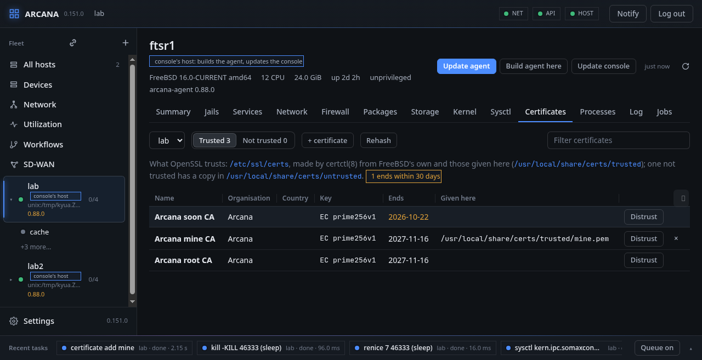

# Certificates

The **Certificates** tab is what OpenSSL trusts on a host, or in one of
its running jails, picked at its left. **Trusted** is
`/etc/ssl/certs`; **Not trusted** is `/etc/ssl/untrusted`. Each one is
read with OpenSSL on the host: its name (the CN), organisation and
country, its key, and the day it ends. A certificate signed by another
is marked *intermediate*. The tab says how many have ended, or end
within 30 days, and those dates are coloured.

**FreeBSD:** `certctl(8)` makes both directories, and the bundle
`/etc/ssl/cert.pem`, from what FreeBSD comes with
(`/usr/share/certs/trusted` and `untrusted`) and from what the host was
given, under the local base (`/usr/local/share/certs/trusted` and
`untrusted`). `certctl trust` and `untrust` alone are undone by the
next rehash, for example after an upgrade. So every change here is
made in the local base's directories and then `certctl rehash` is run;
it lasts.

- **+ certificate** gives the host a certificate authority of your own:
  a name, and the certificate as PEM. Only the certificate is kept,
  never a key; text with a private key in it is refused. **×** on its
  row takes it away again.
- **Distrust** puts a copy of a trusted certificate among the local
  untrusted ones, so OpenSSL stops trusting it.
- **Trust again**, under **Not trusted**, takes that copy away. A
  certificate FreeBSD itself does not trust is marked *FreeBSD's* and
  is not trusted again here.
- **Rehash** runs `certctl rehash` alone.

In a jail, the jail's own `certctl` does the work, by `jexec`. Its
files are read and written beneath the jail's root, never through a
link that leads out of it. From the command line:
`arcanactl [-j jail] cert [list] | add name file | remove name | trust
file | untrust file | rehash`.
