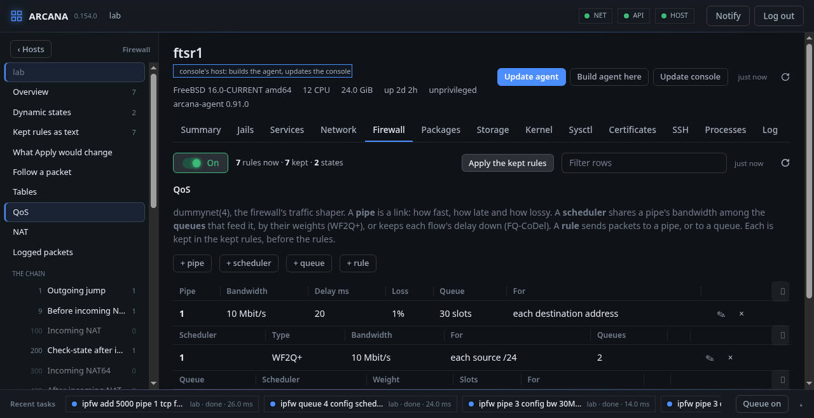

# Firewall

**Firewall** is `ipfw(8)`, laid out as a ruleset is written here: a
main chain that every packet walks in the order of the numbers, and the
parts it calls, each ending in its return. While the tab is shown its
parts are in the side bar, in place of its pages: **Overview**,
**Dynamic states**, **Kept rules as text**, then a line for each part
with how many rules it has. **‹ Back** brings the side bar's pages
back.

**Overview** draws the chain first: the parts every packet walks down
the left, the parts they call on the right, an arrow for each `call`
(and a dashed one for each `skipto`) the rules make between them, and
on each part how many rules it has, how many are kept, and what they
take a second while **Live** reads the counters. A part pressed opens.
Below it, the same as a table.

| Numbers | Part |
|---|---|
| 1–8 | Outgoing jump |
| 9–99 | Before incoming NAT |
| 100–199 | Incoming NAT |
| 200–299 | Check-state after incoming NAT |
| 300–399 | Incoming NAT64 |
| 400–499 | After incoming NAT |
| 500–599 | Before outgoing NAT |
| 600–699 | Outgoing NAT |
| 700–799 | Check-state after outgoing NAT |
| 800–999 | After outgoing NAT |
| 1000–8999 | IPv6 and IPv4, to me and from me, before and after NAT: eight parts of a thousand each |
| 9000–9099 | IPv6 link-locals only |
| 9100–9199 | Silent drop |
| 9200–9999 | Dangerous packets |
| 10000–13999 | IPv6 and IPv4, incoming and outgoing forward |

The light beside the counts is the switch: it shows whether the
firewall is on, and pressed turns it off or on (in safe mode, as
Apply is). `ipfw` must be in the kernel; Arcana does not load it.

**FreeBSD:** `ipfw(8)` and its sets: the kept rules are loaded into set
1 while it is disabled, and set 1 is swapped with set 0, so no packet
meets half a ruleset. Tables, in-kernel NAT and NAT64, `dummynet(4)`
pipes and queues are ipfw's own (dummynet's, under QoS); a packet is followed with `dtrace(1)`
and ipfw's `rule-matched` probe.

## A part's rules

Each rule with its counters and where it is: in the kernel **now**,
**kept**, or both. A rule is added with its number and its words as
ipfw takes them, into what the kernel has, into the kept rules, or
both, and deleted the same ways.

The rules Arcana changes are those of set 0, the set the kept rules are
applied as. Rules of other sets (SD-WAN's own, the default rule's, the
ones Apply holds back in set 1) are shown greyed and are never changed
from here: ipfw's `delete N` would take every set's rule N, so Arcana
always says `set 0 delete N`.

Two rules may share a number; each is a row of its own, paired with its
kept line by its words. A rule is pressed to change it in its own row:
its number, its words as they are kept, now and keep. Saved, it is
changed as one job, and only that rule: ipfw reads every rule the
number is to have first without doing it (`ipfw -n`), then one script
of ipfw's deletes the number and adds them back with the new one; if
the kernel refuses a line after all, the number's rules are put back as
they were listed. **Delete** takes that rule alone, named by its words;
the other rule of its number stays. Without words, a number with
several rules is refused, nothing touched. A rule's words go to ipfw without a shell, so an interface's
pattern is written bare (`via wg[0-1]`, `recv wg*`); quotes around a
word are taken off. As a rule is typed, the words
that may come next are offered in ipfw's order: the action, what the
packet is, `from` and an address (the host's tables among them), `to`,
and the options. **▲** and **▼** put a number before the rule above or
after the one below, for Save to move it there; a rule dragged and
dropped before or after another of its part opens the same way. Where
no number is free there, the rules in the way move on by one, the
farthest first (01702 becomes 01703, then the rule takes 01702), as
one job asked first: each rule is added at its new number before its
old one is deleted, and the job does nothing unless every number is
free when it is reached. A rule that shares its number moves past its
twin first.

While **Live** is lit, the part is read again every five seconds, and
each rule shows how many packets a second it took since the look
before, with a line of the last five minutes, and **never** when none
has matched it.

A rule's words are checked to be ipfw's, with nothing a shell would
read, and the sets are not a rule's to name.

## The kept rules

The kept rules are a file of ipfw's own commands, one a line (`add 01001
allow tcp from any to me6 22 in`, and `table`, `nat` and `nat64…`
lines), which the host loads when it starts, a vnet jail's at its own
start (`rc.d/ipfw` runs in a jail with its own network). The objects
come first, in the order they were made, and what they need loaded
before the rules is said in `rc.conf` as `rc.d/ipfw` reads it:
`firewall_nat_enable` for `nat`, `firewall_nat64_enable` for the NAT64
objects, `firewall_nptv6_enable`, `firewall_pmod_enable` for
`tcp-setmss`, `dummynet_enable` for pipes, queues and schedulers. A rule
that cannot be kept is not left in the kernel either: the change is
whole or not at all.

- **Kept rules as text** shows it to be changed as a whole, checked by
  ipfw without being done; for a host that has none, **Start from the
  layout** fills it with the chain, its calls and returns.
- **Load the current file** puts what the firewall loads now in the
  text as kept rules, nothing kept until **Keep**, read from the host's
  `rc.conf`, or the jail's own for a jail's firewall (as `sysrc` reads
  it):
  - the script `firewall_script` names, when it is one of your own and
    not `/etc/rc.firewall`: its `ipfw` commands are taken out of it,
    whether written as `ipfw`, its path or a variable holding it
    (`${fwcmd} add …`), their options off, a line continued with `\`
    joined and the shell's quoting taken off. The script's variables
    are followed as the shell sets them, so the Handbook's style reads
    as the rules it makes: `cmd="ipfw -q add"`, `pif="em0"` and
    `$cmd 00502 allow tcp from me to any out via $pif setup keep-state`
    become `add 00502 … via em0 …`. A line naming a variable that is not
    known here is left out and said so; a rule the script adds inside an
    `if`, `case` or loop is taken, with a note that it may be added only
    at times. The shell's own lines are left in as comments;
    a script that stages its rules in a set of its own and swaps them
    in, as Apply does, reads as its rules: their `set N` taken off
    (Apply gives the kept rules their set), its tables and NAT64
    instances kept without the set, and its flush, disable and swap
    left to Apply. A kept rule written with a set of its own is loaded
    once in Apply's set, not twice;
  - else the file `firewall_type` names.

  What applying does itself (`flush`, `set`, `delete`) is left in as
  a comment.
- **What Apply would change** sets the kept rules beside set 0's of
  the kernel: the rules Apply would add, those it would remove, and
  those whose words differ. Each kept rule is compared as ipfw writes it
  back (`ipfw -n`, the kernel not asked), so `all` for `ip`, a port's
  name or `keep-state` without `:default` is no difference.
- **Apply the kept rules** makes them the whole of set 0 without a gap.
  When rules the kernel has now are not kept, the question says which
  would be gone, by number, and the word `apply` is typed to go on. The
  rules that were there wait in set 1: if the console does not reach
  the host afterwards, the host swaps them back by itself.
- The first rule kept when none is kept yet keeps the kernel's set 0
  rules first, marked with a comment, so that applying, or the next
  boot, does not take away what the host runs with.

## Dynamic states

The connections the stateful rules let through, as `ipfw -D show` has
them: the rule that made each, its flow, counters and how long it still
lives, read again every two seconds; one pressed leads to its rule.

## Following a packet

**Follow a packet** asks for a protocol, where from, where to, a port,
which walk to see (the packet coming in, going out, or its reply either
way) and the interface it comes in on, and has the agent walk the first
packet of such a connection through the kernel's rules (its
`path-check`, the same the Troubleshoot page asks every host): each
rule it meets in the kernel's own order, `skipto`, `call` and `return`,
`check-state` and the first `keep-state` looking the connection up,
`me` and the tables by what the host has, and what becomes of it. Above
the walk, where the packet is at this host: in on which interface, out
by which route and FIB, or that it is the host's own. A rule the agent
cannot judge without sending the packet (a socket's `uid`, a `tag`) is
marked "may be met" and listed under what it could not judge. With the
firewall off, the walk shows what the rules would do turned on, and
says so. **Across the hosts ›** opens the same packet on the
Troubleshoot page, followed from host to host and back.

The kernel's own answer is **What the kernel decides**, below it: for
some seconds, the packets to or from the address that really cross the
firewall, each with the rule that decided it and what it decided, its
interface and direction. The host needs DTrace (`kldload dtraceall`).

## Aliases

**Aliases** names what rules say again and again, written `$name` in a
rule:

- **addresses**, a list of addresses and networks, is an ipfw table of
  its name: the rule says `table(name)`, so changing the list changes
  the table now and no rule;
- **ports** (`80,443,8000-8080`) and a **value** (an interface, an
  address, a number) are written into each rule that names them; when
  one changes, those rules are written again, in the kept rules and in
  the kernel.

`allow tcp from $lan to me $web in via $wan` is loaded as `allow tcp
from table(lan) to me 80,443 in via vtnet0`. A rule is shown by its own
words, ipfw's when hovered, and changed by them. An alias a rule names
is not deleted while one does.

**FreeBSD:** the kept rules stay ipfw's own commands, which
`rc.firewall` loads at boot as they are (`firewall_type`): an alias is a
comment line, `#arcana alias lan addr` (an address list's entries its
table's own lines, `table lan add 10.0.0.0/8`), and a rule written with
aliases is its own comment line, `#arcana add 01000 allow tcp from $lan
…`, before the rule as ipfw reads it. A rule written with `$name` in
**Kept rules as text** is given both lines when it is kept.

## Tables and NAT

**Tables** lists each table with its type and what is in it: an entry
is added and taken out, a table created and destroyed.

**NAT** shows the NAT instances. One is asked for by what it is: its
number, the interface or address it hides behind, its options (same
ports, private only, reset, deny in, log) and the ports it forwards,
one a line (`tcp 10.0.0.5:80 8080`). One line more makes, changes or
deletes anything else (NAT64, NPTv6) in ipfw's own words. With
**keep**, what is done to a table or an instance is also a line at the
head of the kept rules, and what undoes it takes its lines out again.

## QoS

**QoS** is `dummynet(4)`, the firewall's traffic shaper, read as what
it is and changed by forms:

- a **pipe** is a link: its bandwidth, delay, loss in percent and
  queue, and whether each source or destination address has a pipe of
  its own;
- a **scheduler** shares a pipe's bandwidth (it has the pipe's number)
  among the queues that feed it: WF2Q+ by their weights, FIFO, RR,
  PRIO, QFQ, or FQ-CoDel and FQ-PIE, which keep each flow's delay down
  (their target, FQ-CoDel's interval, and ECN);
- a **queue** is a share of a scheduler, by its weight, 1 to 100;
- **+ rule** sends traffic to a pipe or a queue: its protocol,
  addresses, port, way and interface make an ipfw rule, and **Rules
  that send to them** lists those there are.

**✎** changes one and **×** takes it away. Each is kept by default, as
a line at the head of the kept rules; changed, its line before is
replaced, so a boot makes it as it is now. `ipfw` takes a parameter it
does not know by saying so and leaving it out; Arcana takes that as
the job's failure, with ipfw's own words. With no `dummynet` in the
kernel the section says so; it is loaded on the Kernel tab.

**Logged packets** reads what the rules with `log` wrote into
`/var/log/security`.

## A jail's firewall

A running jail with a network of its own is listed under the host in
the side bar: its firewall is its own, `ipfw` is run inside it, its
rules are kept in the jail, and on or off is as the jail's own network
has it.

From a shell: `arcanactl net ipfw`, `arcanactl [-p] ipfw add number
rule…`, `ipfw keep add …`, `ipfw [keep] delete number`, `[-s] ipfw
apply`, `ipfw enable | disable`, `ipfw rules [-r | -w file [-n]]`,
`ipfw trace address [seconds [packets]]`.
