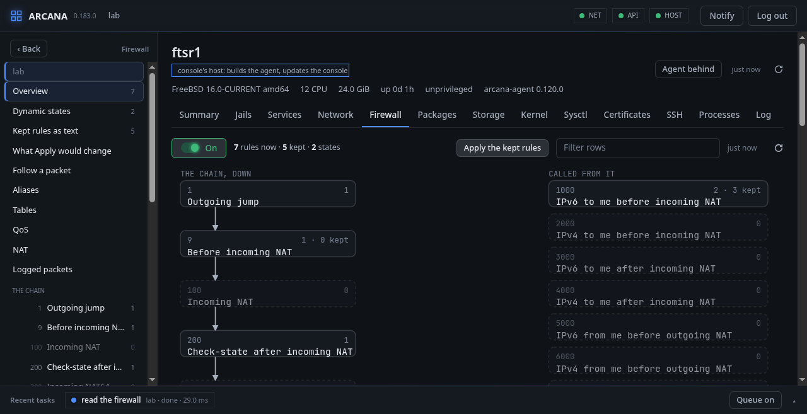
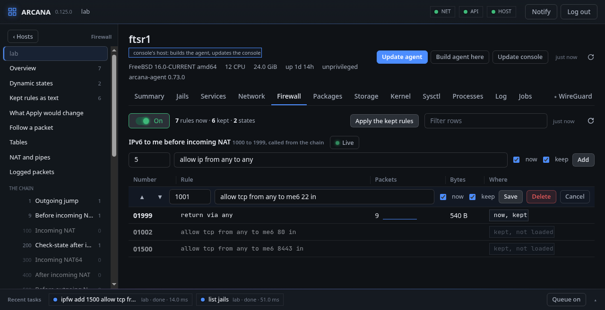
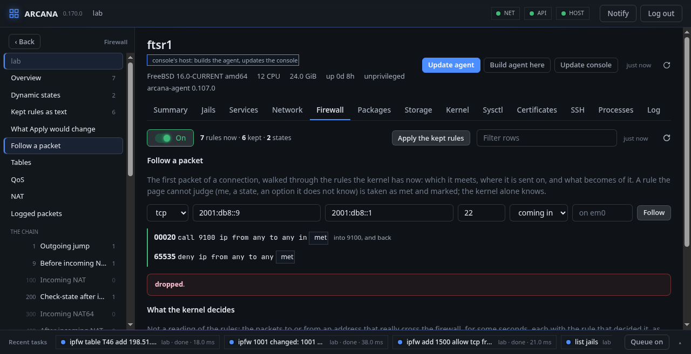

# Firewall

**Firewall** is `ipfw(8)`, laid out as a ruleset is written here: a
main chain that every packet walks in the order of the numbers, and the
parts it calls, each ending in its return. While the tab is shown its
parts are in the side bar, in place of the hosts: **Overview**,
**Dynamic states**, **Kept rules as text**, then a line for each part
with how many rules it has. **‹ Hosts** brings the tree back.

| Numbers | Part |
|---|---|
| 1–8 | Outgoing jump |
| 9–99 | Before incoming NAT |
| 100–199 | Incoming NAT |
| 200–299 | Check-state after incoming NAT |
| 300–399 | Incoming NAT64 |
| 400–499 | After incoming NAT |
| 500–599 | Before outgoing NAT |
| 600–699 | Outgoing NAT |
| 700–799 | Check-state after outgoing NAT |
| 800–999 | After outgoing NAT |
| 1000–8999 | IPv6 and IPv4, to me and from me, before and after NAT: eight parts of a thousand each |
| 9000–9099 | IPv6 link-locals only |
| 9100–9199 | Silent drop |
| 9200–9999 | Dangerous packets |
| 10000–13999 | IPv6 and IPv4, incoming and outgoing forward |

The light beside the counts is the switch: it shows whether the
firewall is on, and pressed turns it off or on (in safe mode, as
Apply is). `ipfw` must be in the kernel; Arcana does not load it.

**FreeBSD:** `ipfw(8)` and its sets: the kept rules are loaded into set
1 while it is disabled, and set 1 is swapped with set 0, so no packet
meets half a ruleset. Tables, in-kernel NAT and NAT64, `dummynet(4)`
pipes and queues are ipfw's own; a packet is followed with `dtrace(1)`
and ipfw's `rule-matched` probe.

## A part's rules

Each rule with its counters and where it is: in the kernel **now**,
**kept**, or both. A rule is added with its number and its words as
ipfw takes them, into what the kernel has, into the kept rules, or
both, and deleted the same ways.

A rule is pressed to change it in its own row: its number, its words as
they are kept, now and keep; saved, it is changed as one job: ipfw
reads the new rule first without doing it (`ipfw -n`), and only then is
the old one deleted where it was and the new one added where it is to
be; if ipfw refuses the new one after all, the old one is put back as
it was. A rule's words go to ipfw without a shell, so an interface's
pattern is written bare (`via wg[0-1]`, `recv wg*`); quotes around a
word are taken off. As a rule is typed, the words
that may come next are offered in ipfw's order: the action, what the
packet is, `from` and an address (the host's tables among them), `to`,
and the options. **▲** and **▼** put a number before the rule above or
after the one below, for Save to move it there; a rule dragged and
dropped before or after another of its part opens the same way.

While **Live** is lit, the part is read again every five seconds, and
each rule shows how many packets a second it took since the look
before, with a line of the last five minutes, and **never** when none
has matched it.

A rule's words are checked to be ipfw's, with nothing a shell would
read, and the sets are not a rule's to name.

## The kept rules

The kept rules are a file of ipfw's own commands, one a line (`add 01001
allow tcp from any to me6 22 in`, and `table`, `nat` and `nat64…`
lines), which the host loads when it starts.

- **Kept rules as text** shows it to be changed as a whole, checked by
  ipfw without being done; for a host that has none, **Start from the
  layout** fills it with the chain, its calls and returns.
- **Load the current file** puts what the firewall loads now in the
  text as kept rules, nothing kept until **Keep**, read from the host's
  `rc.conf`, or the jail's own for a jail's firewall (as `sysrc` reads
  it):
  - the script `firewall_script` names, when it is one of your own and
    not `/etc/rc.firewall`: its `ipfw` commands are taken out of it,
    whether written as `ipfw`, its path or a variable holding it
    (`${fwcmd} add …`), their options off, a line continued with `\`
    joined and the shell's quoting taken off; the shell's own lines
    (variables, `if`, `fi`) are left in as comments;
  - else the file `firewall_type` names.

  What applying does itself (`flush`, `set`, `delete`) is left in as
  a comment.
- **What Apply would change** sets the kept rules beside the kernel's:
  the rules Apply would add, those it would remove, and those whose
  words differ.
- **Apply the kept rules** makes them the whole ruleset without a gap.
  The rules that were there wait in set 1: if the console does not
  reach the host afterwards, the host swaps them back by itself.

## Dynamic states

The connections the stateful rules let through, as `ipfw -D show` has
them: the rule that made each, its flow, counters and how long it still
lives, read again every two seconds; one pressed leads to its rule.

## Following a packet

**Follow a packet** asks for a protocol, where from, where to, a port,
a direction and an interface, and walks the first packet of such a
connection through the kernel's rules: each rule it meets, each jump,
call and return, and what becomes of it. A rule the page cannot judge
(`me`, a state, an option it does not know) is taken as met and
marked: it is a reading of the rules, not the kernel's answer.

The kernel's own answer is **What the kernel decides**, below it: for
some seconds, the packets to or from the address that really cross the
firewall, each with the rule that decided it and what it decided, its
interface and direction. The host needs DTrace (`kldload dtraceall`).

## Tables, NAT and pipes

**Tables** lists each table with its type and what is in it: an entry
is added and taken out, a table created and destroyed.

**NAT and pipes** shows the NAT instances and `dummynet`'s pipes. A NAT
instance is asked for by what it is: its number, the interface or
address it hides behind, its options (same ports, private only, reset,
deny in, log) and the ports it forwards, one a line (`tcp 10.0.0.5:80
8080`); a pipe by its number, bandwidth, delay, loss in percent, queue
and whether each source or destination address has a pipe of its own.
One line more makes, changes or deletes anything else (NAT64, NPTv6, a
queue, a scheduler) in ipfw's own words. With **keep**, what is done to
a table or an instance is also a line at the head of the kept rules,
and what undoes it takes its lines out again.

**Logged packets** reads what the rules with `log` wrote into
`/var/log/security`.

## A jail's firewall

A running jail with a network of its own is listed under the host in
the side bar: its firewall is its own, `ipfw` is run inside it, its
rules are kept in the jail, and on or off is as the jail's own network
has it.

From a shell: `arcanactl net ipfw`, `arcanactl [-p] ipfw add number
rule…`, `ipfw keep add …`, `ipfw [keep] delete number`, `[-s] ipfw
apply`, `ipfw enable | disable`, `ipfw rules [-r | -w file [-n]]`,
`ipfw trace address [seconds [packets]]`.
