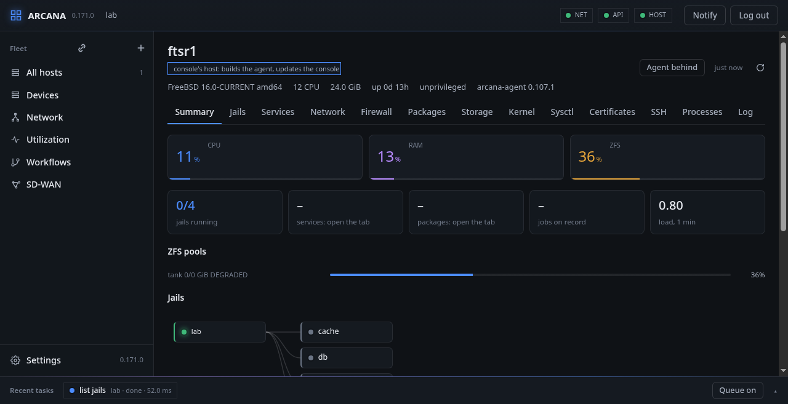
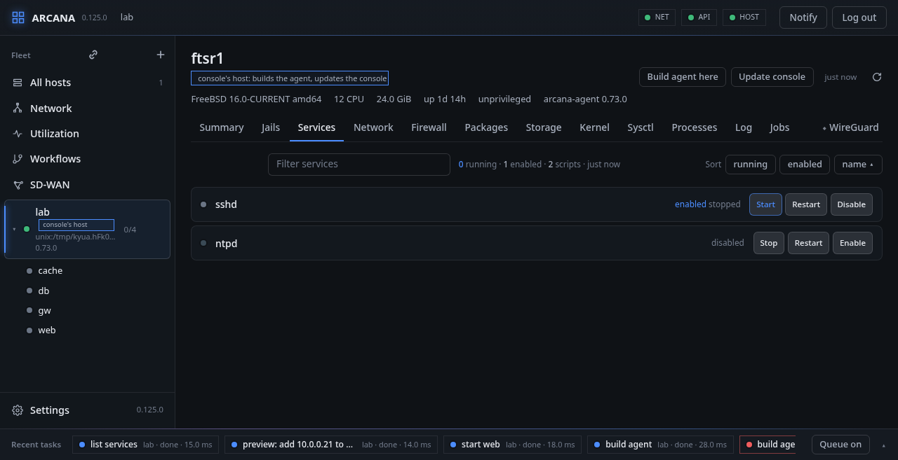

# A host: summary, jails, services

A host's page has a header and a row of tabs. The header says what the
host is (FreeBSD's version and machine, CPUs, memory, uptime, whether
the agent runs as root, the agent's version) and carries **Update
agent** when the host runs another build than the console's.

## Summary

Usage gauges with their recent history, counts of jails, services,
packages and jobs, the ZFS pools, and the host's jails as a graph; a
jail picked in the graph opens in a box over the page.

### How it is reached

At the foot of the summary: the agent's listeners and the connections
open to the agent now, each with its transport, where it comes from and
the name in its certificate, read again every few seconds. A green
light is before the way the console itself gets in, the one it knows to
work; another the agent listens on has an empty one until it is tried.
The agent's local socket is listed only when it is the console's way.

The console keeps its connection to an agent open and sends the next
request over it; several requests at once have one each. An agent that
listens on TCP listens on SCTP as well, at the same address and port,
where the kernel has SCTP. It never loads the module itself: where it
is missing the listener is shown as down with the reason, and once
`sctp` is loaded from the Kernel tab, **Try SCTP again** has the agent
start it.

**Switch to SCTP** has the console ask the agent over SCTP first, and
only when it answers is the host reached that way from then on; when it
does not, nothing is changed. **Go back to TCP** does the same the
other way, and is also offered when a host reached over SCTP stops
answering. From a shell: `arcanactl transport [retry]`.

**Move to another address** reaches the host at another address or
port, without losing it on the way:

1. the agent, asked where it is reached now, listens on the new address
   too (and over SCTP there as well, beside TCP);
2. the console tries the new address on a connection of its own;
3. only when the agent answers there is the server moved, and then, by
   the new way, the old listener closed and the new address kept for
   the agent's next start, in place of the old one in `rc.conf`
   (`arcana_agent_listen`, or `-l` in `arcana_agent_flags`; added to
   `arcana_agent_listen` when neither had it);
4. when the agent does not answer there, or the console cannot keep the
   change, the agent stops listening on the new address and the host is
   reached as before.

**SCTP over several paths**: an SCTP association has a path from each
of the console's addresses to each of the agent's, and carries on over
another when one fails, with nothing for the console or the agent to
do. The console's end, not bound to an address, offers every address
of its host; the agent's offers those its listener is bound to: the
listener's own address, and the other addresses given here (bound with
`sctp_bindx(3)` while it runs, kept in `rc.conf` as
`arcana_agent_sctp_also`, the agent's `--sctp-also`). A listener on
`0.0.0.0` or `[::]` is bound to every address of its family already.
Each SCTP listener lists the addresses it is bound to, and says which
of those given could not be; under **Connected now**, an association
shows its paths: each address of the console's, active, inactive or
not yet confirmed, its smoothed round trip, and which one is the
primary path, with the agent's own addresses beside them.

The agent's certificate must name the new address, or the name the
console checks for the host. The local socket is never closed, nor the
last address the agent is reached by. From a shell: `arcanactl
transport listen <uri>`, and `transport unlisten <old> for <new> keep`.

Over SCTP, the requests the console makes of a host at once all go over
one association, each waiting for its own answer: the agent sees one
session where over TCP it would see one for each. What comes in parts
(the kernel's state, the routes, connections and sockets) is a cblink
stream over that association, flow-controlled by itself: the host sends
a part only while the page has room for it, so a slow page holds its
own stream and nothing else.

**FreeBSD:** SCTP is the kernel's own `sctp(4)`, a module the agent
uses when it is loaded and never loads by itself; the association
carries many streams, each request on its own, so one slow answer holds
up no other.

### Certificate

Below it, the host's own **certificate**, the one its agent answers
the console with over mutual TLS: its subject, who signed it, the day it
ends (marked when less than 30 days are left), the intermediate CAs
sent after it, and the CAs the agent trusts.

**Renew** gives it a new one. The agent makes a new key on the host,
which never leaves it, and a request for it; the console signs that
with its CA, for the name or address it reaches the host by, and sends
the certificate back together with its own. The agent takes it only if
it still trusts the console's certificate afterwards, so no renewal can
lock the console out. It keeps the files before beside (`.before`) and
reads the new ones without a restart: connections made from then on
use them, open ones keep theirs. A host reached by a local socket has
no certificate. From the command line: `arcanactl tls [status] | csr |
install certfile|- [cafile]`.

A host's certificate is for a client as well as a server, so that hosts
can reach each other, and it says it is a host's
(`URI:urn:arcana:role:agent`); the console's says it is the console's.
An agent refuses every request from a peer whose certificate says it is
a host's: only the console asks.

**FreeBSD:** the key and request are made with the base system's
OpenSSL; cblink builds its TLS contexts again from the files, as it
does at the start.

### Rollback timer

Below it, the host's **rollback timer**: how long a change made in safe
mode waits there for the console to be heard from again before the
agent undoes it, 10 to 3600 seconds. Empty, the host follows Settings'
timer for every host ([Settings › Console](settings.md#console)), and
without one, its agent's own (`arcana-agent -w`, a minute unless set),
which the agent says. See [Safe mode](network.md#safe-mode).

### Configuration, as a whole

The host's configuration as one bundle: the files Arcana manages
(`rc.conf` and `rc.conf.d`, `loader.conf`, `sysctl.conf`, `jail.conf`
and `jail.conf.d`, `fstab`, `hosts`, `resolv.conf`, `ntp.conf`,
`rtadvd.conf`, `sshd_config`, `devfs.rules`, syslog's, BIRD's,
strongSwan's, WireGuard's, `dnsmasq.conf`, and what the agent writes in
its own directory: its ipfw rules, its sampling, the SD-WAN's files),
each with its mode, owner and group; the packages put there by hand;
and what the hardware is. **Save it** as JSON or YAML, with its secrets
(WireGuard's and strongSwan's keys) or without. The agent's own keys and
certificates are never in it: a host made the same is still another
host, enrolled as itself. Jails' and datasets' data are not
configuration; a ZFS send carries them.

**Make another host the same as this one**, or this one as a bundle
file says. **Check** first: the host that is to change compares its
hardware with the bundle's (each physical interface and disk the bundle
names has to be there, the architecture the same), and says what it
would do with each file (the same, changed with its diff, new, or a
secret the bundle does not carry, which it keeps), and which packages
it lacks. **Apply** then writes them, each beside itself and renamed
into place, the files before kept under
`/var/backups/arcana/config-<time>`; a host name of its own can be put
in `rc.conf` instead of the bundle's. From another host, the console
reads that host's bundle with its secrets itself: they do not pass
through the page. Nothing is restarted: the files take hold at the next
boot. The packages it lacks are installed only when **Install** is
pressed.

Each tab of a host has **Export** at the end of its bar too: what the
tab shows, as it was last read, saved as JSON or YAML.

## Jails

Each jail with its state (running, stopped, dying; starting, stopping,
restarting while something happens to it; unknown when the host does
not answer), with **Start**, **Stop**, **Restart** and **Kill**. Those
running come first; **Sort** orders by running or by name.

### A jail's page

Each jail has a page of its own: its actions; its addresses, changed
live (with `jail_setv(3)` and the interface's alias), in its
`jail.conf` block (with a diff to preview), or both; its configuration
as `jail(8)` reads it; and its history.

A jail with a network of its own (vnet) has **Open it in the Network
tab**: see [A jail's own network](network.md#a-jails-own-network).

A running jail that was given datasets (`zfs jail`) lists them under
**Datasets**, as the jail's own `zfs list` sees them, run in it by
`jexec`: the datasets that are its own, their parents as far as it sees
them, their sizes and where they are mounted. **Snapshot** takes one.

### Jails made from here

The jails list has **+ jail**, **Defaults** and **Templates**, for jails
kept the way one keeps them by hand:

- **Defaults** writes `/etc/jail.conf`, what every jail includes: its
  path (`/usr/jails/${name}`), host name in your domain
  (`${name}.example.org`) and domain, `exec.start`, `exec.stop`,
  `exec.consolelog`, `exec.clean` and `mount.devfs`, and any more
  lines. The file there before is kept beside it as `.arcana.bak`, and
  put back if jail(8) does not take the new one.
- **Templates** are lines a jail's block takes, kept beside the jails as
  `/etc/jail.conf.d/<name>.inc` (outside rc.d/jail's `*.conf`), such as
  a certbot one's `exec.created +=` and `exec.poststop +=`. Changed, every
  jail that includes one is read back with it; one a jail includes is
  not taken away.
- **+ jail** makes a jail of its own file, `/etc/jail.conf.d/<name>.conf`,
  which includes the defaults and holds the jail's block:
  `devfs_ruleset`, `sysvsem`, `sysvshm` and `sysvmsg = new`,
  `allow.raw_sockets`, its addresses as `ip4.addr = "bridge0|172.23.1.43"`
  and `ip6.addr = "bridge0.20|2001:db8::443"` (an interface and an
  address a line), the templates it includes, and more lines. Its ZFS
  dataset is made from a base jail's snapshot, as the base's sibling
  (`<pool>/jails/<name>`) unless named, by `zfs clone` (quick, tied to
  the snapshot) or `zfs send | zfs recv` (a copy of its own), and
  mounted at the jail's path. The host reads the file back with
  `jail -e` before it keeps it: it must define that jail and no other,
  at that path. It is started when asked. What fails undoes what was
  done.
- In **Templates**, ✎ on a jail changes its file as text. The host reads
  it back with `jail -e` first, as that one jail, and keeps the file
  before it beside it as `.arcana.bak`. A running jail keeps its path,
  where its root is mounted (stop it to move it), and takes the rest
  when it is restarted.
- In **Templates**, × on a jail takes it away: stopped, its file kept
  beside as `.arcana.bak` and removed; its dataset destroyed only when
  named, and only when it is mounted at the jail's path.

Each is a job, `jail-conf`, in the queue and in workflows
(`arcanactl jailconf` too).

## Services

The `rc.d` scripts, enabled or not, running or not, with **Start**,
**Stop**, **Restart**, **Reload**, **Enable** and **Disable**. Those
running come first, then those enabled; **Sort** orders by running,
enabled or name, and the other way round when pressed again. A
service's drawer edits its `rc.conf` variables through `sysrc(8)`, in
safe mode.

**FreeBSD:** running jails are read with `libjail(3)`, configured ones
from `jail.conf(5)` by Arcana's `libjailconf`, and acted on with
`jail(8)`; services are `service(8)` and `rc.conf(5)`, written with
`sysrc(8)`, for a jail in its own root (`sysrc -R`).

