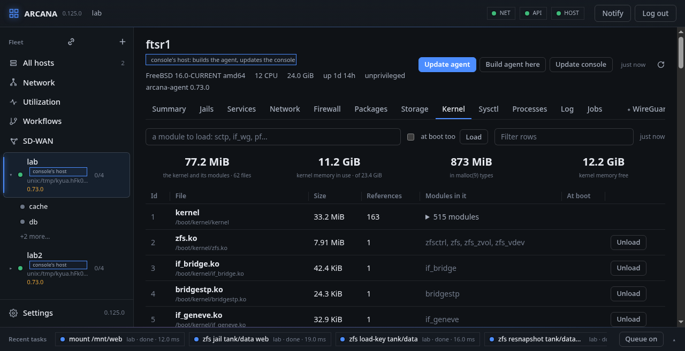

# Kernel, sysctl and processes

## Kernel

Every file linked into the kernel, the kernel itself first, with its
size, how many references hold it, and the modules in it, as `kldstat
-v` has it.

- **Load** takes a module's name as `kldload` finds it, without a path,
  and offers those of the module path that are not in.
- **Unload** asks for the name to be typed, since what a module does
  stops with it; the kernel refuses one still in use.
- With **at boot too**, a module loaded is put into `rc.conf`'s
  `kld_list`, and one unloaded is taken out of it; what `kld_list`
  names that is not in the kernel now is said.

Arcana loads no module by itself: what a feature needs and is missing
is said, and loaded here. Above the list: what the kernel and its
modules take, and how much of the kernel's memory is in use. Below it,
**Kernel memory**: the largest `malloc(9)` types and `uma(9)` zones, as
`vmstat -m` and `vmstat -z` count them, which is where a module's own
memory shows.

From a shell: `arcanactl kmod`, `arcanactl [-p] kmod load | unload
module`.

## Sysctl

The kernel's state, a part of the tree at a time (**kern**, **vm**,
**net** and the others, or from a name typed), as `sysctl -a` has it:
each name with its value, its type, whether it is a loader tunable,
and what it is said to be. The values come in parts and the table fills
as they arrive, so **all**, the whole tree, is all of it.

**Set**, on a value that can be, puts it into a field in its row; it is
set with `sysctl name=value` by a job, and with **at boot too** also
written to `/etc/sysctl.conf`, where the line that set the name before
is replaced and the rest left as it was. What `sysctl.conf` sets is
listed above the table. A jail's sysctls are not set from here.

From a shell: `arcanactl sysctl [name]`, `arcanactl [-p] sysctl
name=value`.

## Processes

What runs on the host, as `top` shows it: each process with its user,
jail, state, nice value, threads, the memory it holds (Res) and has
mapped (Size), CPU, WCPU, I/O, the CPU time it has used, and its
command.

- **CPU** is what it used between the two last looks, in percent of one
  CPU; **WCPU** is the kernel's own, slower figure; **I/O** is blocks
  read and written a second.
- **by CPU / WCPU / Memory / I/O** puts the most first; the table is
  read again every three seconds while **Live** is lit.
- **all** or a jail's name picks whose processes; **kernel** shows the
  kernel's own too. Above the table, each jail's processes are added up.

A process pressed opens under its row: its whole command line, its
parent, what it waits on, what it has open (files, sockets with their
addresses, pipes), its threads, a **Signal** to send, asked about
first, and a **Nice** value to give it, -20 to 20. Both are jobs. The
agent checks that the process is still the one shown, by when it
started, and refuses `init`, the kernel's own and itself.

From a shell: `arcanactl [-j jail] ps [pid]`, `arcanactl signal pid
[name]`, `arcanactl renice pid nice`.

**FreeBSD:** modules are `kldstat(8)`, `kldload(8)` and `kldunload(8)`,
kernel memory `malloc(9)` and `uma(9)`; the tree is `sysctl(3)`;
processes come from `libprocstat(3)`, signalled with `kill(2)` and
reniced with `setpriority(2)`.

