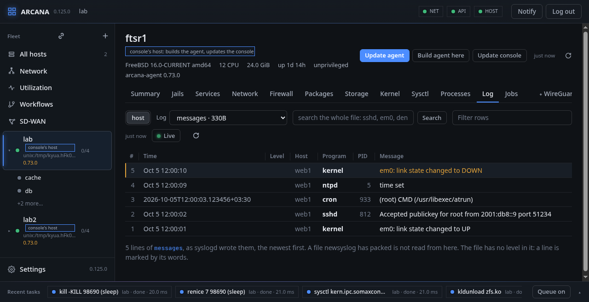

# Log and events

## Log

What `syslogd` wrote, a file of `/var/log` at a time, `messages` first,
the newest line on top. A line is taken apart into its time, host,
program, PID and message, in either form `syslogd` writes; where it
writes a level (`-v`), that is a column too. A line with a word of
trouble in it (error, fail, denied, panic) is marked red, one of doubt
(warn, invalid, cannot) amber.

- While **Live** is lit, what is written is read every three seconds and
  added, as `tail -f` would; a file turned over by `newsyslog` is read
  from its start.
- **Search** looks for a text in the end of the file on the host, in
  either case; the filter narrows what is on the page. **Older** reads
  further back.
- **host** or a running jail's name picks whose `/var/log` is read. A
  packed log (`.bz2`, `.gz`, `.xz`, `.zst`) is unpacked to be read.
- **dmesg** is the kernel's message buffer, followed as it comes: the
  agent reads it every second and numbers each new line, none shown
  twice and none missed. The kernel lets only root read it. An agent
  that runs as another user says so, and that `sysctl
  security.bsd.unprivileged_read_msgbuf=1` (kept in
  `/etc/sysctl.conf`) lets it.
- **audit** is the audit trail, where the host keeps one.

From a shell: `arcanactl log [-o lines] [-f position] [name [text]]`.

## Events

The last entry of the list of logs: every route, interface, address and
neighbour of the host that came, went or changed, as the kernel told the
agent the moment it happened, the last 512 kept; and what the agent
itself raises, such as a threshold crossed or an SD-WAN fault. A storm
of routes (a BGP session coming up) is counted for each second, not
listed.

A jail with a network of its own is watched as the host is, from the
moment it is made or the agent starts, and its events say its name. The
console subscribes to the host's events while they are shown and passes
each to the page the moment it is told; workflows begin on them the same
way.

From a shell: `arcanactl events [after]`, or `arcanactl events -f` to
follow them.

**FreeBSD:** the log is what `syslogd(8)` writes, turned over by
`newsyslog(8)`; dmesg is the kernel's message buffer; events come from
`netlink(4)`'s route, link and neighbour groups, one socket for the host
and one inside each vnet jail.

