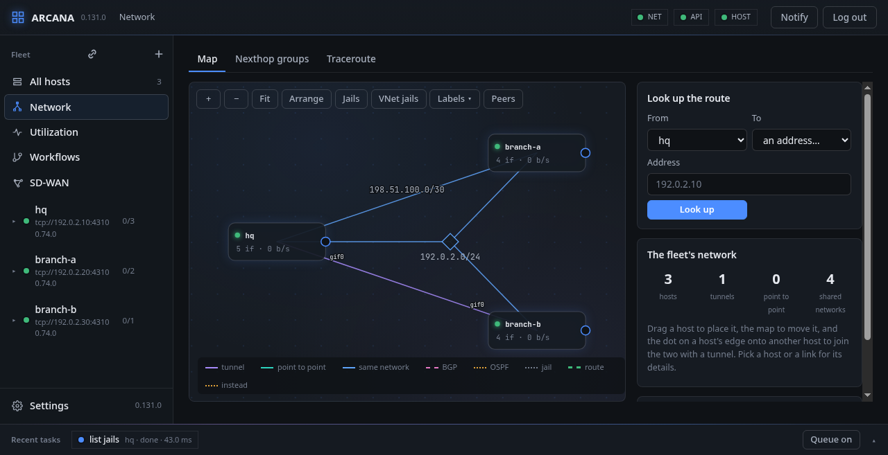
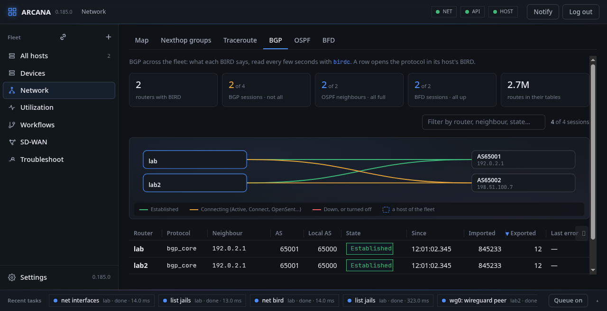

# The network map

**Network**, in the side bar, shows the fleet as a map. Nothing is
configured for it: the console reads each host's interfaces every few
seconds and works the links out. Its second tab, **Nexthop groups**, has
every host's routes of several next hops with what each next hop sent
and what its gateway received, as a host's [Nexthops](network.md#nexthops-and-their-groups)
draws them; its third, **Traceroute**, and the last three, **BGP**,
**OSPF** and **BFD**, are below.

## Links

A link is drawn only between hosts of this console: a tunnel whose far
end is an address of another host, a point-to-point address whose peer
is one, or two hosts with addresses in the same network. Three or more
hosts in one network join a node of its own. A link carries its
traffic: its width and the dashes that run along it follow the rate
of the interface behind it. A link that is down is drawn dashed and
faded. On a tunnel or a point-to-point link, each end's interface
is written at its own end, and what it carries in the middle.

A tunnel measured from the Overlay tab's Quality view carries its
probes as well: under its rate, its last sample (the one-way delay,
its variation and the share lost), and on it probes, white points one
way and the other, that cross in a time that grows with the delay
measured, leave early or late by the variation, and fade out on the
way at the share lost. A lossy tunnel looks it at a glance. The map
reads those monitors every quarter of a minute while it is shown.
**tunnel quality** in the legend, there once a tunnel is measured,
takes the probes and the samples off the map and puts them back; the
choice is kept in the browser.

A host where a change made in safe mode waits to be confirmed has a
fuse round its box: a ring of points that burns down as the time the
agent gave it runs out, amber, then red for its last ten seconds, with
"undone in … unless confirmed" under it. The console confirms a change
by reaching the host again over a new connection, so a fuse that keeps
burning means the change has cut the console off, and the agent will
put it back when the fuse is out.

The probes and the fuses are drawn by WebGL 2 under
the map, from the same C program as the rest of the page; the map
itself, with everything a pointer or a screen reader needs, stays SVG
on top of it. A browser without WebGL 2 shows the words under a host
without its fuse. With Settings › Motion off, or motion reduced in the
system's settings, nothing moves but a fuse, which is the change's
state.

Routing is drawn too, from what each host's BIRD says: a BGP session or
an OSPF adjacency between two hosts as a link of its own kind, and a
neighbour that is not a host of this console as a small node beside the
host that speaks to it, with its AS or router ID; picking one opens
that host's BIRD. **Peers** hides them.

A running vnet jail is a node of its own, drawn with a dashed edge
under its host: it has its interfaces and their traffic, its tunnels,
its BGP and OSPF sessions, as a host has. **Its network** opens its
host's Network tab with the jail picked. **VNet jails** hides them all,
and **Jails** hangs each host's running jails under it.

## Moving around

A host is dragged to where it should be, and stays there in that
browser; the map is dragged to move it, the wheel zooms, and on a
phone two fingers do. **Fit** shows every host, **Arrange** puts them
back on a circle and straightens every line. Once the map was moved or
zoomed it is not fitted again unasked, so nothing shifts under the
hand. A line is dragged to bend it away from the lines beside it.

**Labels** has the switches of what is written: **Names** and **Rates**
apart, and one for each kind of line. Until a kind is switched, a kind
with more than six lines has its labels left out, and a line shows its
own when the pointer is on it or it is picked. The **legend** names the
kinds of lines, and each is picked to take that kind out of the map and
put it back.

A host or a link is picked for its details beside the map: the host's
interfaces with their addresses and a chart of each one's traffic; a
link's two ends. With nothing picked, what the whole fleet receives and
sends over time, its busiest interfaces, and every WireGuard session.

## Drawing a tunnel

Drag the dot on a host's edge onto another host. The console offers the
outer addresses the two reach each other by and a free pair of inner
ones, asks for the kind (gif, gre, WireGuard, vxlan), and creates an
interface on each host, the two ends of one tunnel. For WireGuard each
host makes its own key; once both have one, each is given the other as
its peer, by its public key, at its outer address. Each end is made in
safe mode, and kept in `rc.conf` unless told otherwise. Under the
fields the dialog says what each host is to run, `ifconfig` line by
line, and says it again as a field changes. A tunnel picked on the map
is destroyed with one button, both ends.

While a line is drawn, points stream along it toward the pointer and
every host it can be dropped on breathes a dotted outline round its
box (WebGL; the dashed line and lit boxes alone without it).

## Drawing a routing session

The same line makes a routing session instead: the dialog's top asks
what joins the two, **a tunnel**, **a BGP session**, **an OSPF
adjacency** or **BFD**. For a session it offers what the session goes
over, each tunnel or point-to-point link the map has between them (by
their inner addresses) and each network both have an address in; for
BGP, each end's AS, as each host's BIRD says it in a session it has;
and BFD with it, on by default.

A session is written into each host's BIRD, one end at a time.
**Open the first end's BIRD** opens that host's BIRD with the protocol's
form filled in: a BGP neighbour named for the far host, its address,
AS and the source address; for OSPF the interface, added to the
instance of that family the host runs (version 2 for IPv4, 3 for
IPv6), or to a new one; for BFD the neighbour on that interface. It is
looked at, changed if need be, and saved as any protocol is, in safe
mode. Once it is saved, a note above the BIRD tab offers the other
end: **Open its BIRD** opens the far host's form, filled in from its
own side.

## Look up the route

Asks each host on the way which route it takes to an address, follows
the gateway to the host that has its address, and draws the way over
the map hop by hop, until the address is reached, the way leaves the
hosts of this console, or it comes back to where it was. Beside each
hop are the routes that would be taken in its place when the best one
goes, drawn dashed.

## Traceroute

The way the packets take in fact, as `mtr` shows it: from a host of this
console to an address or another host, a round of `traceroute` every
second, a probe a hop, each hop with what it lost and its last,
average, best and worst times and their deviation. A hop that answers
differently over the rounds says how many more answered. Where a hop is
a host of this console it is named, with the interface the probe came
in by; and of each of ours on the way, the interface it sends on, by
which gateway, and that interface's MTU: the smallest of them is as
large as the path's MTU can be.

From a shell: `arcanactl traceroute address`.

## BGP, OSPF and BFD

Every session of every BIRD in the fleet, hosts and vnet jails alike, on
one page a protocol: what each BIRD says, read again every few seconds
while the tab is open. Above, the figures for all three: how many BGP
sessions are established, OSPF neighbours full (or 2-Way, as two
routers neither of which is the designated one stay) and BFD sessions
up, of all, and the routes in their tables.

The graph has the fleet's routers on the left and what they speak to
on the right, a line a session in the colour of its state: green as it
should be, amber on its way, red down. A neighbour that is a host of
this console is named and framed as one; one outside is shown by its AS
(BGP) or its router ID (OSPF). The table under it sorts by any column
and is filtered by what is typed above it, the graph with it. BGP has
each neighbour's AS and the local one, the routes imported and exported
over its channels and the last error; OSPF the neighbour's priority,
dead time, interface and address; BFD the interval and the timeout.
A row opens the protocol in its host's BIRD tab, its box open.

**FreeBSD:** the links are worked out from each host's `getifaddrs(3)`;
a route is looked up among the routes the kernel gives through
`netlink(4)`, the most specific first; traceroute is `traceroute(8)` and `traceroute6(8)`. BGP, OSPF and BFD
are BIRD's (`net/bird2` or `net/bird3` from the ports), read with
`birdc(8)` over its control socket; the routes they learn reach the
kernel's FIB through BIRD's kernel protocol, a `route(4)` socket.

## Prefix lists

**Prefix lists**, the last tab: named lists of IPv4 and IPv6 prefixes
kept by the console, for the whole fleet. Make one here (a name, a
description, the prefixes one a line), and the forms that take
prefixes offer it by name: an ipfw table's entry form adds every
prefix of the list as an entry (one job each); a BIRD set's form adds
them to its entries; an SD-WAN zone's and an SD-WAN list's forms add
them to theirs. The list is taken in when the form is kept: changing
the list later changes nothing on a host by itself, so what a host
runs stays what you saw it get.

**FreeBSD:** a list becomes what each place has: entries of an
`ipfw(8)` table (`table name add prefix`), a `define` set in BIRD's
configuration, or prefixes in the SD-WAN document's zones and lists,
which the edges get as ipfw tables of their own.

