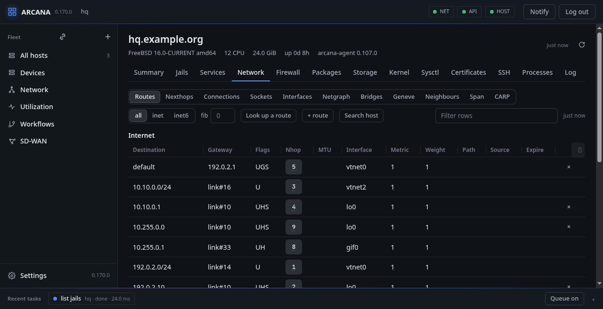
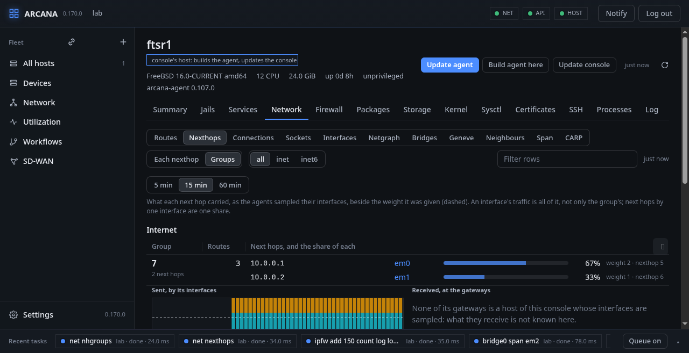
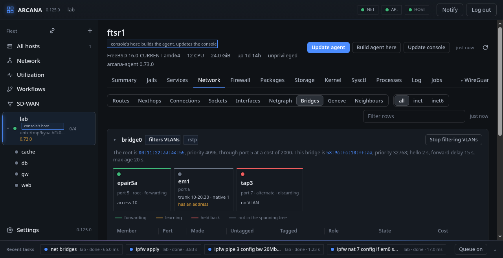
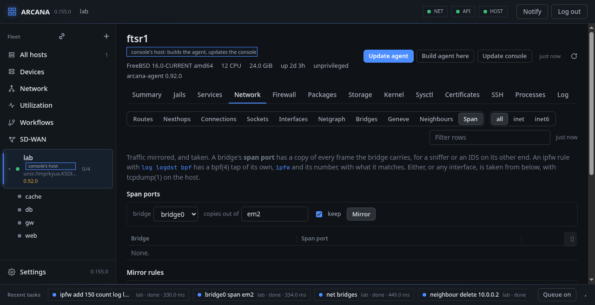
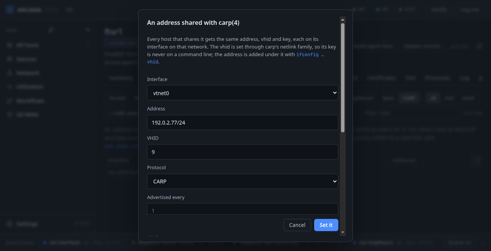
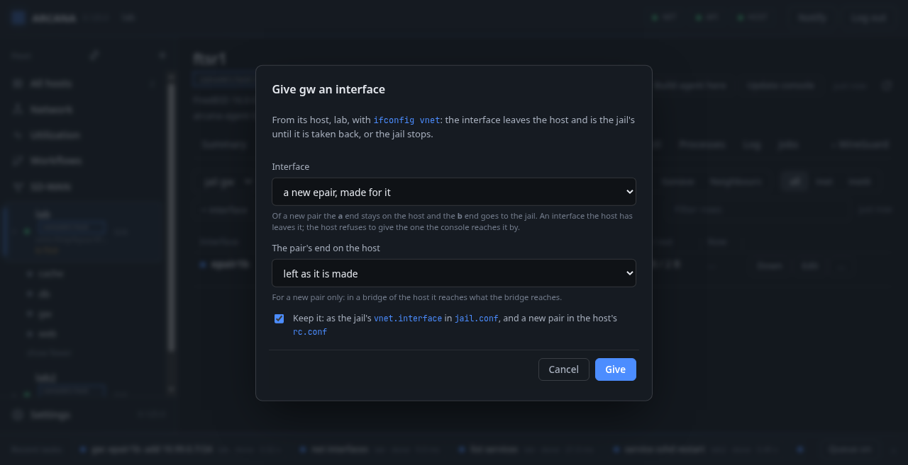

# Network

**Network** shows the host's network as the kernel has it, a view at a
time: **Routes**, **Nexthops**, **Connections**, **Sockets**,
**Interfaces**, **Netgraph**, **WireGuard**, **Bridges**, **Geneve**,
**Neighbours**, **CARP** and **Multicast**, each for IPv4, IPv6 or both. Filter the rows, and click
a column to sort.

**FreeBSD:** routes, nexthops and neighbours are asked of the kernel
through `netlink(4)`; connections and sockets come from the kernel's
own lists, as `netstat(1)` and `sockstat(1)` read them; interfaces from
`getifaddrs(3)`, changed with `ifconfig(8)`; netgraph with `ngctl(8)`;
WireGuard with `wg(8)`;
what is kept for a boot is written to `rc.conf` with `sysrc(8)`.

## Routes

Each route comes with what the kernel knows of it: its metric, its
weight, the address it sends from, its routing table. **fib** picks the
routing table shown and changed, when the host has more than one.

Routes, connections and sockets come in parts over the console's
stream as the host reads them, so a table of any size (a full BGP
table, say) arrives whole: the first time the table fills as the parts
come, and read again, the table shown stays until the new one is whole.
Where the page has no stream, a table of more than 2000 routes comes as
its first 2000 rows with how many it has, and **More** reads on; or type
a prefix or an interface in the filter and press **Search host** to
have the host search the whole table.

**+ route** adds a static route (a destination and a gateway, an
address or an interface), and the cross on a static route deletes it,
both through netlink. A route can be given its **metric** (of several
routes to one destination the lowest is used, the others when it is
gone), its **weight** (its share among routes of one metric), the
**source address** what takes it is sent from, and the **routing
table** it goes into.

A gateway may be several addresses with commas between, each with its
share after an `@` (`10.0.0.1@2,10.0.0.2`): one route with as many next
hops (ECMP), which the table shows as a row for each, **Path** saying
which of how many. A route of several gateways is not kept in `rc.conf`
from here.

A route kept in `rc.conf` is `route_<name>` in `static_routes`
(`ipv6_route_<name>` in `ipv6_static_routes`), as rc.d/routing reads it
at boot. Give it a **Name** that says where it goes: the host it goes
to, or that host and the interface it leaves by (`router1`,
`edge2_gre0`). Left empty, a route keeps the name `rc.conf` already
knows it by, and a new one is called `arc_` and its destination. A
route `rc.conf` keeps is found by its destination and routing table,
whatever its name, so a route written by hand is deleted or renamed
the same way.

**Kept in rc.conf**, beside **In the table**, lists what `rc.conf`
keeps, of the host or of the jail chosen: each route by its name, with
the words `route(8)` is given and what they say (destination, gateway,
kind, routing table), and the default routers of each table under them.
A variable no list names is marked *not listed* (it is not added at
boot), and a name without its variable *no variable*. The pencil keeps a
route by another name, its words as they are; the cross forgets it in
`rc.conf`. Neither touches the kernel's table: they are for a route
another program puts there now, BIRD say, kept from an earlier day.
From the command line these are `arcanactl route keep add <destination>
name <word>`, `arcanactl route keep delete <destination>` and
`arcanactl net kept-routes`.

**Look up a route** asks for an address and tells the route the host
would take to it, as the kernel tells it, and every other route that
covers the address, the most specific first.

## Nexthops and their groups

A route's **Nhop** opens its next hop in a box: its type, gateway,
interface, MTU, flags and how many routes use it. **Nexthops →
Groups** shows the groups the kernel made of routes with several next
hops: each group a row, its next hops one under the other, each with
its gateway, interface and a bar of its share.

Under each group, what it carried, from the samples the agents keep:
on the left what the host **sent** by each next hop's interface, on the
right what the gateways **received**, where the gateway is a host of
this console. Each is a chart of columns over the last 5, 15 or 60
minutes, every column the shares of that moment stacked to the whole,
with the weights dashed across where the shares would meet if they
were kept. An interface's traffic is all of it, not only the group's,
and next hops by one interface are one share: the samples cannot tell
them apart.

## Interfaces

Each interface with its state and link, addresses, MTU, hardware
address, a tunnel's two ends, and its traffic in all and as it is now.

The host's table is read by the standard models, as an SDN controller
reads a device: the console asks the agent for RFC 8343's
`ietf-interfaces` and RFC 8344's `ietf-ip`, with RFC 8529's network
instances for the FIBs, by cblink's YANG family (YANG-CBOR, RFC 9254),
and makes the rows of what comes. The agent reads them as ifconfig(8)
does: getifaddrs(3), the `SIOCGIFFIB`, `SIOCGTUNFIB`,
`SIOCGIFPSRCADDR`/`SIOCGIFPDSTADDR` and media ioctls. `arcanactl get
interfaces` shows the same as RFC 7951's JSON. A jail's table, and the
CARP and Span tabs, still come from the agent's own table, which also
carries what the models do not have yet (CARP, the interface flags).

- **+ address** adds an address, and its cross takes it off.
- **Up** and **Down** change the interface's state; **Edit** its MTU
  and description.
- **+ interface** creates a cloned interface: the kind (epair, gif, gre,
  ipsec, me, vxlan, vlan, bridge, lagg, tap, tun, lo, wg, ovpn), the
  number or the next free, and what that kind takes: a tunnel's two
  ends, an ipsec interface's reqid, a VXLAN's identifier, a VLAN's tag
  and parent, a bridge's first member, an address and a peer's, MTU and
  description. The cross on a cloned interface destroys it.

A change is made live, and with **Keep it in rc.conf** also written
there, to be there after a boot: a created interface in
`cloned_interfaces` with its `create_args_<if>` and `ifconfig_<if>`
lines (a wg one is kept for `wg-quick(8)` instead), an address as the
next `ifconfig_<if>_alias<n>`, a route under a name of its own in
`static_routes`.

## Netgraph

The host's `netgraph(4)` nodes drawn with the hooks that join them. A
node is picked for its hooks, which are removed with their cross, shut
down, or given a new peer; dragging the dot on a node onto another
connects a hook of each.

## WireGuard

The `wg` interfaces with their peers: endpoint, allowed addresses, last
handshake, traffic. A view of the Network tab, beside Netgraph: `wg(8)`
is the base system's, and so is the interface, `if_wg(4)`.

- **Make its key** has the host make the interface's private key, which
  stays on the host: the console is told, and shows, public keys only,
  and what `wg` prints with keys in it is kept out of the trace.
- **+ peer** adds a peer by its public key; the cross removes one.
- **✎** on a peer opens its form with what it has (endpoint, allowed
  addresses, keepalive), its key fixed: what the form says is what the
  peer has after. A keepalive of 0 turns it off.
- Every public key, the interface's and each peer's, is shown whole,
  with **Copy**.
- **+ interface** opens the interface form with wg chosen.
- **+ client** makes a client of the interface, a phone or a laptop:
  its name, its address in the tunnel (the next after the peers' is
  offered), the endpoint it reaches the host at (the host's address
  and the interface's port are offered), what it sends through the
  tunnel (`0.0.0.0/0, ::/0` for everything, the tunnel's network alone
  for a split tunnel), DNS and a keepalive. The console makes its key
  pair and keeps neither half: the host gets the public half as a
  peer, and the page shows the client's configuration for `wg-quick`
  once, with **Copy**, **Download** (`<name>.conf`) and a QR code the
  WireGuard app scans (*Add a tunnel*, *Scan from QR code*). Closed,
  it is gone: a lost one is a client made again, the old peer removed.
  **With a preshared key** (on by default) adds a second secret the
  console makes with the key pair: in the client's configuration as
  `PresharedKey`, and given to the host's `wg` in a file there only
  while it is read, in no title, argument or trace.
- **↻** on a peer gives that client a new key: the same form, its
  addresses and keepalive kept, a new configuration and QR code; the
  new peer is added, then the old key's taken away.

Kept for a boot, an interface is written with its key, addresses and
peers to `/usr/local/etc/wireguard/<if>.conf` for `wg-quick`, readable
by root alone, and named in `wireguard_interfaces`: that needs the
`wireguard-tools` package.

## Bridges

Each bridge drawn as the switch it is, a port for each member, coloured
by what the spanning tree made of it (forwarding, on its way, held
back, or not in the tree), with its role, and the VLAN it is in
untagged or those it carries tagged. Above them: whether the bridge
filters VLANs, which bridge is the root of the tree and through which
port and at what cost it is reached.

A port picked is made an **access port** (one VLAN untagged) or a
**trunk** (a list of VLANs tagged, and perhaps one untagged), put into
or taken out of the spanning tree, made an edge port, or taken out of
the bridge; kept in `rc.conf` when asked. A member takes no address: its
addresses belong on the bridge, and one that has some is marked.

At the foot of a bridge's box: the spanning tree's protocol, priority
and timers, how many addresses it keeps and for how long, of which
**Set what was changed** sets those that differ; and the addresses it
has learned, each with its VLAN, the member it is behind and when it is
forgotten.

**×** on an address forgets it (`ifconfig bridge0 deladdr`); the bridge
learns it again when a frame comes from it. **Set it** sets an address
by hand behind a member (`static`), where it is never learned elsewhere.
With **keep in rc.conf** it is kept in `ifconfig_bridge0`, until it is
set again or taken away. **Forget what it learned** (`flush`) forgets
the learned addresses but not those set by hand.

From a shell: `arcanactl net bridges`, `arcanactl [-p] bridge name
access member vlan`, `bridge name trunk member vlans [untagged]`,
`bridge name vlanfilter on | off`, `bridge name addm | deletem member`,
`bridge name static member address | deladdr address | flush`.

## Geneve

The `geneve(4)` tunnels, each with its mode (l2, Ethernet frames for a
bridge; l3, IP packets that are routed), its identifier, its local
address and the host or multicast group it leads to. **+ geneve
tunnel** makes one; a tunnel picked has every option to be set:
identifier, addresses, group and its device, TTL and don't-fragment
(each also inherited from the packet inside), DSCP inherited, the port
range, learning and its table's size and timeout, external control.
**Flush** empties its forwarding table.

## Connections, sockets and neighbours

Connections and sockets have the columns `netstat` and `sockstat` show:
who holds a socket, its command and descriptor, and `?` for one nobody
holds any more. **Neighbours** are ARP's and NDP's, each with its
link-level address, interface, state (reachable, stale, delay, probe,
incomplete, or permanent for one set by hand) and whether it is a
router. All three are read again every two seconds while they are shown
and **Live** is lit.

**+ neighbour** sets one by hand, with `arp -s` or `ndp -s`: its
address, on one of the networks here, and its link address; it stays
(permanent) unless **It ages out** (`temp`). **Keep it for a boot**
writes it as a pair of `rc.conf`'s `static_arp_pairs` or
`static_ndp_pairs`, which `rc.d/static_arp` and `static_ndp` set at
boot. **×** on a row takes one away (`arp -d`, `ndp -d`), and out of
`rc.conf` too. In a jail's own network they are the jail's.

**Labels.** Under an interface's name, beside the description the host
itself keeps for it, a label of the console's own: *uplink A*, *the
UCS to the IXP*. The pencil opens a field in place; the label is kept
by the console, by host and interface, so it stays through the host's
reinstall and whatever the interface's description says, and the
table's filter finds it.

**Multicast** is IGMP's and MLD's state: for each interface, the
version it speaks (IGMPv1, v2 or v3; MLDv1 or v2) with its robustness
variable (rv), query interval (qi), query response interval (qri) and
unsolicited report interval (uri), shown as the kernel keeps them; and
under it the groups joined there, each with its family, filter mode
(include or exclude), sources and link-level address. IPv4 or IPv6
narrows the groups to one family.

Above them, the kernel's settings: the IGMP version an interface
starts with, whether IGMPv1 and v2 and MLDv1 and v2 are heard at all,
whether an interface falls back to an older router's version, whether
groups of 224.0.0.0/24 are reported, whether reports carry Router
Alert, and whether MLDv2 reports joins as ALLOW records. **Set** sends
one sysctl job for each setting changed; **Kept at boot** writes each
to `sysctl.conf` too. In a vnet jail they are the jail's own.

**FreeBSD:** the state is `ifmcstat(8)`'s, which reads it from the
kernel's `igmp(4)` and `mld(4)`; the settings are the
`net.inet.igmp.*` and `net.inet6.mld.*` sysctls, per vnet, set with
`sysctl(8)`. The host joins and leaves groups for its own sockets; a
querier or multicast routing (`pimd`, `mrouted`) is not Arcana's.

## Span: traffic mirrored, and taken

**Span** puts traffic where it can be seen, and takes it:

- **Span ports.** A bridge's span port gets a copy of every frame the
  bridge carries, for a sniffer or an IDS at its other end. **Mirror**
  makes an interface one (`ifconfig bridge0 span em2`, kept in
  `rc.conf` with **keep**), and **×** stops it.
- **Mirror rules.** An ipfw rule with `log logdst bpf` has a `bpf(4)`
  tap of its own, named `ipfw` and the rule's number (`ipfw150`), which
  carries what the rule matches. **Mirror** adds `count log logdst bpf`
  with the protocol, addresses, port and interface given: the packets
  are counted, mirrored and passed on to the next rules. Every rule
  with a tap is listed, those made elsewhere too (any `log` rule has
  one while `net.inet.ip.fw.verbose` is 0).
- **Capture.** Packets are taken with `tcpdump(1)` on the host, from
  an interface, a span port or a tap, through a `pcap-filter(7)`
  filter, for a number of packets (500 at most) or seconds (60 at
  most), whichever ends first. They are shown one a line, and **Save
  the pcap** saves them for Wireshark or `tcpdump -r`. While tcpdump
  writes the file, it is in a directory under `/tmp` that only root
  can read, and it is removed afterwards.

**FreeBSD:** a tap per rule is FreeBSD 16's; `tcpdump -D` lists the
sources there are. Capturing in a jail's own network needs `bpf(4)`
inside the jail: its devfs ruleset has to unhide it. Since a capture
shows what was on the wire, a read API token cannot make one; a
signed-in session or a write token can.

## CARP: an address shared between hosts

**CARP** lists every virtual host (vhid) of `carp(4)` on the host: its
interface, its state (MASTER, BACKUP or INIT), its protocol (CARP, or
VRRPv3), its timing and the addresses under it. The host that is
MASTER of a vhid answers for its addresses; the others wait as BACKUP
and take over when its advertisements stop. With CARP the host with the
smallest skew is MASTER, with VRRPv3 the one with the highest priority;
with `net.inet.carp.preempt` set (**Sysctl**) a host takes it back when
it returns.

- **+ CARP address** puts an address under a vhid on an interface: the
  vhid (1 to 255), the protocol, how often it advertises and its skew
  (CARP), or its priority and interval (VRRPv3), and its key. Every
  host that shares the address gets the same address, vhid and key,
  each on its interface on that network.
- **Backup** tells a MASTER to step back now, so that another host
  takes over; **Master** has a BACKUP take over now. Neither is kept.
- **✎** changes a vhid's timing or key; what is left empty stays.
- **×** on an address takes it off; the vhid goes with its last one.

**Keep it for a boot** writes the address as an
`ifconfig_<if>_alias<n>` line with the vhid's words, for example
`inet vhid 1 advskew 100 pass … 192.0.2.1/24`, and adds `carp` to
`kld_list`. The key is then in `rc.conf` as well, which every user of
the host can read, as the Handbook's own example has it.

If `carp(4)` is not loaded, **Load carp** loads it (`kldload carp`) and
adds it to `kld_list`.

**FreeBSD:** the vhids are read, made and changed through carp's own
`netlink(4)` family (`genetlink` "carp"), as `ifconfig(8)` does
itself, so the key goes to the kernel and never onto a command line or
into a trace. The address goes under the vhid with `ifconfig … vhid N
alias`. In a jail's own network the vhids are the jail's.

## Tunnel quality

**Tunnel quality**, among the Network tab's views, lists every tunnel
of the host, or of the vnet jail picked: gre, gif, WireGuard, IPsec,
and any interface with a far end. Each tunnel is either measured or
offered **Measure**. A measured tunnel shows its **delay**, its
**variation** and its **loss**, with their trend. This works on any
tunnel, outside SD-WAN: a tunnel made by hand, by rc.conf or by
another tool is measured all the same, and an SD-WAN apply never
touches a monitor.

- The **delay** is one way: half the mean round trip of a sample's
  answers.
- The **variation** is the mean difference between one answer's delay
  and the next's.
- The **loss** is the share of a sample's probes not answered.

**Measure** opens the measuring dialog:

- **Far end**: the tunnel's inner address at the other end. For a gre
  or a gif it comes from the interface's point-to-point address; a
  WireGuard peer's is typed.
- **Routing table**: the interface's own.
- How often it is probed, and how long a sample is (500 ms and 10 s
  unless changed).
- The probes' size and DSCP.
- Thresholds, each optional: a delay, a variation (ms) and a loss (%).

A value over its threshold shows in red. **Change** opens the same
dialog for a measured tunnel, and its samples are kept when it still
probes the same address the same way. **Stop** takes the monitor away.
The view is read again every few seconds while it is shown.

A monitor whose tunnel stops answering, or answers again, is an event,
`monitor`. A metric crossing its threshold either way is another,
`monitor-threshold`. Workflows can begin on either ("a measured tunnel
stops answering", "answers again", "crosses its threshold"), for one
tunnel or any.

**FreeBSD:** the agent's prober sends ICMP echo on a raw socket set to
the tunnel's routing table with `SO_SETFIB`, its DSCP set by `IP_TOS`
or `IPV6_TCLASS`. The SD-WAN's probes use the same prober, and needs
root. A vnet jail's monitor is probed from the jail's own network,
through a socket the agent's helper makes there. The monitors are kept
in `monitors.json` (`monitors@<jail>.json`) beside `history.conf`, and
probed again when the agent starts. From the command line: `arcanactl
monitor`, `monitor set name=… [interface=…] [address=…] [fib=…]
[interval=…] [eval=…] [delay-max=…] [ipdv-max=…] [loss-max=…]` and
`monitor remove name=…` (`-j` for a jail).

### Each tunnel from both ends

The fleet's Network page shows the same monitors per tunnel rather than
per host: its **Overlay** tab has two views, **Tunnels** and
**Quality**. Quality lists every tunnel of the fleet once, with both of
its ends side by side. A gre or gif is matched to its far end by
outer addresses, and a WireGuard interface by peer keys; a tunnel whose
far end no host of the fleet has is listed with one end.

Each end is measured twice:

- **over the tunnel** (the overlay): ICMP to the far end's inner
  address, in the interface's own routing table;
- **under it** (the underlay): ICMP to the far end's outer address, in
  the interface's `tunnelfib`, the table its encapsulated packets
  leave by.

**Measure** opens one dialog for both ends, filled in from the
interfaces: the four addresses and the four routing tables, each of
which can be changed (a host whose underlay sits in another FIB is
the case this is for), how often to probe and how long a sample is. It
sets four monitors, `ov-<interface>` and `ul-<interface>` on each end,
which are the ordinary monitors of [Tunnel quality](#tunnel-quality):
the host's own view shows them too, the underlay's row under the
tunnel's.

The row says each monitor's last sample. **Charts** opens the tunnel
under the table: three charts, **Loss**, **Delay** and **Jitter**, each
with four lines, A to B and B to A over the tunnel (solid) and under
it (dashed). The overlay's delay less the underlay's is what the
tunnel itself adds, and loss on the overlay alone points at the tunnel
rather than the path under it. **Change** opens the dialog again,
and **Stop** takes all four monitors away.

## A jail's own network

A jail with a network of its own (vnet) has that network here, and in
each plugin's tab: the picker at the left of the toolbar names the host
or one of its running vnet jails, and every view is then of that jail.
The jail's page has **Open it in the Network tab**, and the map's **Its
network** opens the same.

It is read and changed from the host: there is no agent in the jail,
and nothing is installed there for it. `ifconfig`, `route`, `netstat`,
`sockstat` and `ngctl` are the host's, run for the jail; `birdc`,
`bird`, `wg` and `swanctl` are the jail's own, run in it, so that what
parses a configuration is the version that runs it. What is kept for
the jail's next start is kept in its own `rc.conf`, and its files are
never followed out of the jail through a link. Safe mode works there as
on the host. From a shell: `arcanactl -j jail net …`.

### Giving a jail an interface

**+ from host**, above the jail's interfaces, gives it an interface the
host has (`ifconfig vlan100 vnet jail`), or, with the field left empty,
a new `epair` made for it: the `a` end stays on the host, to be put in
a bridge or given an address there, the `b` end goes to the jail.
**To host** on a row takes the interface back.

Kept, it is the jail's `vnet.interface` in `jail.conf`, and a new pair
is in the host's `rc.conf`, so the jail has them again after a boot.
The host refuses to give away the interface the console reaches it by,
unless asked in safe mode.

## Safe mode

Changes to interfaces, routes, a jail's address and service variables
are made in **safe mode** where they can be. Once the change is made,
the host waits to hear from the console again, which the console does
by reading the job. If the change cut the host off, nothing arrives,
and the host undoes it by itself, and only what the change changed (an
interface that was up already is not brought down for having been told
to come up): the address is put back with its prefix length, the
interface brought back up, the route added or deleted again. The job
then reads "not confirmed within 60 s: undone". Only a route deleted
without a gateway cannot be put back, and the console says so before it
does it.

How long the host waits is its **rollback timer**, set on its Summary:
10 to 3600 seconds, or empty for the agent's own (`arcana-agent -w`, a
minute unless set). The console sends it with each safe change, and
`arcanactl -s -W seconds` does the same from a shell.
