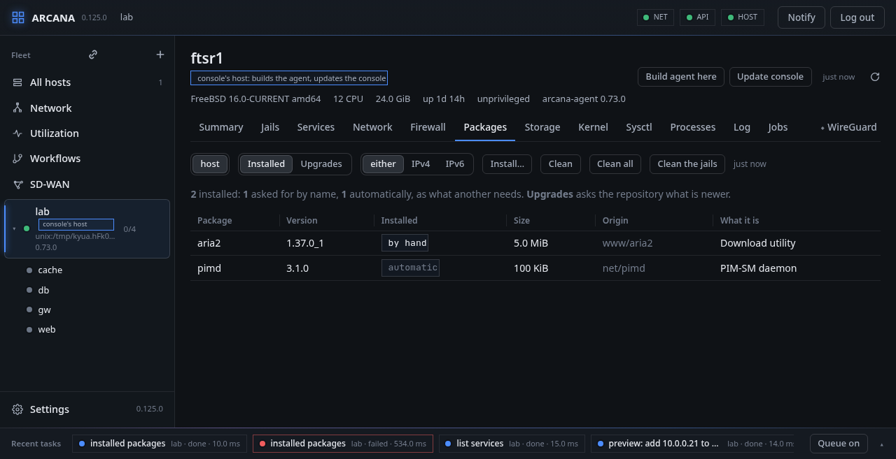

# Packages and jobs

## Packages

Of the host or a running jail. **Installed**, at first, lists what is
installed, from the host's own database without asking the repository:
each package's version, whether it was asked for by hand or came
automatically as what another needs, its size, its port and what it is.

- **Upgrades** asks the repository what is newer, with **Check** (`pkg
  update` first), a dry run, and **Upgrade** of the selected packages
  or of all.
- **IPv4** or **IPv6** has `pkg` reach the repository over that only
  (`pkg -4`, `pkg -6`), kept in the browser; **either** lets it choose.
- **From**, beside Upgrade and in Install…, takes the packages from one
  of the repositories `pkg` is configured with there alone (`pkg
  upgrade -r`, `pkg install -r`), enabled or not, such as a Builder's
  poudriere repository with a debug build of BIRD; **any repository**
  leaves it to `pkg`'s own configuration
  ([pkg.conf(5)](https://man.freebsd.org/pkg.conf/5)). The agent
  refuses a name that is not one of them.
- **Clean** deletes the downloaded packages no longer needed, or no
  longer in the repository (`pkg clean`), **Clean all** the whole cache
  (`pkg clean -a`). **Clean the jails**, on the host's page, does it in
  every running jail at once, a job each, so a jail whose `pkg` refuses
  fails alone.
- **Upgrade the jails**, on the host's page, upgrades every running
  jail's packages at once (`pkg upgrade -y` in each), a job each in one
  batch, after asking: a jail without `pkg`, or whose repositories
  cannot be read, fails alone. The host's own packages are not touched.
- **Install…** installs packages by name, on the host or in the jail
  picked (`pkg install -y`).

When `pkg` refuses packages built for a newer FreeBSD than the host's
(OSVERSION), the console asks whether to go on anyway, and approved,
does it again with `IGNORE_OSVERSION=yes`.

From a shell: `arcanactl packages [-i] [-4 | -6] [jail]` (with the
repositories), `pkg-upgrade [-O] [-r repo] …`, `pkg-clean [-a] [-j jail | -J]`, `pkg-install [-O] [-4 | -6] [-r repo]
[-j jail] package …`.

## Jobs

The host's own record of what it was asked to change, by this console
or with `arcanactl -q`: the last 64, forgotten when the agent restarts.
A row opens its trace. Above the list it says what the agent is doing
now that is not a job, a request somebody waits for such as a check of
the packages, since when, and whether the agent was told to stop and
waits for it.

**FreeBSD:** `pkg(8)`, for a jail with `pkg -j`; a job is the agent's
own, run by a thread of it and kept in its memory.

