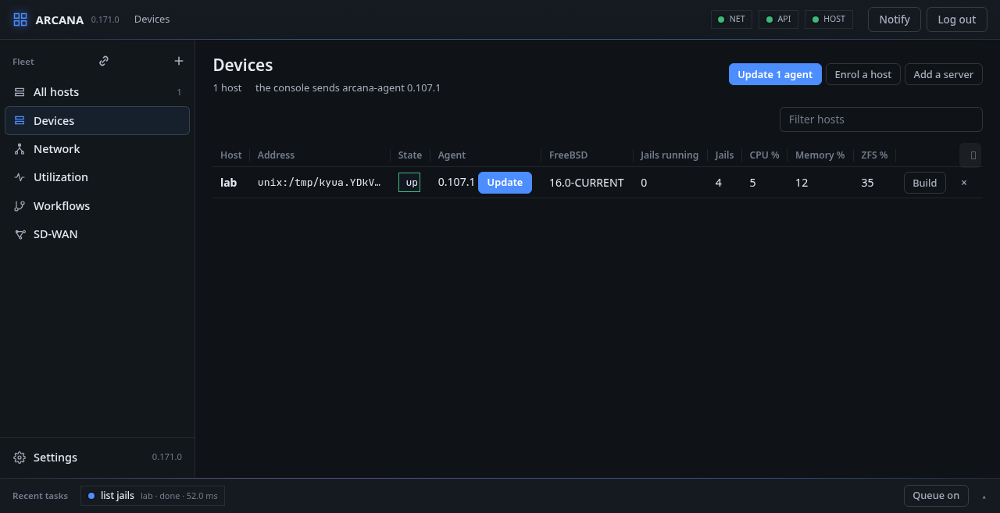
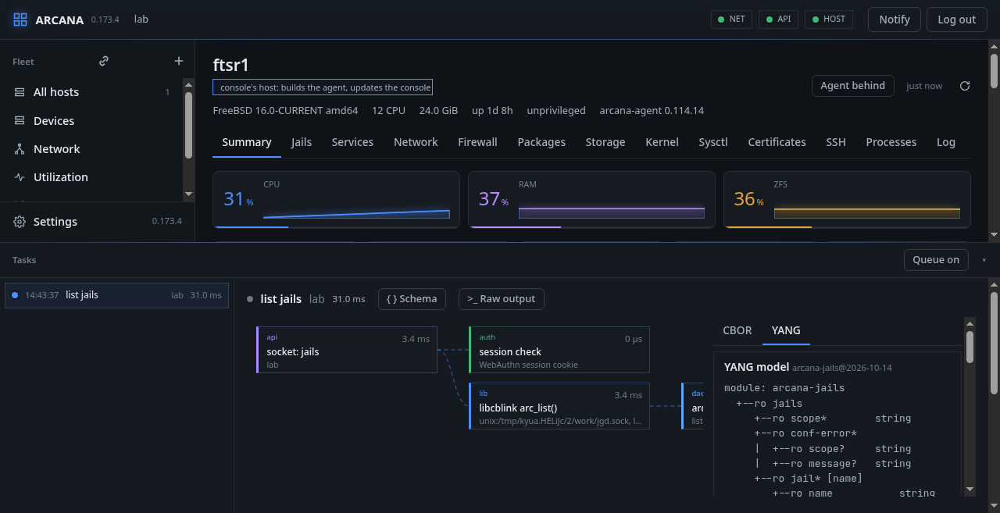
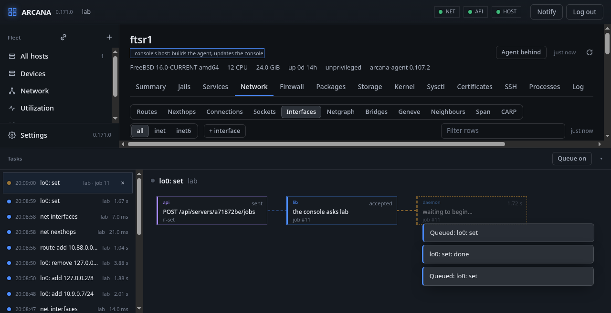
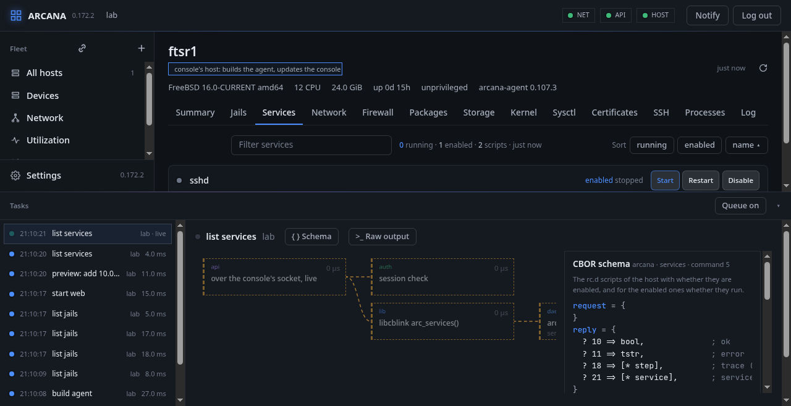
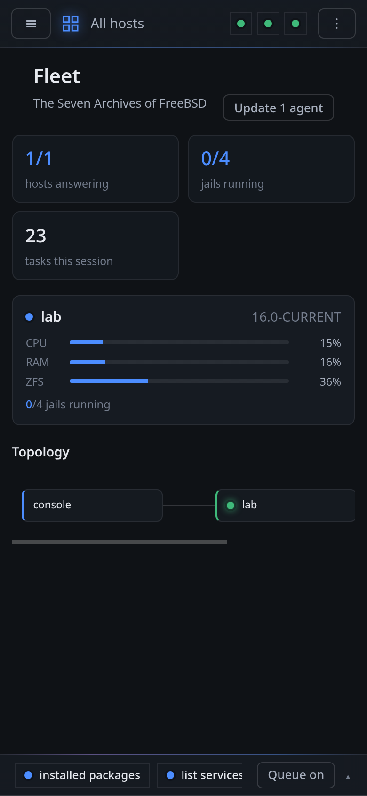
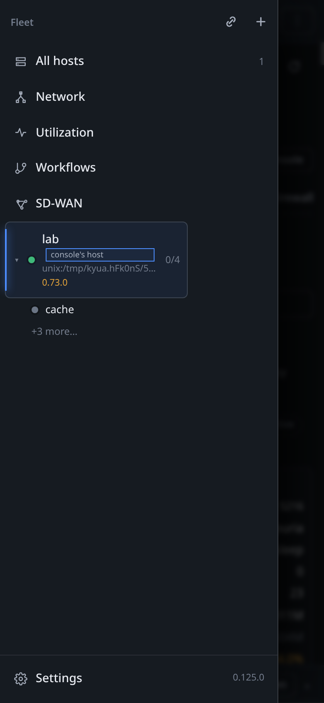
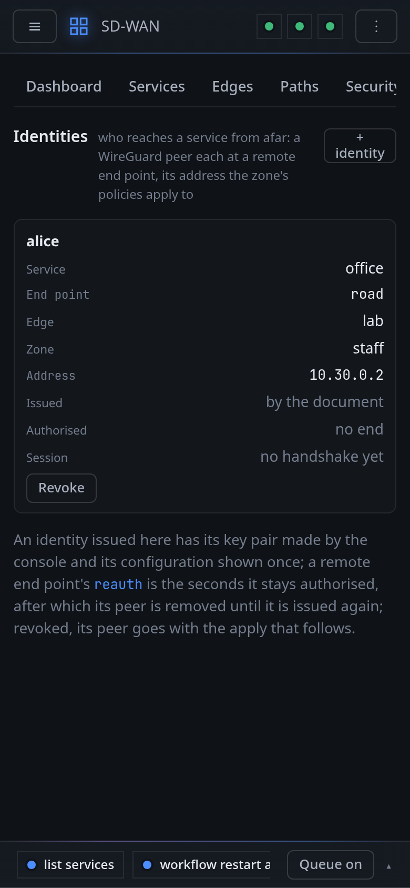

# The panel

The panel is laid out as a side bar and tabs: what you pick in the side
bar on the left decides the page, a host's page has a tab for each part
of the host, and the activity bar along the foot shows every call the panel
makes. This chapter is about what stays the same wherever you are.

## The side bar

The side bar holds the fleet's own pages (**All hosts**, **Devices**,
**Network**, **Utilization**, **Workflows**, **SD-WAN**) and
**Settings** at its foot. **Enrol a host** and **Add a server** are the
two icons at its top. The hosts themselves are on **Devices** and **All
hosts**, and a host's jails on its **Jails** tab.

The side bar, the activity bar, the list of tasks in it and the service
drawer are resized by dragging their edge; the browser keeps the sizes,
and a double click on the edge goes back to the usual one.

## The address

The address in the browser's bar names what is shown, so a link, a
bookmark, a reload or the browser's back and forward land there:

| Address | Shows |
|---|---|
| `#/` | the fleet |
| `#/hosts/<id>` | a host's summary |
| `#/hosts/<id>/<tab>` | its tab: `jails`, `services`, `network`, `firewall`, `packages`, `storage`, `kernel`, `sysctl`, `processes`, `log`, `jobs` |
| `#/hosts/<id>/jails/<name>` | a jail |
| `#/network`, `#/usage`, `#/workflows`, `#/sdwan`, `#/api` | the fleet's own pages |
| `#/settings/<tab>` | a tab of Settings |

`<id>` is the host's id in `/api/servers`. Opened at one before signing
in, the console goes there after. A host that is no longer there gives
the fleet. Each change is a new entry in the browser's history.

## The console's own host

The first host is the machine the console runs on. Arcana installs the
agent beside the console, so nothing is enrolled: start the agent and
the console adds it by itself, under the host's name, over the agent's
local socket. Until then the empty page says what it waits for: no
agent answering, or one whose socket the console's user may not use.
Taken off the list, the host is not added again; `local_agent` in
`web.conf` names another socket, or none.

That host wears a **console's host** label on its page. It builds and
installs the console when **Settings**, **Update** asks.

## Devices

**Devices** is the hosts as a table: each its name and address, its
state, its agent's version, the release of FreeBSD it runs, its jails
running and known, and its CPU, memory and ZFS use now. It sorts by any
column and is narrowed by the filter, like every table; a row opens its
host, and **×** takes a host off the console's list.

**Templates**, its second tab, are hosts' setups kept by the console
under a name (a host's Summary saves one, or a YAML or JSON file is
taken in). Each is the files of a bundle with `{{name}}` where every
host has a value of its own, `{{hostname}}` above all; `{{ }}` and not
`${ }`, which `rc.conf`, `jail.conf` and the shell use themselves. A
template opened shows each value it asks for, with what it is and a
default, and every file's text, all of them to change; **Save** keeps
it, **YAML** and **JSON** save it as a file. **Apply to a host** gives
the host picked its values, and **Check** shows what the host would
do, as a bundle is checked (the hardware the template needs, each
file's diff, the packages it lacks), before **Apply** writes anything.
A value without one given or a default refuses the whole.

The agents are updated here. A host whose agent is not the build the
console sends has its version marked and an **Update** beside it;
**Update N agents**, at the top, sends it to every such host at once.
**Build** has a host build `arcana-agent` from the repository named in
**Settings**, without installing it; the console keeps the program and
offers it to the others.

## All hosts

The fleet at a glance: every host as a card with its CPU, memory and
ZFS use and how many of its jails run, and the fleet as a graph from
the console through the hosts to their jails, of what runs (a host's
own Summary has all its jails). Nodes are links; a jail picked in a
graph opens in a box over the page.

## The top bar

Three lights say whether the network, the console and the host picked
answer. The console's light opens the console's own **API**, as
`docs/openapi.yaml` documents it: every route with what it is for, what
it takes and what it answers, by group and searched, and the document
itself one press away for a client generator. **Notify** has this
device told of what ends (below), and **Log out** ends the session.
**?** opens the page shown in this book, at its part: the tab of a
host, the kind of its network, a section of the side bar.

## The activity bar

Every call to a host is a task in the bar at the foot, with its
workflow as a graph: from the API call through the session check and
the cblink request to each call the agent made on the host. A box
picked in the graph shows its details in a pane beside it, which stays
in view while the graph scrolls.

- **{ } Schema** shows the operation's **CBOR schema**: its request and
  reply as maps keyed by attribute number, in CDDL, with the attribute
  sets they nest, taken from the family's own description
  (`share/arcana/arcana.yaml`).
  An operation already converted to YANG has a second tab, **YANG**:
  the module it is now, drawn as an RFC 8340 tree: `rw` configuration,
  `ro` state, `x` an action, `*` a list. So far the jails
  (`arcana-jails`, FreeBSD's jails as jail(8) and jail_get(2) see them,
  start, stop, restart and kill its actions), the services, the
  packages, the jobs, the storage, sysctl and the kernel, the
  processes, the logs (`arcana-log`, with syslog.conf as RFC 9742's
  `ietf-syslog`), the firewall (`arcana-firewall`: the kept rules
  and aliases as configuration, ipfw's rules with counters, dynamic
  rules, tables, NAT and dummynet as state, the kernel's trace as an
  action), the troubleshooting actions (`arcana-troubleshoot`:
  path-check with the firewall's walks typed, traceroute, capture),
  the history (`arcana-history`: how the agent samples and its limits
  as configuration, the samples as state) and the events
  (`arcana-events`: each kind an identity, its data typed, and the
  notification), BIRD (`arcana-bird`: bird.conf as configuration, what
  birdc tells as state), WireGuard (`arcana-wireguard`), netgraph
  (`arcana-netgraph`), the host itself (`arcana-host`: its facts,
  plugins, stats and trust store), the agent (`arcana-agent`: its
  listeners, TLS files, update, build, the sources and the
  configuration bundle as actions), the jails' files
  (`arcana-jail-files`), sshd (`arcana-sshd`), the probes
  (`arcana-probe`) and the SD-WAN edge (`arcana-sdwan`: what the
  console writes as configuration, what the edge does as state); the
  network's operations show the standard modules they are
  (`ietf-ip`, `ietf-routing`, `arcana-interfaces`,
  `arcana-network-instance`). Every operation has its model now;
  the modules are in `share/yang` of the source, each leaf naming the
  FreeBSD facility it is read from.

  
- **Raw output**, when a program ran, shows its argv, exit status and
  output verbatim.
- Changes are jobs the host runs on its own: the graph fills in stage
  by stage, and a change that cuts the console off still completes.
- A task still waiting says what it asked and where it is. The graph
  starts with the request (its method and address, such as `POST
  /api/servers/<id>/jobs`, and what the job asks: its kind, and the
  jail or name), then **the console asks** the host (waiting for the
  answer, or the job's number once the host accepted it), then, for a
  job, the host's stage: waiting to begin, the state the host last
  reported, or that the host does not answer. The stage it waits at is
  drawn dashed, and each says how long it has waited.

  
- A reading you ask for, the jails of a host you open or its
  services, goes over the console's WebSocket and is **live**: its task
  blinks in teal and says live, not running, and its graph draws each
  step as the host takes it. A program's box, such as `service sshd
  status`, appears the moment it runs and fills in its exit status and
  output when it ends. The agent tells the steps on the console's own
  connection, which subscribed to its steps group for this, and only
  there; the whole trace comes with the answer as ever. Without the
  socket the reading is an ordinary GET.

  
- An entry still under way has a cross. For a job, it takes the job out
  of the host's queue if it has not started; one that runs is left to
  finish, since stopping a change half way is what would not be safe.
  For a reading, it stops waiting for it.
- A reading that takes long, such as the packages, is asked for once:
  leaving its tab and coming back waits for the same answer.
- A task that **failed** has **Retry**: the same job, sent again to the
  same host.
- A workflow's run is a task too, begun by hand, by the clock or by an
  event, and ended as the run ends, with why when it failed.

Only what was asked becomes a task: opening or reloading the page reads
the hosts in the background, and adds none.

**Recent tasks**, along the bottom while the bar is closed, are the
last few, each with its host, how it ended and how long it took; one
picked opens the list at it. Ended tasks are kept in the browser (its
local storage; no database is needed), the last 24, and are still
there when the page is opened again, with their errors. A job's trace
is read again from its host as the task is opened: the host keeps its
jobs (until the agent restarts, or the job is old enough to be let go),
and says when it no longer has it. Another task's trace is kept with
it when it is small (under 16 KB).

### The queue

**Queue** is on unless you turn it off in that browser. A change then
waits in the activity bar until you press **Run**, and what waits is
sent to each host as one batch, run in order, whichever host is
selected then; a change is taken out of the queue with its cross, and
**As a workflow** makes the queue a workflow. With the queue off, a
change is sent at once.

## Notifications on other devices

A change asked for in one browser is told, when it ends, to every other
browser where **Notify** was allowed, whether or not the console is
open there: the phone hears of what was done at the desk.

It is Web Push. The browser subscribes with its vendor's push service
(Google's for Chrome, Mozilla's for Firefox, Apple's for Safari, where
the console must be installed to the home screen first), and the
console posts the message there, encrypted for that browser alone
(RFC 8291) and signed with the console's own key (VAPID; `vapid.pem` in
the data directory). The push service sees who sends and to whom, not
what. The console must reach those services over HTTPS, and the page
must be served over HTTPS for a browser to subscribe.
**Settings → Notifications** lists the devices, up to 16, and removes
one; a device whose browser dropped the subscription is forgotten by
itself.

## Tables

Every table sorts by the column picked (numbers as numbers, whether
they came as numbers or as text) and is narrowed by the filter above
it. A column is as wide as its border is dragged in the head; a double
click on a border fits it to what is in it again. **⤓** at the right of
a table's head saves its rows as CSV, as they are shown (filtered and
in their order), without the buttons, the file named after the heading
it is under. A box with a mark
before its name (a bridge, how a host is reached) folds when its head
is pressed, and stays as it was left.

## On a phone

The tree of hosts is a drawer that slides in from the left (☰), the top
bar is one row with the rest behind **⋮**, a dialog is a sheet from the
bottom, and a row of choices (the views of a tab, a family, a range of
time) is one line that scrolls sideways; a page's tabs too.

A table on a phone is a card for each row. Its title is the column that
names the row (a process's command, an interface's or a jail's name,
a firewall's part), each other value has its column's name beside it,
and what is done to the row is along the card's foot, behind one **⋯**
when there are more than two. The table's head stays above the cards as
a row of buttons to sort by.

The firewall's parts, a side bar elsewhere, are a strip above its
rules. On the network map the tools are one line along the top and the
legend one along the foot, and **Arrange** puts the hosts on a tall
ellipse the screen holds.

