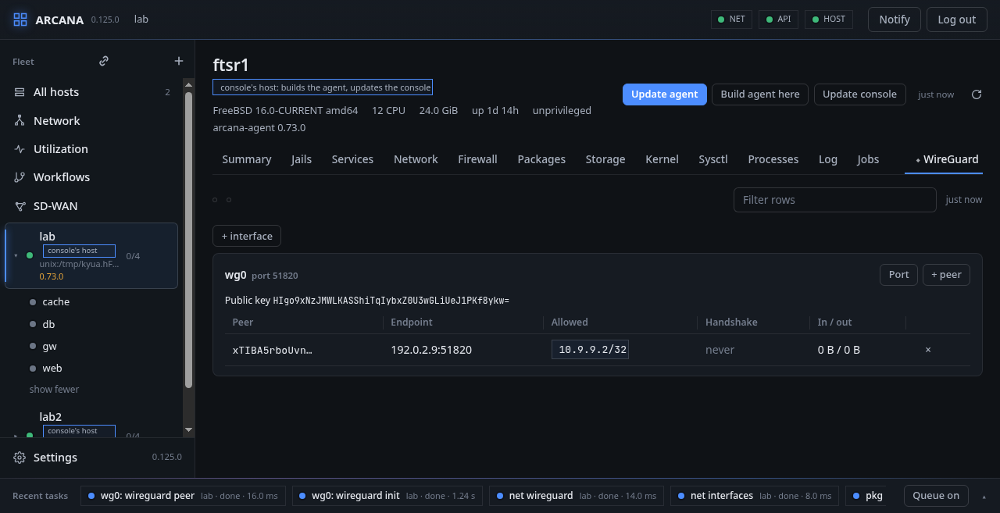
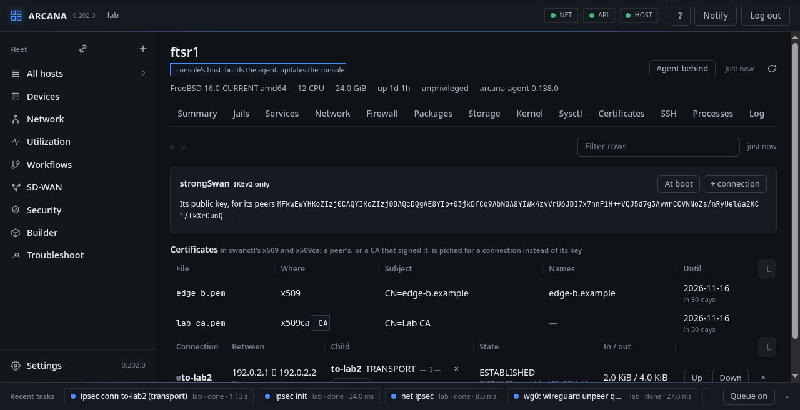
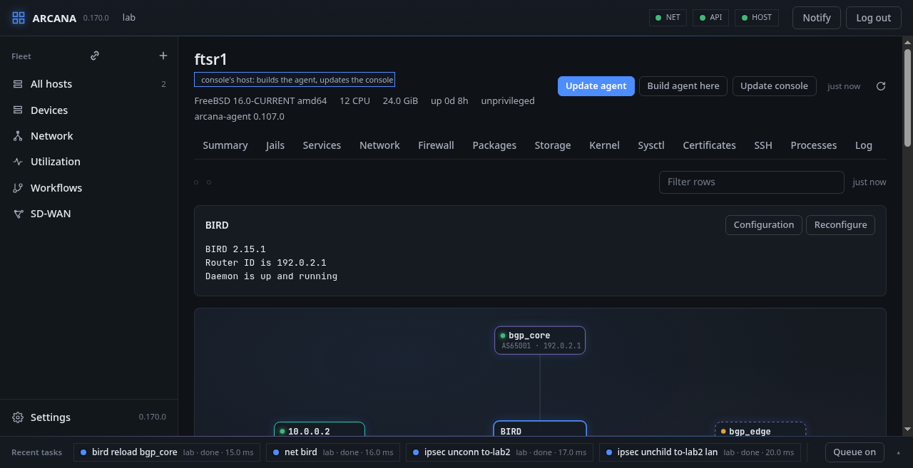
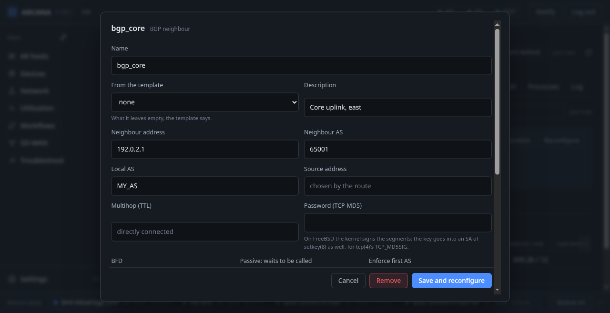

# The plugins

A plugin is what works through a program that has to be installed, not
the base system's:

| Tab | Program | Package |
|---|---|---|
| **WireGuard** | `wg(8)` (the interface itself, `if_wg(4)`, is the base system's, among the interfaces) | `wireguard-tools`; from FreeBSD 15 `wg` is in the base system |
| **BIRD** | `birdc(8)` | `bird3` |
| **IPsec** | strongSwan's `swanctl(8)` (an `ipsec(4)` interface is the base system's) | `strongswan` |

Each has a tab of its own, after the others and marked ◆, on every
host. Where the plugin is not installed (on the host, or in the jail
picked, each marked so in the picker), the tab says which program it
works through and which package has it, with a button that installs it
there with `pkg install`, a job of its own; the tab comes alive once it
is done. Nothing is installed but when that is pressed. **From a
template… → A plugin's package installed** does the same as a workflow.

A jail's programs are looked for as the jail sees them: the agent
attaches to the jail to look, so a link inside the jail leads where it
does there. The picker at the left of the toolbar names the host and
each running vnet jail, and the tab is then of that jail.

## WireGuard

The `wg` interfaces with their peers: endpoint, allowed addresses, last
handshake, traffic.

- **Make its key** has the host make the interface's private key, which
  stays on the host: the console is told, and shows, public keys only,
  and what `wg` prints with keys in it is kept out of the trace.
- **+ peer** adds a peer by its public key; the cross removes one.
- **✎** on a peer opens its form with what it has (endpoint, allowed
  addresses, keepalive), its key fixed: what the form says is what the
  peer has after. A keepalive of 0 turns it off.
- Every public key, the interface's and each peer's, is shown whole,
  with **Copy**.
- **+ interface** opens the interface form with wg chosen.
- **+ client** makes a client of the interface, a phone or a laptop:
  its name, its address in the tunnel (the next after the peers' is
  offered), the endpoint it reaches the host at (the host's address
  and the interface's port are offered), what it sends through the
  tunnel (`0.0.0.0/0, ::/0` for everything, the tunnel's network alone
  for a split tunnel), DNS and a keepalive. The console makes its key
  pair and keeps neither half: the host gets the public half as a
  peer, and the page shows the client's configuration for `wg-quick`
  once, with **Copy**, **Download** (`<name>.conf`) and a QR code the
  WireGuard app scans (*Add a tunnel*, *Scan from QR code*). Closed,
  it is gone: a lost one is a client made again, the old peer removed.
  **With a preshared key** (on by default) adds a second secret the
  console makes with the key pair: in the client's configuration as
  `PresharedKey`, and given to the host's `wg` in a file there only
  while it is read, in no title, argument or trace.
- **↻** on a peer gives that client a new key: the same form, its
  addresses and keepalive kept, a new configuration and QR code; the
  new peer is added, then the old key's taken away.

Kept for a boot, an interface is written with its key, addresses and
peers to `/usr/local/etc/wireguard/<if>.conf` for `wg-quick`, readable
by root alone, and named in `wireguard_interfaces`: that needs the
`wireguard-tools` package.

## IPsec

strongSwan, IKEv2 only: every connection Arcana writes says `version =
2`.

### Keys and certificates

**Make its key** has the host make a key of its own, ECDSA P-256, whose
private half stays on the host; the tab shows the public half, which is
what a peer is given: two hosts know each other by their keys, no CA
between them. Where there are certificates, the tab reads them from
swanctl's `x509` and `x509ca` and lists them with each one's subject,
names and expiry, so that a peer is known one of three ways: by its
public key, pasted; by its certificate, picked from `x509`; or by a CA
that signed its certificate, with the peer's identity saying which.
This host can use a certificate of its own from `x509` too.

**At boot** keeps strongSwan started with the host
(`strongswan_enable`), and **Start** starts it when it is not running.

### Connections and children

**+ connection** joins this host to another between two addresses,
with one child in **tunnel** mode or in **transport** mode, where what
is sent between the two addresses is protected as it is: a gre, gif or
WireGuard tunnel between them, the traffic named as `192.0.2.1[gre]`.

A connection is the IKE side, the two addresses and how each is known;
its children are what it carries, each in its own mode between its own
traffic selectors. **+ child** adds one, the cross on a child takes it
away. With a **reqid** a child serves the `ipsec` interface made with
that reqid: tunnel mode, the interface's routes deciding what goes
through it.

A connection is written as `swanctl/conf.d/arcana-<name>.conf`, with the
peer's key in `pubkey` when it is known by its key, and strongSwan reads
them all again; if it refuses, the files are put back as they were. The
table has each connection with its children, its SA's state and
algorithm, and its traffic; **Up**, **Down**, and the cross, which takes
it away, its SAs ended first.

### In a jail

In a vnet jail, strongSwan is the jail's own, installed in it: its key,
its `swanctl/conf.d` and its `strongswan_enable` are beneath the jail's
root, and `swanctl` and the rc.d script run in it. The kernel's IPsec is
the host's: built in, or `ipsec.ko` loaded on the host, since a jail
cannot load a module; the tab says so when it is not there.

From a shell: `arcanactl ipsec init | start | conn | child | unchild |
unconn | up | down`.

## BIRD

The routing daemon drawn in the middle, and around it its BGP
neighbours (their AS and address), its OSPF neighbours and its RPKI
caches, each coloured by its state. Under the protocols, the **BFD
sessions**: each neighbour that asked for BFD, on which interface, and
whether it still answers.

A neighbour picked opens in a box: what the daemon says of it (session,
timers, each channel's table, its import and export filters, how many
routes came and went), **restart**, **reload**, **disable** and
**enable**, and the part of the configuration that makes it, to be
changed there. Each channel's import and export filter is chosen from a
list of the filters the file has, with `all` and `none`.

### The configuration

Under it, what the configuration is made of, read from the host:

- **filters and functions**, what BGP and OSPF take in and give out,
  each edited as it is written;
- **communities and sets**, the named lists filters test against, one
  entry a line, a community as `(AS, value)` and a large one as `(AS,
  a, b)`;
- **RPKI**, the caches with their state and the ROA tables, and **+
  cache**, which adds the tables, the protocol and a function
  `rpki_invalid()` for filters to ask;
- the protocols and the rest, with **+ BGP neighbour**, **+ OSPF** and
  **+ BFD**, each a form (below).

**Configuration** edits the whole file; a configuration in several
files has a list to pick from. A change is put back as the whole file
with that part changed. The host has `bird -p` parse the whole
configuration first: what it refuses does not stay, the box says what
bird said, and what was typed is kept. Then BIRD is told to read it. The
file as it was is kept beside it as `<file>.arcana-old`.

### BGP, OSPF and BFD, each a tab

Beside **All**, a tab a protocol. Each lists the protocols of its kind
in the file, with what they say in short (the neighbour and both ASes,
the OSPF area and its interfaces, BFD's interfaces), BIRD's state for
each, the routes in and out and the last error. OSPF's tab also has the
neighbours BIRD has, BFD's the sessions.

Each kind is made and changed with a form instead of text:

- **BGP**: the template it is made from (what the form leaves empty,
  the template says), the neighbour's address (a link-local one with its
  interface, `fe80::1%em0`) and AS, the local AS (a number, or a name
  the file defines), the source address, multihop, the TCP-MD5
  password (written with `authentication md5`; on FreeBSD the kernel
  signs the segments, `tcp(4)`'s `TCP_MD5SIG`, so the key goes into an
  SA of `setkey(8)` too); BFD, passive and enforce first AS, each on,
  off or left to the template or BIRD; for IPv4 and IPv6 each, whether the
  session carries it, the import and export (`all`, `none` or a filter
  of the file) and next hop self;
- **OSPF**: OSPFv2 or v3, IPv4 or IPv6, import and export, ECMP, the area and
  up to six interfaces (a name or a pattern), each with its cost, type
  (broadcast or point-to-point), hello and dead times, BFD and stub;
- **BFD**: what sessions it accepts (IPv4 or IPv6, direct or multihop),
  up to six interfaces with their least receive and send
  intervals and the multiplier, and neighbours of its own, each with an
  interface, a local address and multihop (which needs the local
  address).

A protocol the form cannot show whole (a comment in it, a filter
written in it, an option the form has no field for, a BGP channel that
leaves its import or export to BIRD's default) is not read into it: it
is changed as text, so that nothing of it is lost. What the form writes
goes through the same check, `bird -p`, and the same safe mode as any
change.

### BIRD's own safe mode

A change is made in safe mode unless that is turned off beside
**Configuration**: BIRD is told to take the new configuration back by
itself (`configure timeout`, for the host's rollback timer), and a few
seconds later the page says that it stays (`configure confirm`), which
it can only do if the console still reaches the host. If it cannot,
BIRD goes back to what it ran when the time is up, and the host puts
the file back as it was. While a change waits, another is not taken.

A BIRD that does not take a configuration leaves the file as it was.
One that stops answering while it is told is not undone: the file
parses, and stays for BIRD to read when it is started again; the host
starts nothing by itself.

### Routes

**Routes** shows what BIRD's tables hold: for a prefix, or for an
address the route that covers it; those learned from a neighbour or
sent to it; those of one table; and what they carry, a BGP route's path
and communities. More than 2000 routes are not fetched, and the count
is said instead.

From a shell: `arcanactl bird routes …`, `arcanactl -s bird config -w
file`, `arcanactl bird confirm`.
