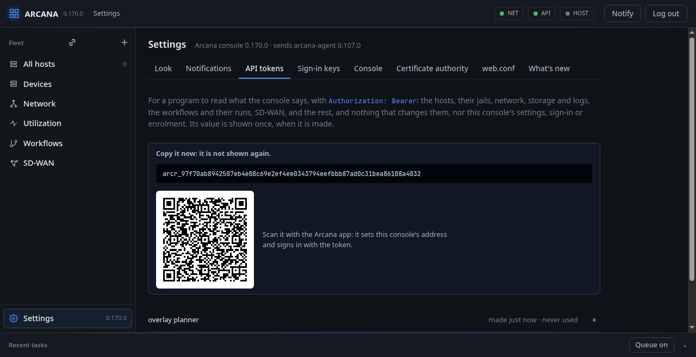
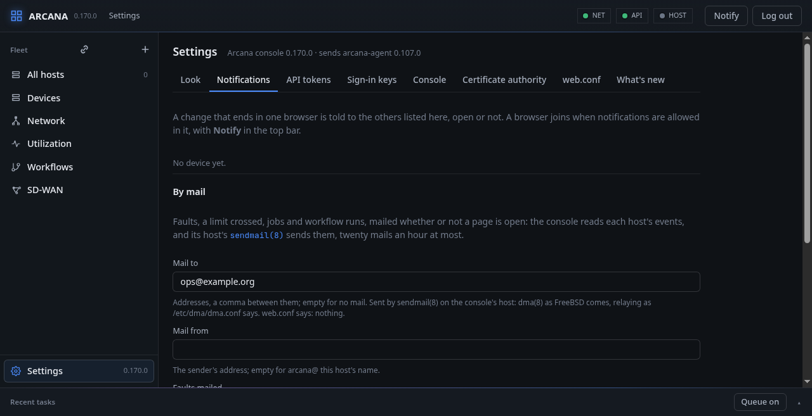
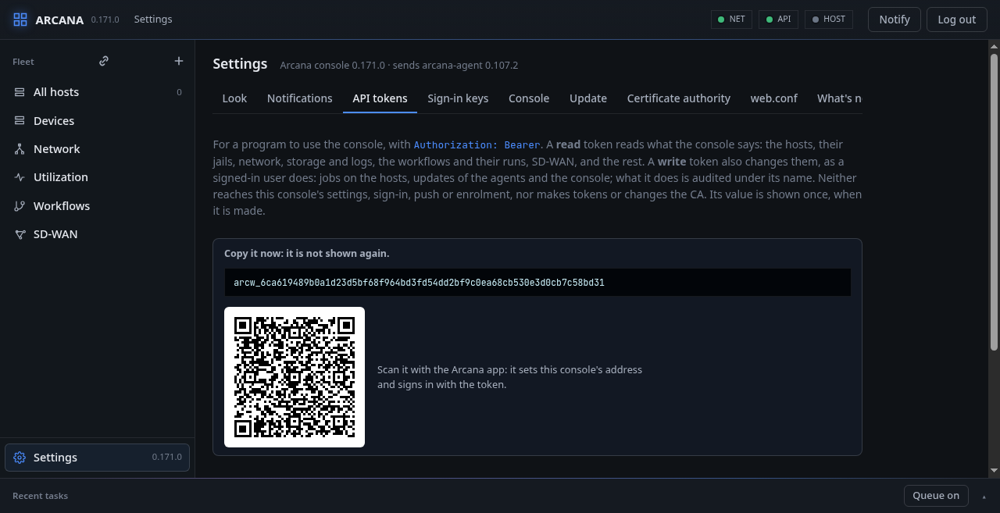
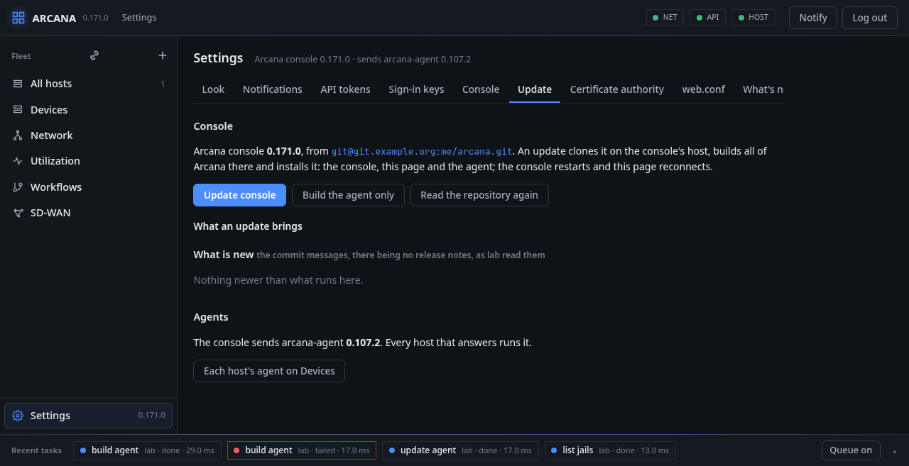
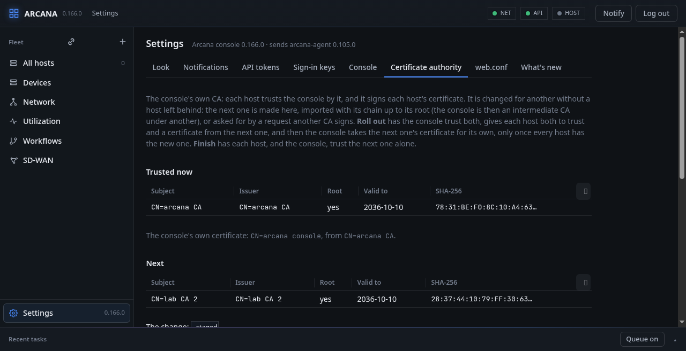

# Settings

**Settings** is a section of its own, at the foot of the tree, with a
tab for each part: **Look**, **Notifications**, **API tokens**,
**Sign-in keys**, **Console**, **web.conf** and **What's new**. It
opens with no host as well, and its head has the console's version and
the agent's it sends.

## Look

The themes. **Graphite**, the default everywhere, is calm: surfaces of
one hue, one blue for what can be acted on, green, amber and red for
how things are, a plain face for reading and the fixed one for what is
read character by character (addresses, keys, code). Slate, Onyx
(black, white and one red) and the light ones, Paper, the warm Sand,
the cool Mist and the green Mint, are drawn the same way in their
colours. The neon ones, Tron, Amber, Matrix and Synth, are the console
on the dark grid it began as: glow, a display face, capitals spaced
out. The one picked takes at once and is kept in that browser.
**Motion** turns the blur and the idle animations off or on.

A theme is a set of colours in `web/style.css`
(`html[data-theme="…"]`): the accent, the surfaces and the text, which
everything else is drawn from.

## Notifications

**Notify**, in the top bar, allows a notification when a task that
took more than ten seconds ends, and has this browser told of changes
made in the others; once allowed, the same button turns them off and
on again for this browser. This tab lists the devices told (see
[Notifications on other devices](panel.md#notifications-on-other-devices))
and removes one.

### By mail

The console can also mail what happened on the hosts, whether or not a
page is open. It reads each host's events, and mails:

- **faults** of the chosen severity or worse (Critical, Major, Minor or
  Warning; *none* for no fault mail), and their clearing;
- **limits crossed**: a figure of history (CPU, memory, a disk, a
  jail's) going over its limit, and back under;
- **jobs**: the failed ones, all of them, or none;
- **workflow runs**: the failed ones, all of them, or none.

What happens within one read goes out as a single mail, and at most
twenty mails go out an hour; the rest wait for the next. A host is read
from its newest event the first time, so nothing from before is
mailed. **Mail to** takes addresses, a comma between them; empty sends
no mail. **Send a test mail** says at once whether mail gets through.

**FreeBSD:** the console's own host sends the mail with
`sendmail(8) -t`. As FreeBSD comes, that is `mailwrapper(8)` handing it
to `dma(8)`, the DragonFly Mail Agent, which delivers or relays it as
`/etc/dma/dma.conf` says (`SMARTHOST`, `PORT`, `SECURETRANSFER`,
`AUTHPATH`). Arcana sets up no mail server. In `web.conf`, `sendmail`
names another program, and the `mail_*` keys set what the page starts
from.

**Mail sent by** chooses the way. *sendmail* is the host's own, above.
*smtp* has the console hand the mail to a relay itself, for a host whose
`dma(8)` relays nowhere:

- **SMTP relay** and **port**: 587 with *starttls* (RFC 3207), 465 with
  *tls* from the first byte (RFC 8314), 25 with *none*, for a relay of
  your own network;
- the relay's certificate is checked against the system's CAs
  (`/etc/ssl/cert.pem`, made by `certctl(8)`) and against its name, with
  TLS 1.2 at least; one that does not check out is not sent to;
- **SMTP user** and **password** sign in (AUTH PLAIN, RFC 4954), over TLS
  only: with *none* a password is refused, not sent. The password is
  kept in the data directory's `settings.json`, readable by the console
  alone (0600); it is never sent back to the page, which says only
  whether one is set, and left empty when saved it stays as it is.

Each step waits fifteen seconds at most, so a relay that does not answer
delays the mail no longer.

### By Telegram

The same, as messages a bot of yours writes to your chats, each way with
its own choice of what it tells (**Faults to Telegram** and the rest,
as for mail): mail may take everything and Telegram the Critical alone.

1. Make a bot: talk to **@BotFather** in Telegram, `/newbot`; it gives
   the bot's **token**, which goes in **Telegram bot token**.
2. Write to the bot once (or add it to the group), so that it may write
   back: a bot cannot start a chat.
3. **Telegram chats**: the chats' ids, a space between them; yours is
   what **@userinfobot** says, a group's is negative, a channel may be
   named `@itsname`.
4. **Telegram sent from**: the host whose agent sends the messages, one
   that reaches `api.telegram.org`; or the agent beside the console.
5. **Send a test message**.

The console does not talk to Telegram itself: it reaches the world
outside through an agent (its luxuria part), which posts each message
to the Bot API's `sendMessage` over HTTPS with the base system's
`fetch(3)`, checking the server's certificate against the host's CAs
(`certctl(8)`'s). The token is kept in the console's `settings.json`
(0600) like the SMTP password, is never sent back to the page, and is
sent to the agent for each message only: the agent neither keeps nor
logs it, and its trace names the chat, not the token. At most twenty
messages go out an hour; what does not fit one message (4096
characters) is cut. From a shell: `ARCANA_TELEGRAM_TOKEN=... arcanactl
notify <chat> <text>`.

## API tokens

Bearer tokens for a program to use the console through the API
without a passkey. One is made with a name and a kind, chosen beside
the name, and its value is shown that once; the console keeps only its
SHA-256 in `tokens.json`, with its kind and when it was last used. The
list marks each **read** or **write**.

- A **read** token (**Reads**, sent as `Authorization: Bearer arcr_…`)
  reads whatever the API tells: the hosts, the workflows and their
  runs, SD-WAN, transfers. It changes nothing.
- A **write** token (**Reads and writes**, `Authorization: Bearer
  arcw_…`) also changes things, as a signed-in user does: jobs on the
  hosts, updates of the agents and of the console. It needs none of a
  session's `X-Arcana` and `Origin` checks, since a browser never sends
  a bearer token by itself. What it does is audited under
  `API token <name>`.

Neither kind reads or changes the console's settings, sign-in, push or
enrolment, and a write token may not change the tokens or the CA
(`403`, "an API token may not change this"): a token cannot make
another, add a passkey, or change the repository that is built as
root. `POST /api/tokens` takes `{"name", "kind": "read"|"write"}`, a
read token unless said; `GET /api/tokens` lists each with its `kind`.
Deleted, a token opens nothing at once.

Beside the value, while it is shown, a **QR code** for the Arcana app on
Android: `arcana://token?console=<the console's address>&token=<token>`.
Scanned on the app's first screen, it sets the console's address and
signs in with the token. It is the same secret as the value, and goes
with it.

## Sign-in keys

The security keys and passkeys that may sign in: each can be removed,
and another registered.

### By LDAP

Under the keys, the directory the console may also sign people in by:
its address (`ldaps://ldap.example.org`, or `ldap://…`, on which
StartTLS is required; the server's certificate is checked against the
system's CAs, or the CA file named), the base the users are looked up
under, the attribute that is the user name (`uid`, `sAMAccountName`,
`mail`), a group whose members alone are let in (`member`,
`uniqueMember` or `memberUid`), and the reader the console looks users
up as, or none for an anonymous lookup. The user's own bind, with the
password typed, is what checks it; an empty password is refused before
it is sent, since a directory takes one as an anonymous bind.

With a directory set, the sign-in page offers **Sign in with the
directory**. A session opened so is limited as a token's: it does
everything on the hosts, but the console's own settings, sign-in keys,
API tokens and CA stay with a security key. Five failed sign-ins in a
minute put every sign-in on hold for the rest of it, and each attempt
is in the console's log.

**FreeBSD:** the console speaks LDAPv3 (RFC 4511) itself, BER written
by hand over the base system's OpenSSL, as it speaks SMTP: no LDAP
library is installed for it. The directory may be any: OpenLDAP
(`net/openldap26-server`), Active Directory, FreeIPA.

## Console

The console's own settings: the name keys show, the release check and
its feed, the `arcana-agent` it sends, and the repository and branch a
host builds it from. They are kept in `settings.json` in the data
directory and take the place of `web.conf`'s; a field put back to
`web.conf`'s value follows it again.

How long a sign-in lasts is set here too: **Signed out after, idle**
(minutes, 30 by default) and **A sign-in lasts at most** (hours, 12 by
default); changed, they hold for the sign-ins there are as well.

Whoever can sign in can set the repository, and so decides what is
built and sent to every host as root.

**Rollback timer, every host**: how long a change made in safe mode
waits for the console before the host undoes it, for every host that
has no timer of its own (10 to 3600 seconds; empty, each agent's own
`-w`). The console sends the timer with each safe change, so there is
nothing to push to the hosts and nothing to restart: it holds from the
next change on, on every host the console reaches. Below the form,
**Rollback timer, host by host** says for each host its own timer, its
agent's own (an agent from 0.131 says it), what its next change will
wait and why; **Use every host's** lets a host's own timer go.

## Update

Updating Arcana in one place.

**Console**: the version running and the repository it is updated
from, with what an update brings (as **What's new** reads it). **Update
console** has the agent on the console's own host (the one reached by
a local socket) clone the repository, build all of Arcana as `nobody`,
install it as root and restart the console; the page reconnects by
itself. **Build the agent only** builds `arcana-agent` there without
installing anything, for the console to send to the hosts. **Read the
repository again** reads what is new afresh, not from the five
minutes' copy.

**Agents**: the `arcana-agent` the console sends, how many hosts run
another build, and **Update N agents** to send it to all of them.
**Devices** has each host's agent, with **Update** and **Build** in its
row.

## Certificate authority

The console's own CA, the one it makes in its data directory when
`web.conf` has no `tls` block: each host trusts the console by it, and
it signs each host's certificate. The tab shows the certificates the
console trusts now and its own certificate, and changes the CA for
another without leaving a host behind.

The next CA comes one of three ways:

- **Make one**: a new CA, self-signed, under the name given.
- **Make a request**: a key here and a request (`CA:TRUE`) for another
  CA, yours, to sign. The key stays in the data directory.
- **Import**: a CA's certificate with the CAs above it after it, up to
  the root, and its key (or none, for the request made here). The
  console is then an intermediate CA under your root: it sends the CAs
  between its certificates and the root with them, and the hosts trust
  the root.

**Roll out** then, in this order:

1. The console trusts both CAs, so it reaches hosts under either.
2. Each host is given both roots to trust and a new certificate from
   the next CA (its key made on the host; see the host's
   [Certificate](host.md#certificate)). The host takes each only while
   it still trusts the console's certificate.
3. Once every host has the new certificate, the console takes the next
   CA's certificate and key for its own, the files before kept beside
   (`.before`). If a host did not answer, the console does not switch:
   that host would not trust the console's new certificate and would
   be lost to it. **Roll out** again when it answers; **Roll out with
   force** switches anyway.

**Finish** has each host, and then the console, trust the next CA
alone; the one before is trusted no more. A host not renewed is left as
it is unless **Finish with force**, which leaves it unable to reach.
Each step's outcome for each host is listed as it runs. A CA named in
`web.conf`'s `tls` block is shown, and changed there instead.

**FreeBSD:** the keys, certificates and requests are the base system's
OpenSSL; each agent reads its new files again through cblink without a
restart.

## web.conf

The relying party, the origin, the data directory and the certificates,
shown and changed only in `web.conf`: keys are bound to the first two,
and all are read once, at the start.

## What's new

What the repository the console builds from (`agent_source`) has, read
by the host the console runs on (a bare clone without the files, kept
in its build directory and fetched each time from the repository named
now, so a repository moved to another server is read from there) and kept five minutes: the release notes, where
the repository's tags carry messages, else the commit messages, newest
first. Above the version running is what an update brings, the
version's own commit marked; below it, what this console has. The
update boxes show the same. `GET /api/update/notes?component=console|
agent&from=VERSION[&to=VERSION]` gives it as JSON.
