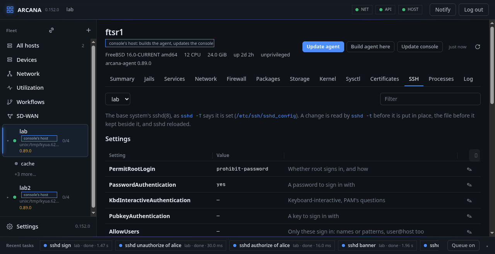
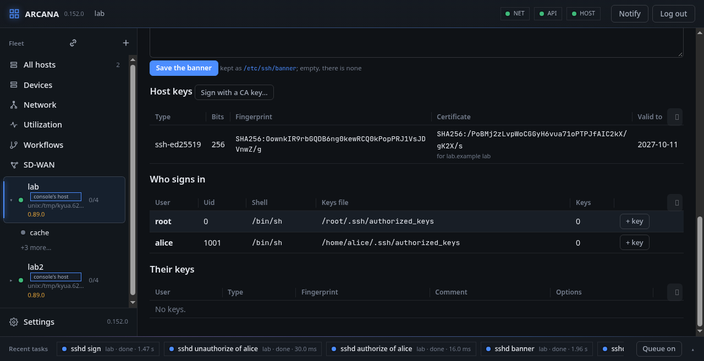

# SSH

The **SSH** tab is the base system's `sshd(8)` on a host, or in one of
its running jails, picked at its left. It shows four things:

- what sshd is set to, as `sshd -T` reports it;
- its banner;
- its host keys and their certificates;
- who may sign in, and with which keys.

**FreeBSD:** every change goes into `/etc/ssh/sshd_config` the same
way. `sshd -t` reads the new file first; what it refuses is not put in
place, and its message is shown. The file as it was is kept beside it
(`sshd_config.arcana-before`), and then `service sshd reload` runs.
Through the API or `arcanactl -s`, a change can be made in safe mode:
unless it is confirmed, the file before it is put back.

## Settings

Each setting shows its value; **✎** changes it:

- `PermitRootLogin`, `PasswordAuthentication`,
  `KbdInteractiveAuthentication`, `PubkeyAuthentication` and
  `X11Forwarding`, chosen from the values sshd takes;
- `MaxAuthTries` and `Port`, numbers (several ports, a space between
  them);
- `AllowUsers`, `AllowGroups`, `DenyUsers` and `DenyGroups`, names or
  patterns (`user@host` too). Leaving them empty takes the line away.

The line goes before the first `Match` block, so it holds for everyone.
The `Match` blocks themselves are left as they are. If `sshd -T` cannot
run (for example without host keys), the page shows what the file says
instead, and says so.

## Banner

The banner is what a client sees before it signs in. It is kept as
`/etc/ssh/banner` and named by `Banner`. Saving it empty sets
`Banner none`.

## Host keys

Each host key shows its type, size and fingerprint (`SHA256:`, as
`ssh-keygen -l` prints it). The agent reads keys and certificates
itself; it does not run ssh-keygen to read them. A host key that has a
certificate shows:

- the fingerprint of the CA key that signed it;
- the names it is valid for;
- the day it ends;
- *not used*, if no `HostCertificate` line names it.

**Sign with a CA key…** signs every host key with your certificate
authority's private key, `ssh-keygen -s … -h` for 52 weeks, for the
principals you give: the names clients reach the host by, one at least,
since a host certificate for no name is good for any. Each certificate is written beside its key and
named by `HostCertificate`. The signing is done on the host, by its
own ssh-keygen, in a directory of `/tmp` that only root can read. The
CA key is there only while ssh-keygen reads it, then overwritten and
removed. For a jail, only its public host keys come out and only their
certificates go in, so the CA key is never inside the jail, whose root
could read it. Neither the console nor the job keeps it. Clients then trust the host through a
`@cert-authority` line in their `known_hosts`, instead of each host's
key.

## Who signs in

The users who may sign in are root and the people (uid 1000 and up)
whose shell lets them in. For each one the tab shows their keys file
(`AuthorizedKeysFile`) and its keys: type, fingerprint, comment and
options.

- **+ key** adds one line of `authorized_keys`, options first if it has
  any. The `.ssh` directory and the file are made if missing, belong to
  the user, and are theirs alone (0700 and 0600). A key they have
  already is refused.
- **×** takes a key out, by its fingerprint.

The directory is opened beneath the user's home and never through a
link, so a `.ssh` that is a link to somewhere else is refused.

From the command line: `arcanactl [-s] [-j jail] sshd [list] | banner
file | set Setting [value ...] | authorize user keyfile | unauthorize
user fingerprint | sign ca-key-file [principal ...]`.
