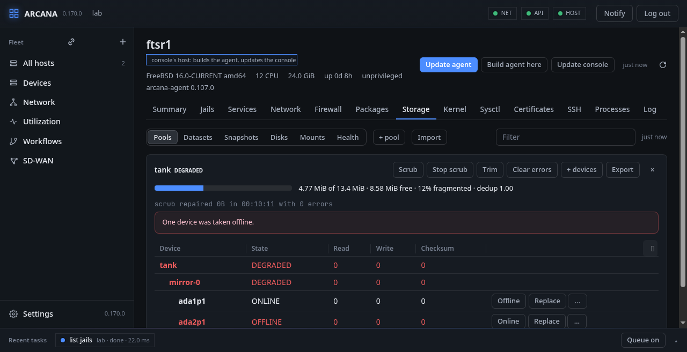
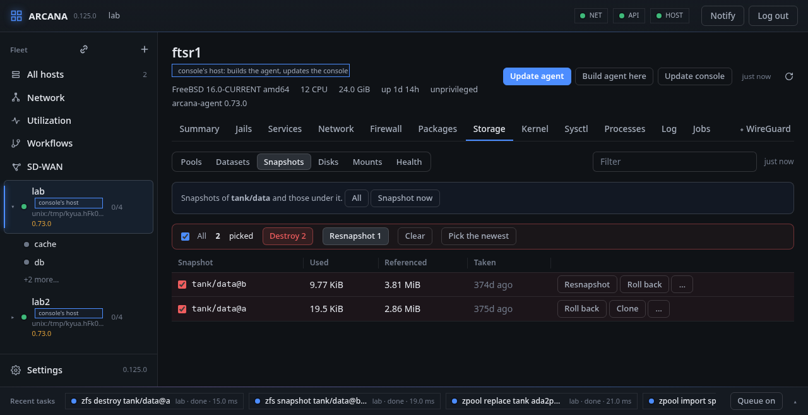

# Storage

**Storage** is ZFS and the disks under it, in six views: **Pools**,
**Datasets**, **Snapshots**, **Disks**, **Mounts** and **Health**.

Every change is a job, and the host checks each word of it before a
program sees it: no word is ever an option, `-r` and `-f` are the job's
own flags, and only the verbs named here exist. Nothing in storage is
done in safe mode, since the host cannot take it back.

**FreeBSD:** `zpool(8)` and `zfs(8)` for pools, datasets and
snapshots, `zfs send` and `zfs receive` to copy them; `gpart(8)`,
`newfs(8)`, `newfs_msdos(8)` and `growfs(8)` for disks and partitions; `camcontrol(8)`
and `nvmecontrol(8)` for the devices; `mount(8)`, `fstab(5)` and
`swapon(8)`.

## Pools

Each ZFS pool with how full and how fragmented it is, its health, what
`zpool status` says of it and of its last scrub, and its devices as
they are nested, with their error counts.

- A scrub is started and stopped, the pool trimmed, its errors cleared.
- A device is taken offline and brought online, replaced by another,
  mirrored by another, or detached from its mirror.
- **+ pool** makes a pool of the devices named, each by itself, as a
  mirror or as raidz1, raidz2 or raidz3, with where it is mounted.
- **+ devices** gives a pool more, as data or as a log, a cache, spares
  or a special device.
- **Import** lists the pools `zpool` finds on the host's devices that
  are not imported, to be picked.
- A pool is exported, and destroyed once its name is typed.

A pool with a dataset mounted where the system lives (the root, or
under `/usr`, `/var`, `/home`, `/tmp` and the like) is never destroyed
or exported from here, and nothing of it is unmounted by force. No pool
is destroyed or exported by force at all: what uses it is stopped
first.

## Datasets

The file systems and volumes as a tree, with what each uses, has
available and refers to, its compression ratio and where it is
mounted. **+ dataset** makes one, a volume when given a size, with
properties as `name=value`; **Set** changes properties, or returns one
to what it inherits; a dataset is mounted, unmounted, snapshotted, and
destroyed once its name is typed. A pool's own dataset is not
destroyed from here.

An encrypted dataset says so, and whether its key is loaded. **Load
key** reads the key from where the dataset's `keylocation` says (a
file, a URL), and **Unload key** forgets it.

A dataset whose key is asked for at a prompt (`keylocation=prompt`)
has **Type the key** when the key is not loaded and **Change key** when
it is. Change key takes the new key twice. The key goes straight to
the host, and not as a job: jobs are kept, and the page keeps what it
sent so it can send it again. `zfs load-key` (or `zfs change-key`)
reads the key from a file in a directory of `/tmp` that only root can
read. The file exists only while zfs reads it, is overwritten after,
and is removed. After a change the dataset's `keylocation` is `prompt`
again, as it was. The key is in no log and no trace, and the console
zeroes its copies when the call ends. A passphrase is 8 characters at
least; a hex key is 64 hex digits; a raw key is never typed. From the
command line: `arcanactl zfskey [-n] dataset`, which asks for the key
at a prompt that does not show it.

**Jail** gives a dataset to a running jail to manage as its own (`zfs
jail`); **Unjail** takes it back.

## Snapshots

The newest first, of all datasets or of one and those under it. A
snapshot is taken with a name (the time, unless another is given), of
everything under the dataset too when asked; rolled back to, cloned
into a new dataset, or destroyed once confirmed.

Each row has a box to pick it, and **All** picks every snapshot the
filter leaves. **Destroy N** destroys those picked as a batch of jobs,
one each, so one refused (a clone was made of it) leaves the others
destroyed.

**Resnapshot**, on the newest snapshot of a dataset, takes it again,
now, under the same name: the new one is taken first under a name of
its own, the old one destroyed, and the new one renamed, so that there
is a snapshot all along. **Resnapshot N** does it to every picked
snapshot that is the newest of its dataset; **Pick the newest** picks
the newest of each dataset shown.

### Replicating

**Replicate** sends a snapshot into a dataset not there yet, on the
same host (another pool, say): `zfs send` into `zfs receive`, all of it
or what changed since a snapshot both have, with the datasets under it
when asked. What arrives is not mounted.

**To** another host sends it there: `zfs send` on this host and `zfs
receive -u` on that one, each as a stream on the connection the console
has with it, the console carrying the bytes at the pace the slower of
the two takes them. Never with `-F`, so nothing there is overwritten,
and never into a pool's own dataset. What is sent between hosts is
listed above the snapshots on both hosts' pages, with what it carried,
how it ended, and **Stop** while it runs; the console keeps the last 32
in `transfers.json`.

## Disks

Every disk as GEOM has it, with what `camcontrol` says it is, and its
partition table drawn to scale and listed. A table is made on a disk
without one (gpt, mbr, bsd); a partition added in the free room,
aligned to 1 MiB, labelled, resized, or deleted once its name is
typed; an empty table destroyed. **Rescan** has `camcontrol` look for
disks that came or went.

On a partition, **newfs** makes a file system, with a label when given
one:

- **UFS**, with soft updates (`newfs -U`);
- **FAT** (`newfs_msdos`), for what other systems read too: FAT32, or
  FAT16 when the partition is too small for FAT32's clusters. Its label
  is 11 characters at most and is written in capitals.

**growfs** grows a UFS file system to its partition's size. The host
refuses newfs while the partition is mounted, swapped on or a pool's
device, and, unless told it may, while it has a file system on it.

## Mounts and swap

What is mounted, with how full, and beneath it what `fstab` says to
mount: an entry that is not mounted is mounted, what is mounted
unmounted (never the root). **Edit** opens `fstab` whole; the host
takes it only if every line is an entry and nobody changed the file
meanwhile, and keeps the one before beside it as `fstab.arcana-old`.

Beneath, the devices the host swaps on, with how much of each is used;
**+ swap** adds one and **Swap off** takes one away, until the next
start, for which swap is a line of `fstab`.

## Health

How each disk says it is: well or failing, its temperature, how long it
has been powered on, how worn it is, and the errors it counts. An NVMe
disk is asked with `nvmecontrol`, any other with `smartctl` when the
host has smartmontools.

From a shell: `arcanactl storage disks | pools | datasets | snapshots
[dataset] | mounts`, `arcanactl zfs …`, `zpool …`, `gpart …`, `mount
path`, `umount [-f] path`, `cam rescan`, `fstab [-w file]`.
