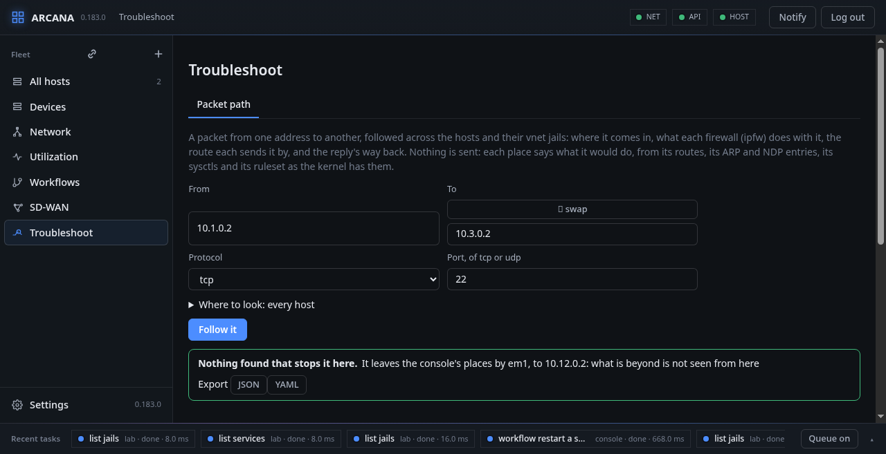

# Troubleshoot

**Troubleshoot**, in the side bar: a packet from one address to another
followed across the hosts and their vnet jails, and what stops it on
the way. Nothing is sent to find it out: each place says what it would
do with the packet, from its addresses, its routes, its ARP and NDP
entries, its sysctls and its firewall's ruleset as the kernel has them
now.

## Packet path

Give the source and the destination (every address the hosts have is
offered as you type, with its host and interface; **swap** turns the
packet round), the protocol (TCP, UDP, ICMP, or any IP) and the port,
and where to look: the hosts, and their running vnet jails that route
as routers do. None ticked, every host is asked. The page's address
names the packet (`#/troubleshoot?src=…&dst=…&proto=tcp&port=22`), to
share or to open from the firewall tab's **Across the hosts ›**.

Where the packet comes in is the place whose address the source is, or
the one on the source's network, coming in on that interface. There it
is asked:

- **does the firewall take it in**: ipfw's ruleset walked for the
  packet, coming in on that interface;
- **does the place forward at all**: `net.inet.ip.forwarding`;
- **is there a route to send it by**, the *send route*: in the FIB of
  the interface it came in on, or the one the firewall's `setfib` gives
  it; a blackhole or reject route is said as one;
- **does the next hop answer**: its ARP or NDP entry;
- **does the firewall let it out** by that interface;
- **does the reply find its way back**, the *receive route*: the route
  back to the source from where the reply comes in, by the same
  interface (symmetric) or another; and does the firewall let the reply
  in and out.

The send route names the next hop (or the firewall's `fwd` another), and
the place that has that address is asked next, the packet coming in on
the interface that has it, until the destination is reached, the next
hop is no place of the console's (it leaves them there), something
stops it, or it comes back to a place it passed (a loop).

The reply is followed the same way, from the destination back, as a
reply: a TCP segment of the connection (not a SYN), an echo reply, from
the service's port. A place it passes that the request did not has no
state of the request: a stateful firewall there (`check-state`,
`keep-state`) drops it, and uRPF (`verrevpath`) on a place the request
came in on by another interface drops the request itself. When the
request and the reply go by different places, that is said as the
asymmetry it is.

What is wrong is said first, worst first, each with its place: the
firewall dropping it (and by which rule; **Its firewall ›** opens that
rule on the host's Firewall tab), no send route, no receive route,
forwarding off, a next hop that does not answer, an asymmetric way
back. A firewall that is off is walked all the same, for what it would
do turned on, and said to be off; nothing of it stops the packet.

Then the way is drawn: the source at the left, the destination at the
right, each place passed as a box between (its name, the interface it
comes in on and goes out by, its FIB, two dots for what its firewall
does coming in and going out, "asymmetric" when the reply would go
back another way), the request's way above the boxes left to right and
the reply's below, right to left, dashed. Where either is stopped the
arrow ends in a bar and the box is red; where it leaves the hosts asked
the arrow goes on, dotted, to the next hop. A place the reply passes
that the request did not gets a box of its own. A box pressed opens the
host's page, its jail's. Below the drawing, the way there and the way
back, place by place: where it comes in, each firewall's verdict with
its rule (the rule's text when hovered), the route, the next hop, and
each place's own check. The whole can be exported as JSON or YAML.

**FreeBSD:** the ruleset is the kernel's, as `ipfw list` and `ipfw table
all list` print it, and the walk follows `ip_fw2.c`: `count`, `reass`
and `setfib` go on, `skipto` jumps forward, `call` pushes the rule and
jumps and `return` comes back to the rule numbered after it (or the
next rule, `next-rule`), as `O_CALLRETURN` does, `check-state` and the
first `keep-state` look the flow up, `verrevpath`, `versrcreach` and
`antispoof` by the routes, `me` by the place's addresses, a table by its
longest entry, `tablearg` by the entry's value. A rule the walk cannot
judge for a packet that was never sent (a socket's `uid`, a `tag`, a MAC
address) is named as uncertain, never guessed. The routes are netlink's
`RTM_GETROUTE` per FIB, the neighbours `RTM_GETNEIGH`; a vnet jail's
are read from inside it. The walk is tested against the kernel: packets
sent at a ruleset in a vnet jail move the counter of the rule it names.

The agent's `path-check` answers for one place: `arcanactl
[-j jail] path-check [-r] [-F fib] [-i interface] [-p proto] [-P port]
src dst`.
