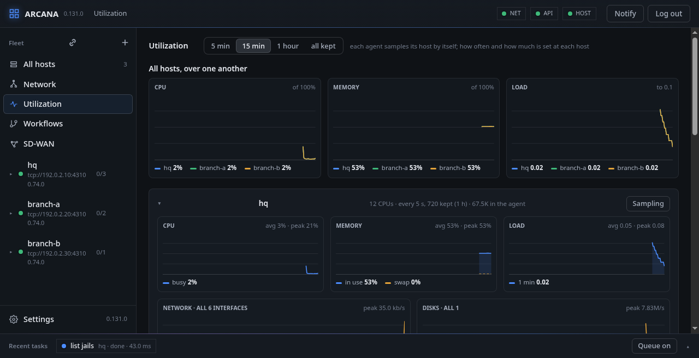
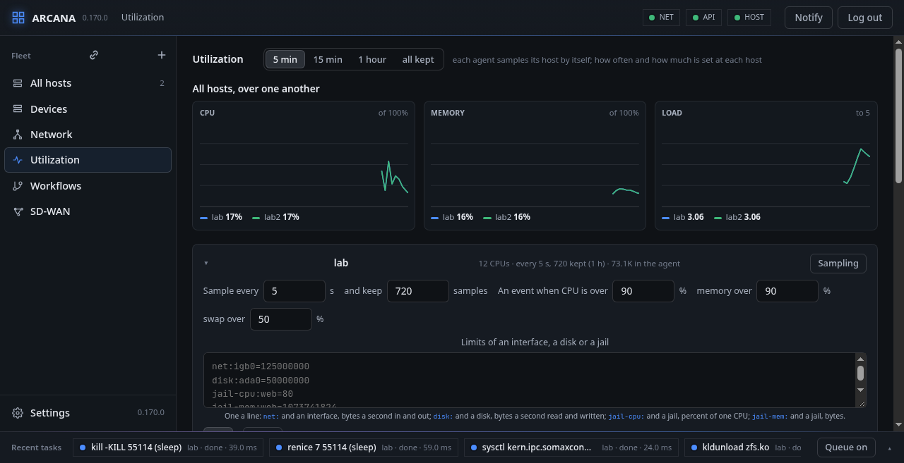

# Utilization

**Utilization**, in the side bar, is how busy every host has been, as lines
over the last five minutes, quarter of an hour, hour, or all that is
kept. With more than one host, their CPU, memory and load are first
drawn over one another, a colour each. Then each host has a box of its
own, which folds: the CPUs' busy share, the memory in use with the swap
as a dashed line, the load, what the network received and sent, and
what the disks read and wrote, each with its average or peak over what
is shown. A gap in a line is when the host was not sampled.



Under **Network** are the host's interfaces, without the loopback, each
with what goes over it now: **all** draws them added up, one pressed
draws that one; a bridge and its members are each counted, so **all**
counts a bridged packet more than once. Under **Disks** the same for
each disk. Each running jail's share of the CPUs and its memory are
drawn under the disks, a jail picked at a time.

## Sampling

Each agent looks at its host by itself, every five seconds and an hour
of it unless told otherwise, so the lines are there when the page is
opened; while it is open, what came since is added.

**Sampling**, at a host's name, says how often its agent looks and how
many samples it keeps, with what that takes of the agent's memory
(about 70 KiB for the hour on a host with five interfaces and three
disks), and sets both; with 0 kept the agent does not sample at all.
The agent keeps what it was told in `/usr/local/etc/arcana/history.conf`,
and the samples beside it when it stops and every five minutes, so a
restart of the agent keeps the graphs.

Once every sample is there, the older ones are thinned rather than
dropped. In the older half, the two samples closest together (after the
oldest) become one: the later one's time, each figure the mean of the
two, weighed by the time each stood for. The newer half keeps every
look, and the older samples are fewer and further apart the older they
are, so the same memory reaches further back. Once the older half is 64
looks apart, the oldest sample is dropped instead: at the default 5
seconds and 720 kept, that is about a day and a half. A gap is drawn
only where the host was away: a gap wider than the looks around it.



## Limits

The same form sets the limits: a CPU, memory or swap figure over its
limit makes an event, and another when it is back under (five points
lower), listed under events in the Log tab; the defaults are 90, 90 and
50 percent, and 0 is no limit. **A file system over** (90 percent by
default) is looked at each minute: each ZFS pool, its allocated share
of its size as `zpool list` has it, and each other local file system
that holds data, as [df(1)](https://man.freebsd.org/df/1) has it ([statfs(2)](https://man.freebsd.org/statfs/2)); one over it is
an event and a storage fault (Mplify 119's resource faults, listed
with SD-WAN's faults). **Limits of an interface, a disk or a
jail**, a line each, do the same for one of them:

```text
net:igb0=125000000          bytes a second, in and out together
disk:ada0=50000000          bytes a second, read and written
jail-cpu:web=80             percent of one CPU
jail-mem:web=1073741824     bytes
```

Back under is a tenth lower. A workflow can start on such an event
(`threshold`).

From a shell: `arcanactl history`, `arcanactl history set seconds
samples`.

<div class="freebsd">

**FreeBSD:** CPU and memory come from `sysctl(3)`, interfaces from
`getifaddrs(3)`'s counters, disks from `devstat(3)`; a jail's share is
the kernel's resource accounting, `rctl(8)`'s, which needs
`kern.racct.enable=1` in `/boot/loader.conf` and a reboot (the page
says so when it is off).

</div>
