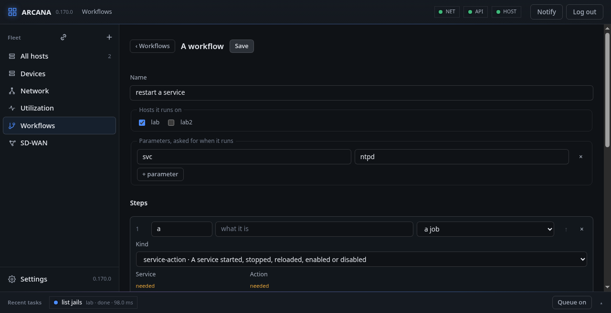

# Workflows

A workflow is a chain of steps the console keeps and runs on several
hosts at once, by hand, at an interval, or on an event.

## Steps

A step is one of three things:

- **A job** of any kind, its fields those `share/arcana/jobs.yaml` says
  the kind needs (first, marked) and uses (under **More options**). Each
  field is the control its kind calls for: a choice in words where it is
  one of a few (pkg's network: *IPv4 only*, *IPv6 only*), a box for yes
  or no, a number, a jail of the fleet's hosts; its help is under it.
  The build checks that file against `arcana.yaml`'s kinds of job and
  their attributes, and stops where they differ.
- **A read** of the host (hello, jails, services, stats, events,
  history, packages) whose answer a later step looks at.
- **One of Arcana's own**, from the repository the console builds from
  (`agent_source`):
  - **is its repository newer** asks the step's host for the commit at
    its head (`git ls-remote`, nothing cloned) and answers
    `new_agents`, `new_console` and `new`, each true when the head is
    not what the agents, or the console, were last updated to;
  - **build the agent** has the host build `arcana-agent`, kept by the
    console;
  - **update every host's agent** sends it to every host, each
    restarted with it;
  - **update the console** builds and installs all of Arcana on the
    console's own host, the console restarting once the step has
    ended.

Steps are put in another order by dragging them by their number, or one
earlier with ↑.

## Conditions, failures and values

**Only when…** puts a condition before a step: a read made then, or
what an earlier step answered, a path in it (`jails[name=web].state`,
`host.hostname`) and a test (eq, ne, contains, gt, lt, exists,
missing). A step whose condition fails is skipped.

**When it fails**, the host's run stops, goes on, or goes on at a later
step, those between not run.

A field holds a value of its own. **{x}** beside it makes it an
expression instead, with what can be put in it to pick from: the
workflow's parameters, the host's name and id, what an earlier step
answered. **{x}** again makes it a value of its own, the expression
gone. An expression that comes out a number is one, for a field that
takes a number. A value may be:

| Value | Is |
|---|---|
| `${param.NAME}` | asked for when it runs, its default offered |
| `${host.id}`, `${host.name}` | the host the step runs on |
| `${step.ID.PATH}` | what an earlier step answered |
| `${event.PATH}` | of the event that began the run |

## When it runs

- **By hand**: **Run**, on the hosts picked.
- **Every** so many seconds, a minute to a week. The interval counts
  from when the workflow last ran by it, kept in `every.json` across
  restarts of the console.
- **On** events: those the console sees itself (a host that stopped
  answering, `host-down`; that answers again, `host-up`) and those the
  host tells (a jail made or removed, `jail-state`, with `jail` and
  `state` running or stopped; a program that crashed, `crash`, with
  `process`, `jid` and `signal`; `threshold`, `kmsg`, `link` and the
  rest), each with what it must match (`what=mem`). A value to match
  may be a parameter, `${param.process}`: its default is what is
  matched, an empty one matching any. An event's run is on the host it
  happened on.

**FreeBSD:** a jail's coming and going is the kernel's word, kqueue(2)'s
`EVFILT_JAIL`: the agent is told of each jail made (`NOTE_JAIL_CHILD`)
and removed (`NOTE_JAIL_REMOVE`) as it happens, so no run waits for a
look at the jails. A crash is the kernel's too: a process that dies
of a signal that dumps core (SIGSEGV, SIGABRT, SIGBUS…) is written to
the message buffer, `pid 812 (nginx), jid 0, uid 80: exited on signal
11`, while `kern.logsigexit` is 1, as it is unless set off; the agent
reads the buffer each second and tells each such line as `crash`.

The console subscribes to the events of each host a workflow waits on,
so a run begins as soon as the host tells, and a host that goes is
`host-down` at once; what a host said while it was not heard is read
when it answers again. A workflow that runs by itself may hold a step
that destroys (a dataset, an interface, a partition table) only when
**It may destroy, by itself** says so.

## Runs

Each run is listed with what began it and how each host's went. A run
is drawn as its chain, a row for each host, each step coloured by how
it went; a failure that goes on at a later step is drawn as an arrow
under the row from the one to the other, bright when the run took it.
A step picked shows its trace.

## Templates

What waits in the queue becomes a workflow with **As a workflow**, and
**From a template…** starts one made already, to be looked over and
saved:

- **Arcana kept up to date** from its repository: every hour the check,
  then the agent built, sent to every host, and the console updated,
  each only when the head is newer;
- **a jail started again** when it stops;
- **packages upgraded** every week;
- **every jail's packages upgraded** every week: the host's, then every
  running jail's, one after the other (the job's jail *every running
  jail*, `*`): a jail without `pkg(8)` is left out, and one that fails
  does not stop the rest, the job's error naming each that failed;
- **a service restarted when it crashes**: the service, and the name
  its process goes by (the same, mostly; `postgres` for postgresql),
  are parameters; a crash of that program on the host itself, not in a
  jail (`jid` 0), restarts the service;
- **a service restarted** when its host answers again;
- **a plugin's package installed**, the package a parameter.

The console keeps the workflows in `workflows.json`, the last 30 runs
in `runs.json` with each run's traces in a file of its own under
`runs/`; what runs by itself is started by one worker of the console's,
the one holding `workflows.lock`.
