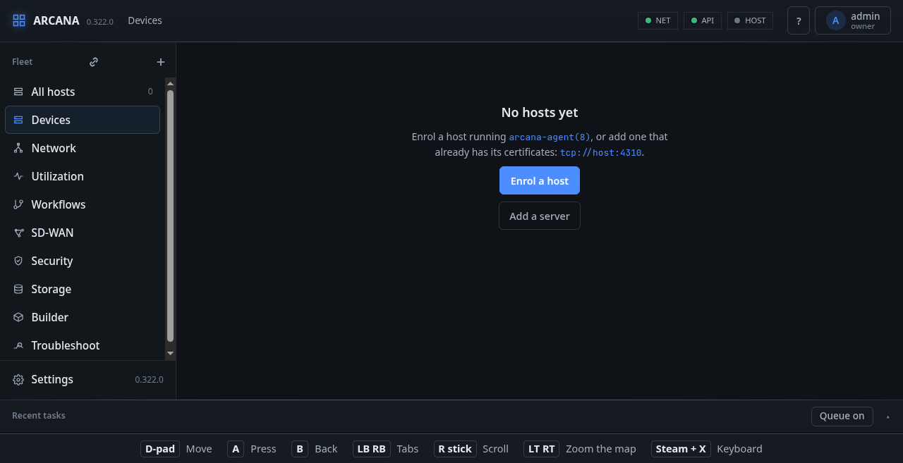

# With a game controller

The panel can be used by a game controller alone: a Steam Deck in its
Game Mode, with the console added to Steam as a non-Steam game (or
installed as an app and opened from there), or a controller on any
computer. The page reads it through the browser's Gamepad API; as soon
as a button is pressed it shows a visible focus, makes its controls a
thumb's size for the Deck's 1280×800, and says at the foot of the screen
what each button does:

| Button | What it does |
|---|---|
| D-pad, left stick | Move the focus to the nearest control that way |
| A | Press it; on a field, type (Steam + X brings the screen's keyboard) |
| B | Close a dialog, else go back |
| LB, RB | The tab before or after; on a page without tabs, the side bar's page before or after |
| Right stick | Scroll; on the network map, pan it |
| LT, RT | Zoom the network map out or in |

A choice in a list takes the next one at each press of A. Using the
mouse or a finger puts the controller's look away until the controller
is used again.

