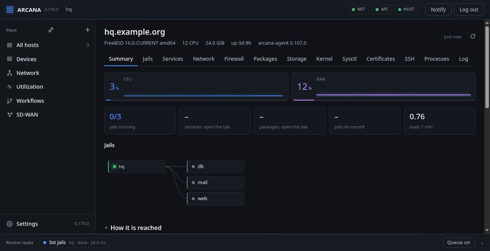

# The fleet and a host

## All hosts

After you sign in, the panel opens on **All hosts**: how many hosts
answer, how many of their jails run, and a card for each host with its
CPU, memory and ZFS use and its FreeBSD version.

The panel has three parts that stay put wherever you go:

- **The side bar** on the left: the fleet's pages (All hosts, Devices,
  Network, Utilization, Workflows, SD-WAN) and Settings. What you pick
  there decides the page. The two icons at its top are **Enrol a
  host** and **Add a server**.
- **The top bar**: three lights for the network, the console's API and
  the host picked; **Notify**, to have the console's notifications on
  this device; and **Log out**.
- **The activity bar** at the foot. Every call the panel makes to a
  host is a task there, newest first. Opened (see [Jails](jails.md)),
  a task shows its *graph*: the API call, the session check, the cblink request
  and then each call the agent made on the host. Beside it, the call's
  **CBOR schema**, the exact shape of what was sent and answered.

## A host

Pick a host on **Devices** or **All hosts**. Its page has a header and
a row of tabs.

The header says what the host is: its name, FreeBSD's version and
machine, its CPUs and memory, how long it has been up, and the agent's
version. The host the console runs on carries the **console's host**
label: it also builds the agent for the others
(**Build agent here**) and updates the console itself (**Update
console**). **Update agent** appears when a host runs another build than
the one the console has.

**Summary** gathers the rest at a glance: CPU, memory and ZFS as they
are now, with a short history; counts of jails, services, packages and
jobs; the ZFS pools; and the jails as a graph.

The tabs, left to right, are this part's chapters: **Jails**,
**Services**, **Network**, **Firewall**, **Packages**, **Storage**,
**Kernel**, **Sysctl**, **Processes**, **Log** and **Jobs**, then the
plugins, marked with a diamond: **WireGuard**, **BIRD** and **IPsec**.

**FreeBSD:** the header comes from `uname(3)` and `sysctl(3)`; the
usage figures from the kernel's resource accounting and
`libprocstat(3)`, sampled by the agent every few seconds and kept on
the host.

