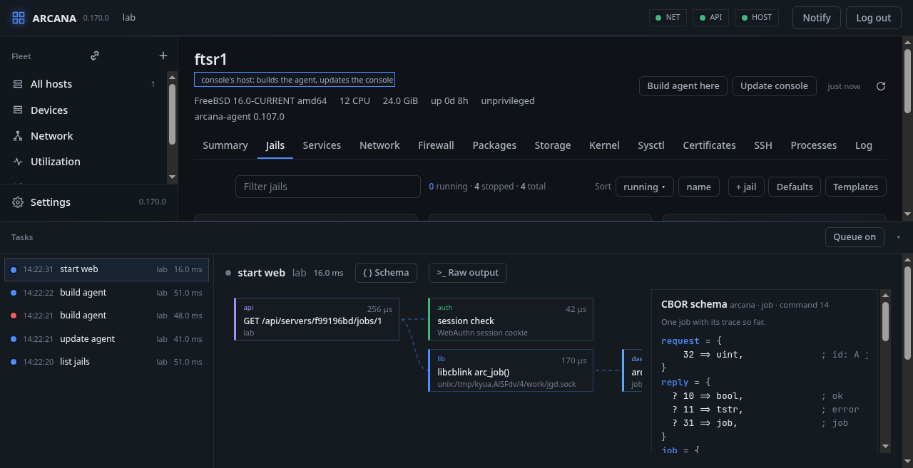
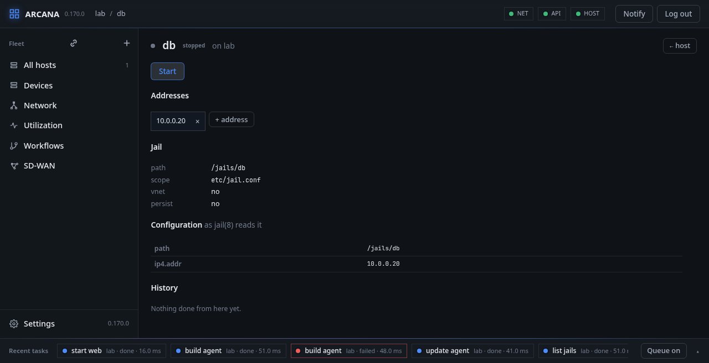
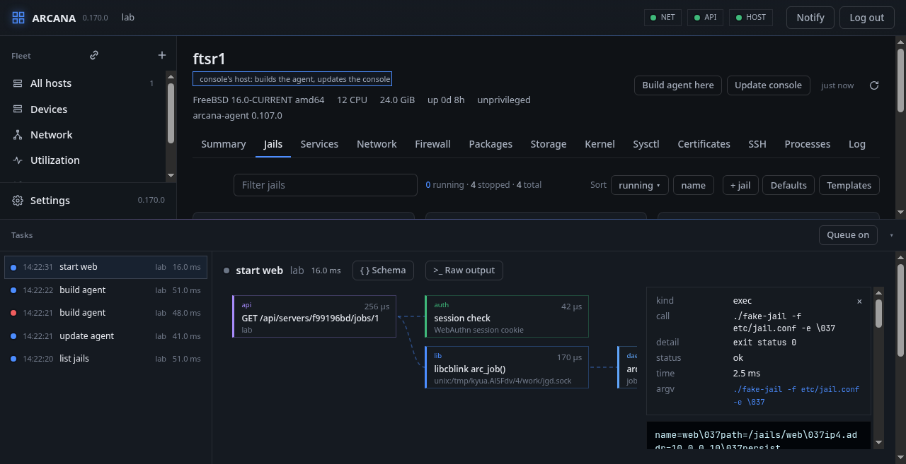

# Jails

**Jails** lists every jail the host knows of: those running, from the
kernel, and those only configured, from `jail.conf` and the files it
includes. Each shows its state, addresses and path, and they sort by
whether they run or by name, and filter as you type.

**Start**, **Stop**, **Restart** and **Kill** are on each jail. A press
sends a *job*: the agent on the host does the work and keeps the result
until it is read. In the picture the jail `web` was started; its task in
the activity bar shows the call as it went, down to the agent.

## A jail's page

Pick a jail on its host's **Jails** tab for its own page.

- **Addresses**: each with a cross to take it away, and **+ address** to
  add one, live (on the running jail) or in `jail.conf`, or both.
- **Jail**: where it lives, which configuration file defines it,
  whether it has a network of its own (vnet), whether it persists.
- **Configuration as jail(8) reads it**: the parameters, after
  `jail.conf`'s defaults and includes are applied.
- **History**: what was done to this jail from the console.

## What a change did

Pick a box of a task's graph to see what it was. Here, the agent ran
`jail(8)` to start the jail:

Each box says what kind of call it was (a library call, a system call,
a program), how long it took and how it ended. A program's box has its
arguments, exit status and output; **Raw output** shows them verbatim.
Nothing is hidden, and nothing is summarised away: this is how you
learn what the panel does on your behalf.

**FreeBSD:** running jails come from `libjail(3)`
(`jailparam_get(3)`), configured ones from `jail.conf(5)` read by
Arcana's `libjailconf`; starting and stopping is `jail(8)` itself, and
an address kept for the next start is written into `jail.conf` in
place, keeping its comments and layout.

