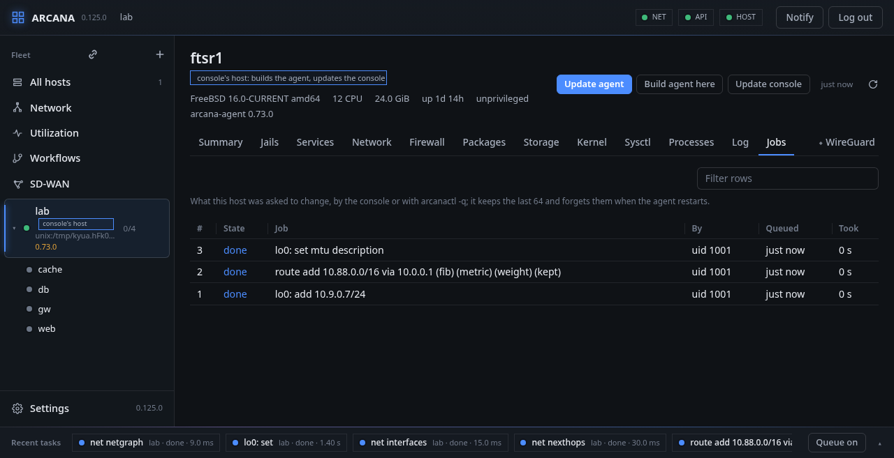
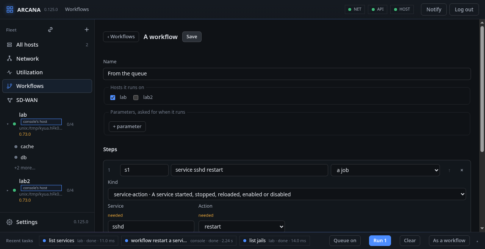
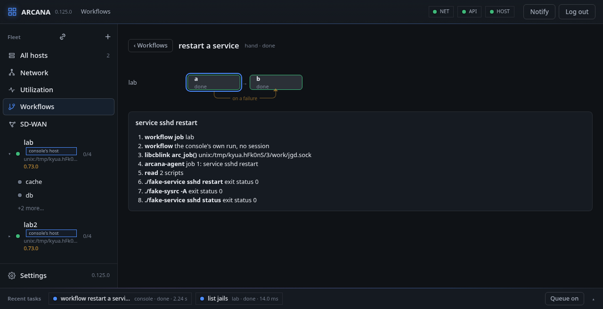

# Jobs, the queue and a workflow

## Jobs

Every change you ask of a host is a job, and **Jobs** lists those the
host was asked for, by the console or by `arcanactl -q`, with what
became of them.

A job runs on the host from start to end even when the console is cut
off. The host keeps its last 64 jobs with their traces, and forgets
them when the agent restarts.

## The queue

With **Queue on** (at the right of the activity bar, on unless you turn
it off), a change does not go at once: it waits in the activity bar.
Look over what waits, take out what you did not mean with its cross,
and press **Run** to send it, to each host as one batch run in order.

**As a workflow** turns what waits into a workflow, to run again
later, on other hosts, or by itself:

## A workflow

A workflow is a chain of steps the console keeps and runs on several
hosts at once: jobs of any kind, reads of the host whose answers later
steps look at, and conditions. It runs by hand, at an interval, or on
an event a host tells (a threshold crossed, a link down, a jail
stopped). A run is drawn as its chain, a row for each host, each step
coloured by how it went:

**From a template…** starts from one made already: Arcana kept up to
date, a jail started again when it stops, packages upgraded every week,
a service restarted when its host comes back, a plugin's package
installed.
