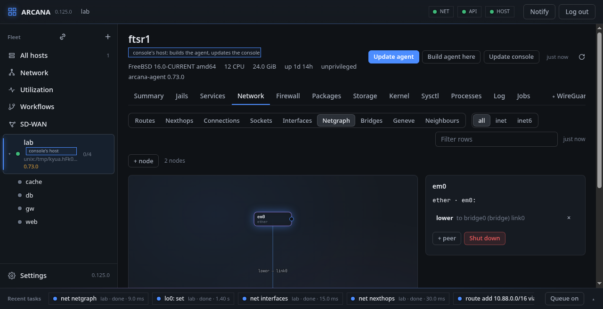
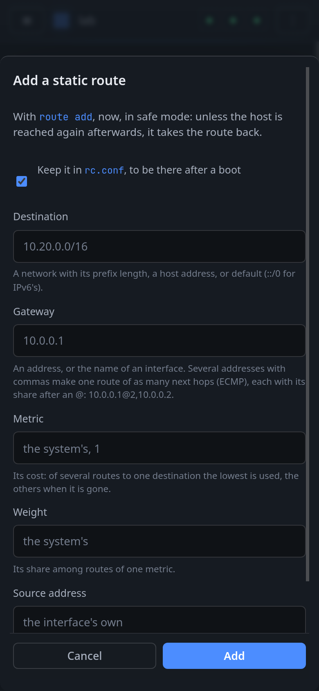

# The network, in safe mode

**Network** shows the host's network as the kernel has it, a table at a
time: **Routes**, **Nexthops**, **Connections**, **Sockets**,
**Interfaces**, **Netgraph**, **Bridges**, **Geneve** and
**Neighbours**, each for IPv4, IPv6 or both, and for any routing table
(FIB). A jail with a network of its own (vnet) has all of this too:
pick it in the picker at the left of the toolbar.

Netgraph, for instance, is drawn as the graph it is, nodes and hooks,
with a node's details beside it:

## Safe mode

A change to the network can cut the host off from the console: an
address taken away, a route that sends the console's packets
elsewhere. So the panel makes such changes in **safe mode**.

The agent makes the change and then waits to hear from the console
again. The console, still connected, confirms, and the change stays. If
the change did cut it off, nothing arrives, and when the host's
**rollback timer** runs out (a minute unless set on its Summary) the
agent undoes the change by itself, and only what it changed. **Keep it
in rc.conf** makes the change last across a boot as well.

**FreeBSD:** routes and nexthops are read through `netlink(4)` and
changed with `route(8)`, in any FIB; interfaces with `ifconfig(8)`;
netgraph with `ngctl(8)`. What is kept for a boot goes into `rc.conf`
as FreeBSD's own scripts read it (`static_routes`, `ifconfig_*`).

