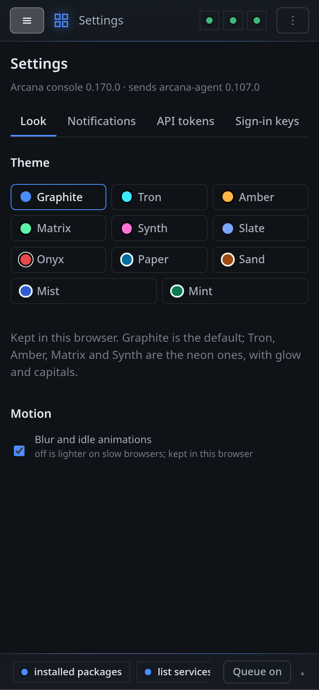

# On a phone

The panel is one page for every screen. On a phone the side bar folds into
the menu at the top left, the tabs scroll, and forms fill the screen.

Opened in a phone's browser, the console offers to install itself as an
app, with its own icon, opening without the browser around it and
working offline as a shell. Sign in with the phone's own passkey (see
[The first sign-in](../install/first-sign-in.md)), and **Notify** has
the console's notifications sent to the phone.
